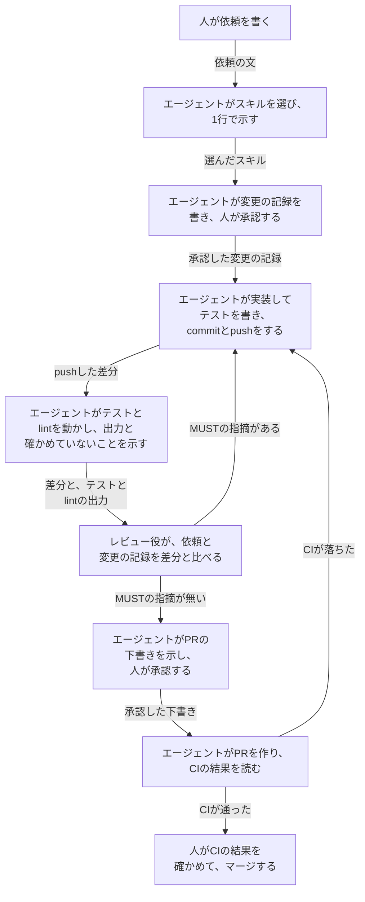

# my.harnessの全体の説明

| 項目 | 内容 |
|---|---|
| 確かめたコミット | `b7d78e4` |
| チームの文書 | [`README.md`](../../README.md)、[`CONTRIBUTING.md`](../../CONTRIBUTING.md)、[`docs/setup-guide.md`](../../docs/setup-guide.md)、[`docs/decisions/`](../../docs/decisions/)（判断の記録：比べた案と選んだ理由を、判断ごとに書いた文書） |

my.harnessは、AIのエージェントでプロダクトを改修するためのハーネスである。ハーネスは、エージェントが読むルールと作業の手順、操作を止めるか確認を求める設定、結果を確かめるスクリプトをまとめたものである。ハーネスを入れて作業するリポジトリを、導入先と呼ぶ。

この文書には、誰の何のためにあるか（背景と要求）と、何を満たすか（要件）を書く。ハーネスを組み立てる構成要素（例：ルール、スキル、フック）でどう満たすか（構成）と、導入先への入れ方（導入）と、ファイルの置き場所（コードの配置）も書く。

ほかの文書には、次のことを書く。

- 語の意味：ハーネスの語と意味の一覧（[`ubiquitous-language.md`](ubiquitous-language.md)）
- 構成要素ごとの詳しい設計：[`features/`](features/)の機能の説明（節「構成要素」の表の「詳しい設計」の列）
- 操作を止める仕組み：[`features/protection.md`](features/protection.md)
- 導入先ごとのルール、設定、文書を置く`.harness/`：[`features/harness-folder.md`](features/harness-folder.md)

## 背景

エージェントに既存のプロダクトを改修させると、次のことが起きる。

- 成果物（例：コード、文書、PR）に誤りや抜けがあると、人が見つけて直す。エージェントが確かめられること（例：テスト、lint）を確かめないままPRにすると、レビューする人が確かめる手間を負う。
- 人が、同じことをセッションごとに何度も指摘する。
- 多くのAIのツールでは、セッションをまたぐと会話の文脈がリセットされる。文書に残していない背景（例：なぜその実装になったか）は、次のセッションに伝わらない。サイボウズの記事「仕様ですか？不具合ですか？」も、背景をAIに伝えるには文書に残す必要があると書いている。
- 秘密情報の漏れは、一度起きると取り消せない。

## 要求

要求は、「実際の業務で、人の手間が極力避けられ、AIが自律的に精度の高い成果物を出せる」ことである。要求の4つの語は、次の意味で使う。

| 語 | 意味 | ISO 9241-11:2018の用語 |
|---|---|---|
| 精度 | エージェントが依頼を、誤りなく（正確さ）、すべての項目を満たして（完全さ）終える。秘密情報の漏れや、保護するブランチ（直接pushさせないブランチ、例：`main`）へのpushのようなセキュリティの事故も、誤りに含める。 | 有効さ（effectiveness、3.1.12） |
| 人の手間 | 得た結果に対して、人が使う時間と手間（例：判断、確認、手直し、待ち）を少なくする。人が判断すべき場面（例：方針の変更、取り消せない操作、ほかの人に見える書き込み）では、手間をかけても確認を求める。 | 効率（efficiency、3.1.13） |
| 自律 | 人は依頼を書くだけでよく、エージェントが手順を選び、確かめ、別の文脈のレビュー（書いた本人とは別の会話が変更を見直すこと）まで進める。エージェントが止まって人に聞くのは、人が判断すべき場面だけにする。 | なし |
| 実際の業務 | 節「利用の状況」の状況（例：管理者の権限が無いPC、既存のプロダクト、チームの合意が無い状態）で満たす。 | 利用の状況（context of use、3.1.15） |

精度と人の手間がぶつかるときは、精度を先にする。精度を下げると、確かめていない成果物を人が見つけて直す手間が、かえって増える。

### 利用の状況

利用の状況は、使う人、目標と作業、資源、環境の組み合わせである（ISO 9241-11:2018）。

| 項目 | 内容 |
|---|---|
| 使う人 | 既存のプロダクトに参加した1人の開発者である。成果物の読み手は主にエンジニアで、エンジニアでない人に向けた資料も書く。 |
| 目標 | エージェントが、依頼された作業を、誤りなく、すべての項目を満たして終える。 |
| 作業 | 主に、既存のプロダクトの改修と機能の追加である。新しいアプリを作ることは少ない。 |
| 資源 | 人の時間と判断と、エージェントの利用料である。 |
| 環境 | macOS、Linux、WSL2のPCで使い、管理者の権限が無いPCでも使う。エージェントはClaude Codeを基本にし、複数のエージェントを並べて動かすデスクトップアプリ（例：Orca）でも使う。 |
| 使い始め方 | 開発者はまず自分だけで使い、導入先のgitには、ハーネスのためのファイルを何も入れない。日々の作業で、人の指摘とエージェントの気づきをルールとして足し、チームで使えそうと開発者が判断したら、チームへ広げる。 |

### 測り方

要求を満たしたかは、次のもので見る。

| 要求 | 測り方 |
|---|---|
| 精度 | エージェントが完了と言ったときに、機械の確認（テストやlint）の出力と、依頼の項目ごとの変更とテストがある。人の受け入れ（依頼した人が、成果物が依頼を満たしたと認めること）で差し戻しが無く、マージのあとに不具合のチケットが出ない。 |
| 人の手間 | 人がレビューややり取りで指摘したことを記録する、ハーネスのリポジトリのIssue（「人の指摘」のラベル）の数と、同じ指摘が何回出たかで見る。ルールを足したあとも同じ指摘が続けば、そのルールでは指摘を防げていない。 |
| 自律 | 人が判断すべき場面でない作業で、エージェントが人に確認を求めない。場面の一覧は、[`rules/always-read.md`の節「人に確認を求める場面」](../../rules/always-read.md#人に確認を求める場面)にある。 |

人の手間は、値を集める専用の仕組みを作らず、Issueのラベルで数える。1人で使う間は、確認が多いかどうかは人がその場でわかり、同じ指摘が続くかはIssueの数で見られる。比べた案（例：人の判断の回数を集める仕組み）は、[判断の記録](../../docs/decisions/0013-improvement-measurement.md)に書く。

## 要件

要件には名前を付け、節「コードの配置」の「もとの要件」の列から、この名前で指す。どのファイルがどの要件のためにあるかを、たどれるようにするためである。表の「もとの要求」は節「要求」の語で、「確かめ方」は要件を満たしたかを何で確かめるかである。確かめ方の語の意味は、次のとおりである。

| 確かめ方 | 意味 |
|---|---|
| レビュー役 | 別の文脈のレビューをするサブエージェント（`reviewer`）が、差分を見て確かめる。 |
| 人の受け入れ | 依頼した人が、成果物が依頼を満たしたと認める。 |
| 判定の一覧のテスト | コマンドと判定（通す、確認を求める、止める）の組を並べた一覧で、判定のスクリプト（`git push`のようなコマンドを判定するスクリプト）を確かめるテストである。 |
| 環境を確かめるスクリプト | 保護の仕組みが働くかを表示する`scripts/print-protection-status.sh`である。 |
| 判定と確認のスクリプト | `scripts/`のスクリプトで、コマンドを判定するもの、commitの中の秘密情報を探すもの、文章の語と表記を確かめるものがある。 |

### 構成の要件

| 名前 | 要件 | もとの要求 | 確かめ方 |
|---|---|---|---|
| 説明できる構成 | 人が全体を理解して説明できる構成にする。構成要素（節「構成要素」の表の行）を足す人かエージェントは、先にこの文書を直す。 | 人の手間 | 人のPRのレビュー |
| 要るものだけ | AIのエージェントを使った開発に要るものだけを入れる。要るものとは、この節の要件のどれかで、何のためにあるかを説明できるものである。 | 人の手間 | 人のPRのレビュー |
| エージェントに依存しない作り | ルール、スキル、判定と確認のスクリプト、確認のコマンド（例：テスト、lint）、gitのフック、CIを、エージェントに依存しない形で作る。今はClaude Codeの設定だけを作り、ほかのエージェントの設定は使うときに足す。 | 実際の業務 | 人のPRのレビュー |
| スキルの形式 | スキルのfrontmatterには、Agent Skillsの仕様の6つの項目（`name`、`description`、`license`、`compatibility`、`metadata`、`allowed-tools`）だけを使う。 | 実際の業務 | レビュー役 |

エージェントごとに書くのは、次の2つだけにする。1つは、設定の書き方がエージェントで違う仕組み（例：フック、権限、サンドボックス）の設定である。もう1つは、エージェントから渡る入力を、エージェントに依存しないスクリプトの引数に変える小さな処理（例：`hooks/read-bash-command.sh`）である。

ほかのエージェントの設定を足すときは、開発者がそのエージェントで、次の2つを動かして確かめる。1つは、ハーネスの`skills/`をどう読ませるか（例：Codexの個人用のスキルの場所の`~/.agents/skills`から読ませる方法）である。もう1つは、スキルの`assets/`と`references/`を、相対パスで読めるかである。

### 作業の要件

| 名前 | 要件 | もとの要求 | 確かめ方 |
|---|---|---|---|
| 作業ごとのスキル | 節「作業の種類」の作業ごとに、手順をスキル（作業の手順を書いたMarkdownのファイル）として用意する。 | 精度、自律 | レビュー役と人の受け入れ |
| スキルの選択 | 人は依頼を書くだけでよく、エージェントが依頼に合うスキルを選び、[`rules/always-read.md`の節「作業の始め」](../../rules/always-read.md#作業の始め)のとおり1行で示す。選んだスキルが違っていれば人がその場で直せ、人は`/名前`でもスキルを呼べる。 | 自律 | 人の受け入れ |
| 毎回のルール | ハーネスが、毎回守るルールを、作業の種類に関係なく、セッションの始めにエージェントへ渡す。 | 精度、人の手間 | 人の受け入れ |
| 既定の形 | ハーネスが、コミット、ブランチ、手元のマージ、PR、チケットの既定の書き方をルールとして持つ。導入先にルールや既存の形があれば、エージェントはそちらを先にする。 | 精度、実際の業務 | 人のPRのレビュー |
| ルールの記録 | エージェントが、人の指摘と作業中の気づきを、次のセッション以降も守られるようにルールとして記録できる。 | 人の手間 | 「人の指摘」のIssueの数 |
| 複数の作業の並行 | 1つの依頼に独立した作業が複数あるときは、エージェントが作業ごとにworktreeとブランチを分けて並行で進められる。並行で始めるかは、エージェントが実装の前に示す計画を見て、人が決める。 | 人の手間、精度 | 人の受け入れ |
| worktreeでの動作 | ハーネスのスクリプトとスキルが、git worktreeの中でも、ふつうの作業フォルダーと同じように動く。`.claude/worktrees/`（Claude Codeがworktreeを作る既定の場所）の外のworktreeで始めたセッション（`CLAUDE_PROJECT_DIR`がそのworktreeのセッション）では、通すか確認を求める`git push`、`git fetch`、`glab`が、いつも確認になる（[`features/protection.md`の節「判定のスクリプト」](features/protection.md#判定のスクリプト)）。 | 実際の業務 | テスト |

Claude Codeは、スキルの説明だけを先に読み、呼ばれたスキルの中身を読み込む（Extend Claude with skills）。そのため、エージェントは説明を見て、依頼に合うスキルを選べる。

触るファイルが重なる作業を並行で進めると、競合と意味のずれが起き、待ち時間が減っても成果物の質が下がる。そのため、並行で始めるかは人が決める。

Orcaのようなデスクトップアプリもエージェントをworktreeで動かすので（stablyai/orcaのREADME）、worktreeでの動作が要る。Orcaがworktreeを`.claude/worktrees/`の外に作るときは、worktreeを`<メインの作業フォルダー>/.claude/worktrees/<名前>`に作ってOrcaで開けば、確認は増えない。Orcaは、`git worktree add`で作ったworktreeを表示に足せる（OrcaのWorktrees）。

### 確かめの要件

| 名前 | 要件 | もとの要求 | 確かめ方 |
|---|---|---|---|
| 完了の証拠 | エージェントが完了と言う前に、機械の確認を動かし、その出力を証拠として示す。完了の条件は、[`rules/always-read.md`の節「完了の条件」](../../rules/always-read.md#完了の条件)に書く。 | 精度 | レビュー役と人の受け入れ |
| 別の文脈のレビュー | 書いた本人とは別の文脈（例：サブエージェント、新しいセッション）で、変更をレビューする。レビューの深さ（軽い、標準、深い）は、変更を誤ったときの害の大きさで変える。 | 精度、人の手間 | そのPRの本文の確かめ方の表の、別の文脈のレビューの行 |
| 質の問い | 計画、実装、レビューで、同じ質の問い（[`rules/quality.md`](../../rules/quality.md)の、変更の質を確かめる問い）を使い、作る側とレビュー役の基準をそろえる。エージェントは案を決めるときに、問いの観点で案を比べ、観点どうしのトレードオフを示す。 | 精度 | レビュー役 |
| 言葉と表現 | エージェントが、文章を書くすべての場所で、[`rules/writing.md`](../../rules/writing.md)の言葉と表現のルールを守る。厳密に従わせる規則（例：文章に書かないと決めた止める語、表記）は、スクリプトで確かめる。 | 精度 | 判定と確認のスクリプト |
| ハーネス自身の確かめ | ハーネスのスクリプトと文書を、pushのたびに、エージェントとは別のサーバー（CI）で機械で確かめる。 | 精度 | CIの結果 |

### 人の判断と保護の要件

| 名前 | 要件 | もとの要求 | 確かめ方 |
|---|---|---|---|
| 人に確認を求める場面 | エージェントは、人が判断すべき場面では止まって確認を求め、ほかの作業では確認を求めない。場面と作業の一覧は、[`rules/always-read.md`の節「人に確認を求める場面」](../../rules/always-read.md#人に確認を求める場面)に書く。 | 自律、人の手間 | `git push`、`git fetch`、`git pull`、`gh`、`glab`は判定の一覧のテスト、ほかの場面は人の受け入れ |
| 秘密情報と保護するブランチ | ハーネスの保護の仕組み（権限、サンドボックス、フックと判定のスクリプト、gitのフック）が、秘密情報のファイル（例：`.env`）の読み書きと、保護するブランチへの直接のpushを止める。保護するブランチは、既定の一覧（`data/default-protected-branch-list.txt`）に導入先ごとに足せ、既定のものは外せない。 | 精度 | 判定の一覧のテストと、環境を確かめるスクリプト |

止める操作と確認を求める場面は、セキュリティ上必須の所を厳しくし、ほかでは確認を求めすぎないようにする。セキュリティ上必須の所は、要件「秘密情報と保護するブランチ」と、その要件のために操作を止める仕組みの設定である。仕組みの設定は、権限、サンドボックス、フック、gitのフック、`.harness/`のルールと設定である。

### 導入の要件

| 名前 | 要件 | もとの要求 | 確かめ方 |
|---|---|---|---|
| 導入の提案 | 導入先ごとに1回、エージェントが導入先を読んで設定の案を示し、人が承認してから、エージェントが設定を書く。 | 精度、人の手間 | 人の承認 |
| 導入先を変えない | エージェントは、導入の設定を導入先のgitに入れず、既存の設定と衝突させず、既存のファイルを上書きしない。ハーネスのリポジトリだけは、`.harness/`（導入先ごとのルール、設定、文書を置くフォルダー）をコミットする（節「判断」）。 | 実際の業務 | テスト |
| 守れないことの提示 | エージェントと環境を確かめるスクリプトが、導入先で働かない保護と、その原因（例：2.54より古いgit、サンドボックスが動くためのソフトウェアが無いPC）を人に示す。 | 精度 | 環境を確かめるスクリプトの出力 |
| ハーネス自身への導入 | ハーネスのリポジトリにも、ほかの導入先と同じ手順（節「導入」）でハーネスを入れ、手元の編集が次のセッションから読み込まれる。 | 人の手間 | 人のPRのレビュー |

エージェントが導入のときに提案するものは、次のとおりである。

- テスト、lint、ビルドのコマンド
- コミットメッセージとブランチ名の形（直近の履歴から読む）
- PRのテンプレート
- 既存の`CLAUDE.md`と`AGENTS.md`の中身
- 保護されているブランチ
- 確かめる語（正しい使い方もある、人が指摘した語）を、その導入先でも禁止にするか（導入先で使われた場所を添えた表）

### 作業の種類

要件「作業ごとのスキル」の作業と、その手順で決めることは、次のとおりである。作業とスキルの対応は、[`features/skill.md`](features/skill.md)に書く。

| 作業 | 手順で決めること |
|---|---|
| 調査 | コードを変えない。原因、影響範囲、選択肢を、根拠を付けて報告する。 |
| 計画（実装の前まで） | 要件を詰める。チームで議論するための資料も作れる。 |
| 機能の追加 | ほかの変更の作業の基本になる手順にする。文書、テスト、ビルド、CIの変更も、機能の追加の手順で行う。 |
| 不具合の修正 | 先に、不具合を再現するテストを書く。本番の障害を急いで直す作業と、不具合になる前に直す作業（予防保守）も含める。 |
| リファクタリング | 振る舞いを変えないことを、既存のテストで確かめる。テストが無ければ、先に書く。 |
| 性能の改善 | 変更の前と後の測定値を示す。 |
| 依存や環境の更新 | ライブラリやランタイムのバージョンを上げる前に、リリースノートと互換性の無い変更を読む。公開元と変更の中身は、セキュリティの確認の手順で確かめる。 |
| データの変更 | データベースのスキーマとデータを変える前に、戻す方法と、動いているコードとの互換を、変更の記録（1つのPRの背景、要求、判断、作業の手順を書く文書）で決める。 |
| インフラの変更 | 適用の前に、変わるものと影響範囲を差分（例：`terraform plan`の出力）で示し、戻す方法を変更の記録で決める。 |
| セキュリティの確認 | 観点の一覧で確かめる基本の確認から、セキュリティに詳しい人が行うレビューまでを含める。 |
| 指摘への対応（レビューの指摘を直すか、直さない理由を返す） | エージェントが、指摘ごとに直すかを先に決める（基準は[`rules/review.md`の節「指摘の流れ」](../../rules/review.md#指摘の流れ)）。すべてを直すとは限らない。 |
| ほかの人のPRのレビュー | エージェントが指摘の案を作り、人が確かめてから、エージェントがGitHubかGitLabに送る。 |
| 導入 | 導入先ごとに1回だけ行う。 |
| ハーネスの改善 | 人の指摘と、作業中に気づいたことを、ルールとして記録する。 |

### 制約

| 対象 | 制約 |
|---|---|
| 管理者の権限が無いPC | プロキシーと、管理者が配る設定があることがある。ハーネスがすすめるツール（例：`jq`、サンドボックスが動くためのソフトウェア）を入れられないことがある。 |
| 導入先のgit | チームの合意が無いうちは、ハーネスのためのファイルを導入先のgitに入れない。 |
| お金 | ハーネスが動くために、エージェントの利用料のほかに、お金のかかるサービスを前提にしない（例：GitHubとGitLabの有料のプランだけの機能）。導入先の作業で使うサービスは、導入先のチームが決める。 |
| ホスト | PRとチケットを送るホストは、GitHubとGitLabを対象にし、ほかのホストの種類（例：Bitbucket）は対象にしない。`gh`はGitHubの導入先だけで、`glab`はGitLabの導入先だけで前提にする。 |
| OS | ハーネスのスクリプトと設定は、macOS、Linux、WSL2で動く。WSLを使わないWindowsは、対象にしない。 |
| 前提にするコマンド | 導入先で動くスクリプトは、gitとbashと、OSに標準で入るコマンド（例：`grep`、`awk`、`sed`）だけを前提にする。Claude Code用の処理で使う`jq`とサンドボックスの依存が無いときの動きは、[`features/protection.md`](features/protection.md)で決める。 |
| bash | macOSの標準の3.2で動く書き方だけを使う。管理者の権限が無いPCでは、新しいbashを入れられないことがある。 |
| 新しいbash | 新しいバージョンでも動くことを、CIで確かめる。 |
| エディター | 特定のエディターに依存しない（例：VS Codeだけで動く形にしない）。 |

### 優先順位

要件どうしが衝突したときは、エージェントと人は次の順で決める。

1. セキュリティ上必須の所（節「人の判断と保護の要件」）
2. 人が理解し、管理できるシンプルさ
3. 環境に依存しないこと
4. 確認を求めすぎないこと
5. エージェントに依存しないこと

### 範囲の外

ハーネスは、次のことをしない。

- 導入先のチームの進め方（例：CI、レビューのルール、`CLAUDE.md`）を変えない。ハーネスが、チームのやり方に合わせる。
- 技術ごとの知識を持たない。導入のときに、エージェントが導入先を読んで提案し、人が承認する。
- ランタイム（例：NodeやPHP）のバージョンを管理しない。導入先が決めたものに従う。
- コマンドの文字列を細かく解析して、判定をすり抜けるすべての書き方を防ぐことはしない。判定のスクリプトは、判定できない形（例：区切りの記号でつないだコマンド）を止め、環境の問題で判定できないときは確認を求める。比べた案は[判断の記録](../../docs/decisions/0009-command-allow-list.md)に、確認をすり抜ける書き方の扱いは[`features/protection.md`の節「止める境界」](features/protection.md#止める境界)に書く。
- 導入先のCIを作らない。
- 新しいアプリの雛形を作らない。

## 構成

### 依頼から完了までの流れ

次の図は、コードを変える依頼が、どの順に進み、どこで戻るかを示す。調査の依頼では、`investigate-code`のスキルで調べて報告するところで終わる。



- 変更の記録は、1つのPRについて、背景、要求、要件、判断、確かめ方、作業の手順を書く文書である。`propose-change`のスキルが書き、実装からPRまでは`implement-change`のスキルが進める。
- `MUST`は、レビュー役が指摘に付けるラベルの1つで、直すまでレビューを終えない指摘である（[`rules/review.md`](../../rules/review.md)）。
- エージェントは、レビューの前に、作業用のブランチ（PRのために切ったブランチ）へcommitとpushをする。PRに入る変更をすべてレビューに通すためである。pushでCIが動く導入先（例：ハーネスのリポジトリ）では、PRの下書きを人に示す前に、CIの結果も得られる。ハーネスのリポジトリのCIには、LinuxとWSL2の手元では動かせない確認（例：macOSの`/bin/bash`のbash 3.2のテスト）がある（節「前提」）。

### 構成要素

ハーネスの構成要素は次のとおりで、すべてコードの配置の表のファイルとしてある。「エージェントに依存しないか」は、ほかのエージェントでもそのまま使えるかである。

| 構成要素 | すること | エージェントに依存しないか | 詳しい設計 |
|---|---|---|---|
| 常に読むルール | `SessionStart`のフックが、毎回のセッションの始めに、共通のルール（どの導入先でも守るルール）と導入先ごとのルール（その導入先だけのルール）をエージェントへ渡す。 | 依存しない | [`features/always-read-rule.md`](features/always-read-rule.md) |
| スキル | 作業ごとの手順を持ち、エージェントが依頼に合うものを選ぶ。複数の作業を並行で進める流れも、スキルが持つ。 | 依存しない | [`features/skill.md`](features/skill.md)、[`features/parallel-work.md`](features/parallel-work.md) |
| レビュー役 | 書いた本人とは別の文脈で、差分をレビューする。 | Claude Code用 | [`features/reviewer.md`](features/reviewer.md) |
| 判定のスクリプト | `git push`、`git fetch`、`git pull`、`gh`、`glab`のコマンドを受け取り、通す、確認を求める、止めるのどれかを返す。ほかの人に見える書き込み（例：PRとMRの作成、コメント）と、CIの設定のファイルを変えるpushの前の確認も、判定のスクリプトが求める。 | 依存しない | [`features/protection.md`の節「判定のスクリプト」](features/protection.md#判定のスクリプト) |
| フック | Claude Codeのフックが、セッションの始めにルールを渡し、`git push`、`git fetch`、`git pull`、`gh`、`glab`の前に判定のスクリプトを呼ぶ。外に出すコマンドは、gitのフォルダーを固定して外で動かすスクリプトの呼び出しに書き換える。 | Claude Code用 | [`features/protection.md`の節「フック」](features/protection.md#フック) |
| 権限 | Claude Codeが、ツール（例：ファイルの読み書き、コマンドの実行）を、動かす前に許す、止める、確認を求めるに分ける。 | Claude Code用 | [`features/protection.md`の節「権限」](features/protection.md#権限) |
| サンドボックス | シェルのコマンドが読み書きできるファイルと通信先を、OSの仕組みで制限する。 | Claude Code用 | [`features/protection.md`の節「サンドボックス」](features/protection.md#サンドボックス) |
| gitのフック | gitが、commitとpushの直前に、ハーネスのスクリプトで秘密情報と保護するブランチを確かめる。 | 依存しない | [`features/protection.md`の節「gitのフック」](features/protection.md#gitのフック) |
| CI | ハーネスのリポジトリのテストを、pushのたびに動かす。 | 依存しない | [`features/ci.md`](features/ci.md) |
| 導入先の`.harness/` | 導入先ごとのルール、設定、文書を置く。 | 依存しない | [`features/harness-folder.md`](features/harness-folder.md) |
| 導入 | 人とエージェントが、PCごとの設定（`~/.claude/settings.json`）と、導入先ごとの設定を書く。 | PCごとの設定と`.claude/settings.local.json`がClaude Code用 | 節「導入」 |

## 導入

導入は、PCごとに1回と、導入先ごとに1回行う。

PCごとには、次のことを行う。手順と、働かない保護（PCや導入先の環境のために止まらない操作）の直し方は、導入の手引き（[`docs/setup-guide.md`](../../docs/setup-guide.md)）に書く。

- 人が、`claude plugin marketplace add`で、ハーネスのリポジトリを手元のパスのまま、Claude Codeのマーケットプレイス（プラグインの一覧）に登録する。手元のパスから登録したプラグインは、コピーされずに元の場所から読まれる（Plugin loading reference）。
- エージェントが、`~/.claude/settings.json`に権限とサンドボックスの設定を足し、人が承認する。足す設定は、`data/recommended-claude-setting.json`に置く。
- 足す権限には、ハーネスの場所（ハーネスのリポジトリを手元に置いたフォルダー）の読み取りと、ハーネスの`scripts/`のスクリプトの実行を許すルールも入れる。ほかの導入先ではハーネスのファイルが作業フォルダーの外にあり、許さないと、スキルがハーネスのファイルを読むたびに確認が出る。`scripts/`のスクリプトは、読み取りと表示だけをする。比べた案（例：導入先ごとにハーネスの場所を作業フォルダーに足す）は、[判断の記録](../../docs/decisions/0028-harness-file-permission.md)に書く。
- 人が、環境を確かめるスクリプト（`scripts/print-protection-status.sh`）を、Claude Codeの外のシェルで動かす。スクリプトは、git、`jq`、Claude Codeのバージョン、サンドボックスの依存と設定、PCの設定、導入先のgitのフックを調べる。そして、働く保護と働かない保護と、直し方を表示する。サンドボックスの依存が無いPCでは、サンドボックスの設定の`failIfUnavailable`のためにClaude Codeが起動しないので、Claude Codeの外で動かす。

導入先ごとには、まず人が導入先で次のコマンドを1回動かし、その導入先だけでプラグインを有効にする。`configure-repository`のスキルはプラグインの中にあり、有効にする前は呼べないためである。PCの全体でなく導入先ごとに有効にする理由は、[判断の記録](../../docs/decisions/0025-plugin-enable-scope.md)に書く。

```bash
claude plugin install my-harness@nnst0knnt --scope local
```

次に、エージェントが`configure-repository`のスキルで、要件「導入の提案」「導入先を変えない」「守れないことの提示」のとおりに案を示す。人が承認したら、エージェントが設定を書く。書くのは、`.harness/`、`.git/info/exclude`、`.claude/settings.local.json`と、`.git/config`のフックの設定である。ハーネスのリポジトリにも、プラグインを有効にする手順と、`configure-repository`で設定を書く手順で入れる。

導入先のコミットメッセージは、1行目を導入先の既存の形にする。本文の形が、導入先のチームのルール（導入先のgitに置く、チームが決めたルール）にも導入先ごとのルールにも無ければ、エージェントが導入のときに人に聞く。聞いた形は、導入先ごとのルールに書く。比べた案は、[判断の記録](../../docs/decisions/0031-commit-message-body.md)に書く。

導入先の`.claude/settings.local.json`には、次の設定が入る。どれも、その導入先でハーネスを使う人だけの設定である。

| 設定 | 中身 | 誰が書くか |
|---|---|---|
| `enabledPlugins` | プラグインを有効にしたこと | `claude plugin install`のコマンド |
| `model`、`effortLevel` | 本体の会話のモデルとeffort（Model configurationの節「Setting your model」「Adjust effort level」） | `configure-repository` |
| サンドボックスの通信先と書き込みの禁止 | その導入先だけで許す通信先と拒否する通信先と、`.harness/`のルールと設定へのシェルからの書き込みの禁止（[`features/protection.md`の節「サンドボックス」](features/protection.md#サンドボックス)） | `configure-repository` |
| `env`、サンドボックスの書き込み先、外で動かすコマンド、待ち受けの許可 | 人が案から選んだときの、ツールのキャッシュの場所と、手元のサーバーを使うテストの設定（同じ節） | `configure-repository` |

`.claude/settings.local.json`は、導入先のgitに入らない。Claude Codeが、gitから外れていないこのファイルを最初に書くときに、PCのgitの除外のファイル（例：`~/.config/git/ignore`）に足す（Settings files and precedence）。導入の手順では、最初に`claude plugin install`のコマンドがこのファイルを書く。

本体の会話（人とやり取りする、サブエージェントでない会話）のモデルとeffortは、エージェントが`configure-repository`の手順で人に聞いて書く。すでに値があれば上書きせず、人に示して決めてもらう。勧める値は、Opusとeffort `high`である。`.claude/settings.local.json`に書く理由は[置き場所の判断の記録](../../docs/decisions/0029-main-conversation-model-location.md)に、勧める値の理由は[値の判断の記録](../../docs/decisions/0032-main-conversation-model-value.md)に書く。

## コードの配置

ファイルは、どこで使うかで3つに分ける。表の「もとの要件」は、そのファイルが何のためにあるかを、節「要件」の名前で示す。要件「要るものだけ」と「エージェントに依存しない作り」は配置の全体にかかるので、列には書かない。

スクリプトの役割は、ファイルの先頭のコメントに書く。スクリプトが1ファイル100行の上限（[`CONTRIBUTING.md`の節「スクリプトの長さ」](../../CONTRIBUTING.md#スクリプトの長さ)）を超えたら、規則のまとまりごとにファイルを分ける。分けたファイルも、表の同じ行に書く。

### どの導入先でも使うもの

| ファイルとフォルダー | 中身と使う場面 | もとの要件 |
|---|---|---|
| `rules/always-read.md` | 毎回守るルール（セッションの始めにフックが渡す） | 毎回のルール、完了の証拠、人に確認を求める場面、既定の形 |
| `rules/writing.md` | 文章の書き方（エージェントが書く前に読む） | 言葉と表現 |
| `rules/git.md` | gitとGitHubの書き方（エージェントが書く前に読む） | 既定の形 |
| `rules/review.md` | 指摘の流れ、レビューの深さと使用量の見込み、レビューの終わり方（レビューの前に読む） | 別の文脈のレビュー |
| `rules/quality.md` | 質の問い（計画、実装、レビューの前に読む） | 質の問い |
| `skills/propose-change/SKILL.md`、`skills/implement-change/SKILL.md` | 計画と実装のスキルの手順（エージェントが選んだときに読む） | 作業ごとのスキル、スキルの選択、スキルの形式、複数の作業の並行 |
| `skills/propose-change/assets/change.md`、`skills/propose-change/references/`、`skills/implement-change/assets/feature.md` | 変更の記録のテンプレート、変更の種類ごとの違い、機能の今の説明（機能ごとの背景と業務のルールを書く文書）のテンプレート | 作業ごとのスキル |
| `skills/investigate-code/SKILL.md` | 調査の手順 | 作業ごとのスキル、スキルの選択、スキルの形式 |
| `skills/add-rule/SKILL.md` | 人の指摘と作業中の気づきを記録する手順 | 作業ごとのスキル、スキルの選択、スキルの形式、ルールの記録 |
| `skills/audit-security/SKILL.md`、`skills/review-pr/SKILL.md`、`skills/resolve-review-comment/SKILL.md` | セキュリティの確認、ほかの人のPRのレビュー、指摘への対応の手順 | 作業ごとのスキル、スキルの選択、スキルの形式 |
| `skills/review-pr/references/`、`skills/resolve-review-comment/references/` | ほかの人のPRのレビューと、自分のPRへの指摘の対応で、PRを送るホストの種類に合う片方だけを読む、ホストごとのコマンドと送る形（`github.md`と`gitlab.md`） | 作業ごとのスキル、スキルの形式 |
| `skills/audit-security/references/security-viewpoint.md` | セキュリティの観点の一覧（`audit-security`と、そこから頼まれたレビュー役が読む） | 作業ごとのスキル、別の文脈のレビュー |
| `skills/audit-security/assets/expert-review-material.md` | 人の専門家に渡す資料のテンプレート | 作業ごとのスキル |
| `skills/configure-repository/SKILL.md` | 導入の手順 | 作業ごとのスキル、スキルの選択、スキルの形式、導入の提案、導入先を変えない |
| `skills/configure-repository/assets/`、`skills/configure-repository/references/repository-convention.md` | 全体の説明、業務の言葉の一覧、`.harness/docs/`の目次のテンプレート（`architecture.md`、`ubiquitous-language.md`、`document-index.md`）と、導入先の既存の書き方をどこで読むかの表 | 作業ごとのスキル、導入の提案 |
| `scripts/classify-remote-command.sh` | `git push`、`git fetch`、`git pull`、`gh`、`glab`のコマンドの判定（フックが呼ぶ）と、分けた処理（コマンドを語に分ける`scripts/print-command-word.sh`、コマンドごとの判定の`scripts/classify-git-push-command.sh`、`scripts/classify-git-fetch-command.sh`、`scripts/classify-gh-command.sh`、`scripts/classify-glab-command.sh`、pushの送り先ごとの判定の`scripts/classify-git-push-refspec.sh`、手元のgitの設定と`glab-cli/`と送るcommitで判定を強める`scripts/classify-local-git-state.sh`） | 人に確認を求める場面、秘密情報と保護するブランチ |
| `scripts/classify-glab-command.sh` | `glab`のコマンドの判定（`scripts/classify-remote-command.sh`が呼ぶ）と、分けた処理（読み方の食い違う形と止めるオプションと本文の`scripts/find-glab-unreadable-form.sh`、一覧の行の`scripts/print-glab-command-row.sh`、本文と対象の番号と送り元のブランチの要る引数の`scripts/find-glab-missing-argument.sh`、通すコマンドのオプションの`scripts/classify-glab-read-command.sh`、`glab api`の`scripts/classify-glab-api-command.sh`とそのエンドポイントの`scripts/print-glab-api-endpoint-kind.sh`と値の`scripts/find-glab-api-unsafe-value.sh`）と、探す処理（行の頭が`/`の行の`scripts/find-quick-action-line.sh`、ほかのホストを指す語の`scripts/find-other-host-word.sh`、gitのフォルダーの`glab-cli/`の`scripts/find-glab-setting-in-git-directory.sh`と、その中身の有無を外で動かすスクリプトと同じく見る`scripts/find-nonempty-glab-setting.sh`） | 人に確認を求める場面、秘密情報と保護するブランチ |
| `scripts/classify-gh-command.sh` | `gh`のコマンドの判定（`scripts/classify-remote-command.sh`が呼ぶ）と、分けた処理（本文か送る中身をファイル、エディター、commitのメッセージから読む形を探す`scripts/find-gh-unreadable-form.sh`、読み取りのコマンドの`scripts/classify-gh-read-command.sh`、`gh api`の`scripts/classify-gh-api-command.sh`） | 人に確認を求める場面、秘密情報と保護するブランチ |
| `scripts/print-protection-list.sh` | 保護するブランチかCIの設定のファイルの、既定の一覧と、導入先の`.harness/config`で足したものを出す処理（判定のスクリプトと`pre-push`が呼ぶ） | 秘密情報と保護するブランチ |
| `scripts/classify-git-push-commit.sh` | 送るcommitがCIの設定のファイルを変えるpushで確認を求め、送り元を判定で確かめたcommitのSHAにしたコマンドを出す処理（判定のスクリプトが呼ぶ）と、分けた処理（リモートの今の先頭を問い合わせる`scripts/print-remote-head.sh`、CIの設定のファイルのmodeとSHAを、中身から計算し直したSHAと照らして読む`scripts/print-tree-entry.sh`） | 人に確認を求める場面、秘密情報と保護するブランチ |
| `scripts/find-git-setting-in-working-tree.sh` | サンドボックスの外で動くgitが使う、サンドボックスの中から書ける設定とファイル（例：フック、`core.fsmonitor`、通信の方式か相手を変える設定）を探す処理（判定のスクリプトが呼ぶ）と、分けた処理（値がサンドボックスの中のコマンドから書ける場所を指すかを見る`scripts/find-writable-path-in-value.sh`） | 人に確認を求める場面、秘密情報と保護するブランチ |
| `scripts/find-git-transport-setting.sh` | 値が書ける場所を指すかでは決まらないので`scripts/find-git-setting-in-working-tree.sh`から分けた、gitの通信の方式か相手を変える設定（例：`ext::`のURL、リポジトリの設定の`http.proxy`）を探す処理（gitの設定の確認が呼ぶ） | 人に確認を求める場面、秘密情報と保護するブランチ |
| `scripts/print-git-directory.sh` | gitのフォルダー、共通のgitのフォルダー、作業フォルダーの一番上を、たどった先の絶対パスで求める処理（判定のスクリプトとgitの設定の確認が呼ぶ） | 人に確認を求める場面、秘密情報と保護するブランチ |
| `scripts/print-project-common-directory.sh` | Claude Codeの作業フォルダーのリポジトリを、導入先のリポジトリとみなせる形のときだけ、その共通のgitのフォルダーを求める処理（判定のスクリプトが呼ぶ） | 人に確認を求める場面、秘密情報と保護するブランチ |
| `scripts/print-quoted-word.sh` | 書き換えたコマンドの語と、人に示す語（全文のファイル、確認の画面の理由の文）を、シェルが1つの語として読む形に囲む処理（送るcommitの判定とフックが呼ぶ） | 人に確認を求める場面 |
| `scripts/print-command-without-trailing-redirect.sh` | コマンドの文字列の全体の最後の`2>&1`だけを外す処理（判定、フックの記録、書き換えたコマンドの3か所が呼ぶ） | 人に確認を求める場面 |
| `scripts/deny-protected-branch-push.sh`、`scripts/find-secret-in-commit.sh` | 保護するブランチへのpushを止める処理と、commitの中の秘密情報を探す処理（gitのフックが呼ぶ）と、分けた処理（差分から足した行を取り出す`scripts/print-added-line.sh`、パターンと比べる`scripts/find-secret-in-line.sh`） | 秘密情報と保護するブランチ |
| `scripts/print-protection-status.sh` | 働く保護と働かない保護と直し方の表示（人が導入のときと、セッションの始めにエージェントから働かない保護を伝えられたときに、Claude Codeの外で動かす）と、分けた処理（git、`jq`、Claude Codeのバージョンの`scripts/print-tool-status.sh`（gitの行は`SessionStart`のフックも呼ぶ）、PCの設定に無いものの`scripts/find-missing-claude-setting.sh`、Claude Codeの設定の保護を止める値と緩める項目の`scripts/print-claude-setting-status.sh`、導入先に無いgitのフックの`scripts/find-missing-git-hook-setting.sh`） | 守れないことの提示 |
| `scripts/print-sandbox-state.sh` | OS、サンドボックスの依存、Claude Codeの設定のファイルから、サンドボックスの状態を出す処理（`SessionStart`のフックと環境を確かめるスクリプトが呼ぶ） | 守れないことの提示 |
| `scripts/print-main-worktree-path.sh` | worktreeの中でも、メインの作業フォルダー（worktreeでない、もとのクローンの作業フォルダー）を求める処理（例：`SessionStart`のフック、判定のスクリプト、保護するブランチへのpushを止める処理が呼ぶ） | worktreeでの動作 |
| `scripts/find-long-rule.sh` | ルールの字数の確認（CIが共通のルールに、`add-rule`と`configure-repository`が導入先ごとのルールに当てる） | 毎回のルール |
| `scripts/`のほかのスクリプト | 文章の規則のうち、スクリプトで確かめるもの（例：止める語、表記、表のセルの文の数）の確認（エージェントとCIが、書いたあとに動かす） | 言葉と表現 |
| `data/banned-word-list.txt` | 機械で止める語の一覧 | 言葉と表現 |
| `data/ambiguous-word-list.txt` | ハーネスのリポジトリでは止め、導入先では導入先ごとの語の一覧の答えで止めるか示すかを決める、確かめる語（正しい使い方もある語）の一覧 | 言葉と表現 |
| `scripts/print-ambiguous-word-usage.sh` | 導入のときに、答えの無い確かめる語ごとに、導入先で使われた場所を探す処理（`configure-repository`が呼ぶ） | 導入の提案、言葉と表現 |
| `data/default-protected-branch-list.txt` | 保護するブランチの既定の一覧 | 秘密情報と保護するブランチ |
| `data/ci-setting-path-list.txt` | CIの設定のファイルの場所の既定の一覧（`.github/workflows/`、`.github/actions/`、`.gitlab-ci.yml`） | 人に確認を求める場面、秘密情報と保護するブランチ |
| `data/glab-command-list.tsv`、`data/glab-read-command-option-list.tsv`、`data/glab-api-endpoint-list.tsv` | `glab`のコマンドごとの判定と理由の種類、通すコマンドの許すオプション、`glab api`の通す形と止める形の一覧（`glab`の判定のスクリプトが読む） | 人に確認を求める場面、秘密情報と保護するブランチ |
| `data/secret-pattern-list.txt` | 秘密情報のパターンとファイル名の一覧 | 秘密情報と保護するブランチ |
| `data/recommended-claude-setting.json` | PCの設定に足す権限とサンドボックスの設定（導入の手引きのとおりにエージェントが足し、環境を確かめるスクリプトが比べる） | 秘密情報と保護するブランチ、人に確認を求める場面、守れないことの提示 |
| `data/loosening-claude-setting-list.tsv` | 保護を止めるか緩めるClaude Codeの設定のキーと、起きることと直し方の一覧（環境を確かめるスクリプトが読む） | 守れないことの提示 |
| `data/git-hook-setting-list.tsv` | 導入先の`.git/config`に足すgitのフックの一覧で、名前、イベント、コマンド、足す導入先（すべての導入先か、ハーネスのリポジトリだけか）の4列（環境を確かめるスクリプトが比べる） | 秘密情報と保護するブランチ、守れないことの提示 |

### Claude Codeだけで使うもの

| ファイルとフォルダー | 中身と使う場面 | もとの要件 |
|---|---|---|
| `.claude-plugin/plugin.json`、`.claude-plugin/marketplace.json` | プラグインの名前と、手元のパスから登録するための一覧 | 導入先を変えない、ハーネス自身への導入 |
| `agents/reviewer.md` | レビュー役のサブエージェント（スキルが、完了と言う前に動かす） | 別の文脈のレビュー |
| `hooks/hooks.json`の`SessionStart` | セッションの始めに`hooks/print-session-context.sh`を呼ぶ設定 | 毎回のルール |
| `hooks/hooks.json`の`PreToolUse` | `git push`、`git fetch`、`git pull`、`gh`、`glab`と、外で動かすスクリプトの呼び出しを、BashとMonitorのツールで動かす前に`hooks/read-bash-command.sh`を呼ぶ設定 | 人に確認を求める場面 |
| `hooks/print-session-context.sh` | セッションの始めに、ハーネスの場所、メインの作業フォルダー、常に読むルール、文書の目次を渡す処理 | 毎回のルール、worktreeでの動作 |
| `hooks/print-environment-state.sh` | サンドボックスが有効か、`jq`があるか、gitが2.54より古いか見つからないか（`scripts/print-tool-status.sh`の引数`git`で調べる）と、`git push`、`git fetch`、`git pull`、`gh`、`glab`の動かし方、ファイルの読み書きとコマンドの書き方、終了コードの読み方を、`SessionStart`のフックの出力に入れる処理（並行の実装役も、最初に動かして読む） | 守れないことの提示、人に確認を求める場面 |
| `hooks/read-bash-command.sh` | JSONからコマンドの文字列と作業フォルダーを取り出し、判定のスクリプトとgitの設定を探す処理に渡し、結果をフックの出力の形にする処理と、外に出すコマンドで、判定した語を`hooks/write-pinned-command-record.sh`でフックの記録に書き、外で動かすスクリプトと記録の名前だけの呼び出しに書き換え、動かすコマンドを`hooks/print-pinned-command-reason.sh`で理由の文に出す処理 | 人に確認を求める場面 |
| `hooks/write-pinned-command-record.sh` | 判定した語の並びを、サンドボックスの中から書けない場所に予想できない名前で1回分だけ書き、動かす語を囲んだ全文のファイルも書く処理（フックが呼ぶ） | 人に確認を求める場面 |
| `hooks/print-pinned-command-reason.sh` | フックの記録の語から、長い語と全体を字数で切り、`scripts/print-quoted-word.sh`で語を囲んで、確認の画面に出す理由の文を作る処理（フックが呼ぶ） | 人に確認を求める場面 |
| `hooks/exec-with-pinned-git-directory.sh` | 渡された名前のフックの記録の語だけを、判定で求めたgitのフォルダーを環境変数で固定して、サンドボックスの外で動かす処理（`excludedCommands`に当て、PCの設定の`scripts/`のallowに当てないよう`scripts/`の外に置く）と、分けた処理（`commondir`やgitのフォルダーの中のリンクのような、判定のあとに書き換えられた場所を探す`scripts/find-unpinned-git-path.sh`） | 人に確認を求める場面、秘密情報と保護するブランチ |
| `hooks/print-pinned-command-record-path.sh` | フックの記録のフォルダーと、名前が英数字だけかを確かめた記録のパスを求める処理（フックの記録を書く、読むスクリプトが呼ぶ） | 人に確認を求める場面 |

### ハーネスのリポジトリだけで使うもの

| ファイルとフォルダー | 中身と使う場面 | もとの要件 |
|---|---|---|
| `linters/` | ハーネス自身のファイルの字数、行数、整形、コメント、実行の権限、リンク、判断の記録、出典の形、名前のバッククォート、1台のPCの具体と推測の形の確認 | ハーネス自身の確かめ |
| `data/backquote-name-list.txt` | バッククォートで囲んで書く名前の一覧（`linters/find-missing-backquote.sh`が読む） | ハーネス自身の確かめ |
| `data/unverified-or-pc-specific-word-list.txt` | 1台のPCの具体を表す語と、推測と未確認の形の一覧（`linters/find-unverified-or-pc-specific-word.sh`が読む） | ハーネス自身の確かめ |
| `tests/run-test-suite.sh`、`tests/expect.sh`、`tests/linter-list.tsv` | テスト、linter、ShellCheckをすべて動かす処理、比べる関数`expect`、当てるlinterの一覧 | ハーネス自身の確かめ |
| `tests/test-<スクリプトの名前>.sh`、`tests/<スクリプトの名前>-case-list.tsv` | スクリプトごとのテスト（gitのフックが呼ぶ処理のテストは、一時のリポジトリにgitの設定でフックを足して動かす）と、ケースの一覧（例：`tests/test-classify-remote-command.sh`は判定の一覧のテスト） | テストするスクリプトの行の、もとの要件 |
| `tests/print-session-context-state.sh` | `SessionStart`のフックの出力の字数を数え、出力から節ごとの状態を取り出す関数（`tests/test-print-session-context.sh`が読み込む） | 毎回のルール、worktreeでの動作 |
| `tests/create-case-repository.sh` | テストのケースごとに、worktreeや`.git`の置き場所の違う導入先を作る処理 | worktreeでの動作 |
| `tests/create-remote-case-repository.sh` | 判定のスクリプトのテストのために、手元のbareのリモートとcommitのある導入先と`.harness/config`を作る関数（リモートへの問い合わせを含む判定を、外と通信せずに確かめる） | 人に確認を求める場面、秘密情報と保護するブランチ |
| `tests/create-forged-repository.sh` | CIの設定のファイルの中身だけが違う2つのcommitを持つリポジトリを作り、手元のオブジェクトを偽る関数（`tests/test-print-tree-entry.sh`が読み込む） | 人に確認を求める場面、秘密情報と保護するブランチ |
| `tests/create-suite-copy.sh` | `tests/run-test-suite.sh`のコピーを一時のフォルダーに置き、動かした結果を出す関数（`tests/test-run-test-suite.sh`が読み込む） | ハーネス自身の確かめ |
| `tests/create-fake-command.sh` | OSとコマンドの有無とバージョンを、PATHの先頭に置いた偽のコマンドで変える処理と、外で動かすスクリプトが渡す環境変数と引数を出す偽の`git`、`gh`、`glab` | 守れないことの提示、人に確認を求める場面 |
| `tests/print-hook-flow-result.sh` | フックの書き換えから本物のgitまでをつなぎ、判定のあとにgitのフォルダーを書き換えて動かす処理（`tests/test-exec-with-pinned-git-directory.sh`が読み込む） | 人に確認を求める場面、秘密情報と保護するブランチ |
| `.github/workflows/test-and-lint.yml` | CIの設定 | ハーネス自身の確かめ |
| `.github/pull_request_template.md`、`.github/ISSUE_TEMPLATE/` | PRとIssueのテンプレート | 説明できる構成、ルールの記録 |
| `CONTRIBUTING.md`、`.editorconfig` | このリポジトリだけのルールと整形の設定 | 説明できる構成、ハーネス自身の確かめ |
| `README.md`、`docs/decisions/` | 使い方の最初の説明と、判断の記録 | 説明できる構成 |
| `docs/setup-guide.md` | PCごとの導入の手引き | 導入の提案、守れないことの提示 |
| `.harness/rules/always-read.md`、`.harness/docs/` | このリポジトリ自身の導入先ごとのルールと、全体の説明、業務の言葉の一覧、構成要素ごとの設計（`features/`の機能の説明）、変更の記録 | ハーネス自身への導入、説明できる構成 |
| `.harness/config` | このリポジトリ自身の、足す保護するブランチ（既定の一覧のほかに保護するブランチが無いので、作らない） | ハーネス自身への導入、秘密情報と保護するブランチ |

### 配置の理由

- エージェントが読む文（`rules/`、`skills/`、`agents/`）と、プログラムが動かすスクリプト（`hooks/`、`scripts/`、`linters/`）を分ける。文はエージェントが読んで判断し、スクリプトは毎回同じ結果を返すためである。
- 導入先でも使うものと、ハーネスのリポジトリの開発だけで使うものを分ける。開発のためのルールとCIを、導入先に持ち込まないためである。文章の確認とルールの字数の確認は静的解析だが、導入先でも使うので`scripts/`に置く。スキルの中に数えるコマンドを書くと、導入先で動かすたびに確認が出て、数え方が2か所になる。
- `hooks/`のスクリプトは、ハーネスの場所を、スクリプト自身の場所から求める。エージェントの変数（例：`CLAUDE_PLUGIN_ROOT`）に依らず、テストがスクリプトのコピーを動かせるためである。
- 書き方のルールを、書く場面ごとのファイルに分ける。文章を書くたびに、gitやレビューのルールまで読まずに済むためである。
- `.claude-plugin/`、`agents/`、`hooks/`はClaude Code用である。プラグインとサブエージェントは、Claude Codeの仕組みである。フックの設定の形と、フックに渡すJSONの項目も、エージェントごとに違う。
- プラグインの名前は、リポジトリの名前の`my.harness`ではなく、`my-harness`にする。`claude plugin validate`が、kebab-caseでない名前を警告するためである（Plugin manifest reference）。

## 前提

| 前提 | 理由 |
|---|---|
| ハーネスのリポジトリでチェックアウトしているブランチの中身を、このPCでプラグインを有効にしたすべての導入先が、次のセッションから読む。 | 手元のパスから登録したプラグインは、コピーされずに元の場所から読まれる（Plugin loading reference）。作業用のブランチに切り替えると、そのブランチの変更が、ほかの導入先の次のセッションにも入る。 |
| 手元の`tests/run-test-suite.sh`は、動かしたbashでテストし、ShellCheckは動かせるときだけ動かす。 | bash 3.2と新しいbashのテストと、ShellCheckは、CIで確かめる。手元のLinuxで通っても、bash 3.2のジョブで落ちることがある。 |

## 判断

| 判断 | 誰が決めたか | 理由 |
|---|---|---|
| 全体を先に設計し、構成要素を足すときは、先にこの文書を直す（要件「説明できる構成」）。 | エージェントの案 | PRごとに機能を足すと、設計の文書が機能ごとに増え、同じ中身のファイルが複数になる。そうなると、人が全体を説明できず、次にどこを直すかを判断できない。 |
| エージェントに依存しない部分は、Markdownと、引数を受け取って判定を返すシェルのスクリプトで作る。 | エージェントの案 | 前提にするコマンドを、gitとbashとOSの標準のコマンドに保てる（節「制約」）。 |
| 業界標準と公式の推奨に合わせる。外れる所の理由は、判断の記録か、ルールのファイル（`rules/`と`CONTRIBUTING.md`）の節「業界標準から外れる所」に書く。 | エージェントの案 | 業界標準は初めて見る人にも通じやすく、優先順位の2番目（人が理解し、管理できるシンプルさ）を満たす。 |
| `rules/writing.md`の節「機械で止めない形」（書く人が確かめ、レビューでは見ない書き方）には、業界標準から外れる理由を書かない。 | エージェントの案 | エージェントが書くたびに読むファイルで、レビューでも見ない形なので、理由があっても守り方は変わらず、読む量だけが増える。 |
| 完了の条件（[`rules/always-read.md`の節「完了の条件」](../../rules/always-read.md#完了の条件)）では、機械の確認と、依頼を満たすことを分ける。 | エージェントの案 | テストが通っても、依頼と違うものを作っていれば完了ではない。 |
| エージェントは、確かめられることを確かめてからPRにする。 | エージェントの案 | レビューする人に確かめる手間を負わせず、成果物の質を下げない（節「背景」）。 |
| 結果がどちらでも設計が変わらないものは、未確認にせず条件として書き、確かめる時期が決まっていないものはIssueにする。 | エージェントの案 | 未確認のまま、残り続けないようにする。 |
| 要求、要件、全体の設計を、導入先と同じ`.harness/docs/`の形で書く。導入の手引きと判断の記録は、チームの文書として`docs/`に置く。 | [判断の記録](../../docs/decisions/0043-harness-document-form.md) | このリポジトリの作業でも`implement-change`が導入先と同じ今の説明を直すので、テンプレートの誤りが導入先より先に見つかる。 |
| ハーネスのリポジトリでは、`.harness/`もコミットする。 | [判断の記録](../../docs/decisions/0003-harness-folder-location.md) | 自分のリポジトリではチームの合意が要らず、コミットすれば、どのPCでも同じルールと設定になる。 |
| 報告には、結論に使ったファイルを全文で読んだか、一部の行か、検索だけかを書く（[`rules/writing.md`の節「詳しさ」](../../rules/writing.md#詳しさ)）。 | 人の回答（2026-11-23） | 読んでいない所を読んだように結論すると、人は報告から気づけない。 |
| 「無い」と結論するとき（例：記載なし、残っていない）は、探した範囲と探した語も報告に書く（[`rules/writing.md`の節「詳しさ」](../../rules/writing.md#詳しさ)）。 | 人の回答（2026-11-24） | どこを何で探したかが無いと、人が確かめ方の深さを判断できない。 |
| 質問に答えるときと変更を決めるときは、このリポジトリで起きることに加えて、導入先のプロダクトとそこで作業するPCで起きることも書く（[`CONTRIBUTING.md`の節「答えと変更で見る範囲」](../../CONTRIBUTING.md#答えと変更で見る範囲)）。 | 人の回答（2026-11-24） | このリポジトリの中だけで答えると、導入先に無い仕組み（例：`commit-msg`のフック）を前提にした答えになる。 |
| 規則か確認を足す案では、機械で止める所と、書く人とレビュー役の判断に残る所を分けて書く（[`rules/quality.md`の節「案の比べ方」](../../rules/quality.md#案の比べ方)）。 | 人の回答（2026-11-24） | 毎回同じに止まる所とそうでない所が混ざると、案がどこまで確かかを人が読み取れない。 |
| 計画のファイル、作業のメモ、エージェントの記憶にしか無い言葉（例：問いや候補に付けた記号）は、人への返事、質問、計画、報告にも書かない（[`rules/writing.md`の節「言葉」](../../rules/writing.md#言葉)）。 | 人の回答（2026-11-24） | 人は作業のメモを読めず、記号の中身を聞き直すことになる。英字と数字の形は正しい語（例：S3、K8s）まで止まるので、機械では止めない。 |

## 出典

- [ISO 9241-11:2018（SISTの見本）](https://preview.sist.si/sist-preview/63500/33c267a5a7564f298f02bbd65721a181/ISO-9241-11-2018.pdf)の3.1.12：「accuracy and completeness with which users achieve specified goals」、3.1.13：「resources used in relation to the results achieved」、3.1.15：「combination of users, goals and tasks, resources, and environment」（確かめた日：2026-10-24）
- [仕様ですか？不具合ですか？](https://blog.cybozu.io/entry/2026/04/13/113000)の節「まとめ：ドキュメントは未来のチームのために」：「セッションをまたぐと、多くのAIツールではそれまでの会話の文脈がリセットされます」、「「なぜこの実装になっているのか」「当時どんな議論があったのか」そういった背景をAIに伝えるには、どこかにドキュメントとして残っている必要があります」（確かめた日：2026-10-23）
- [Extend Claude with skills](https://code.claude.com/docs/en/skills)の節「Control who invokes a skill」：「In a regular session, skill descriptions are loaded into context so Claude knows what's available, but full skill content only loads when invoked.」（確かめた日：2026-10-23）
- [Specification](https://agentskills.io/specification)（Agent Skills）の節「Frontmatter」：表の「Field」の列の6つの値（`name`、`description`、`license`、`compatibility`、`metadata`、`allowed-tools`）（確かめた日：2026-10-23）
- [stablyai/orca](https://github.com/stablyai/orca)のREADMEの節「Parallel Worktrees」：「Quickly split tasks into isolated environments, so multiple agents can work side by side without interfering with each other.」（確かめた日：2026-11-06）
- [Worktrees（Orca）](https://orca.dev/docs/model/worktrees)の節「Using plain git」：「Worktrees you create yourself with `git worktree add` stay external until you show them in Orca.」（確かめた日：2026-11-23）
- [Plugin loading reference](https://code.claude.com/docs/en/plugins/loading)の節「In-place and copied plugins」：「Your edits to the source directory take effect at the next session start or /reload-plugins」（確かめた日：2026-10-23）
- [Settings files and precedence](https://code.claude.com/docs/en/settings)の節「Keep personal settings out of a repository」：「The first time Claude Code writes the file in a git repository that doesn't already ignore it, it adds `**/.claude/settings.local.json` to your global git excludes file, so the file stays out of your commits in every repository.」（確かめた日：2026-11-14）
- [Model configuration](https://code.claude.com/docs/en/model-config)の節「Setting your model」：「configure permanently in your settings file using the `model` field」（確かめた日：2026-11-14）
- 同じページの節「Adjust effort level」：「A top-level `effortLevel` in project, local, or managed settings, or one passed with `--settings`, applies to every model.」（確かめた日：2026-11-14）
- [Plugin manifest reference](https://code.claude.com/docs/en/plugins-reference)の節「Validate the manifest」：「a name that isn't kebab-case」（確かめた日：2026-10-23）
