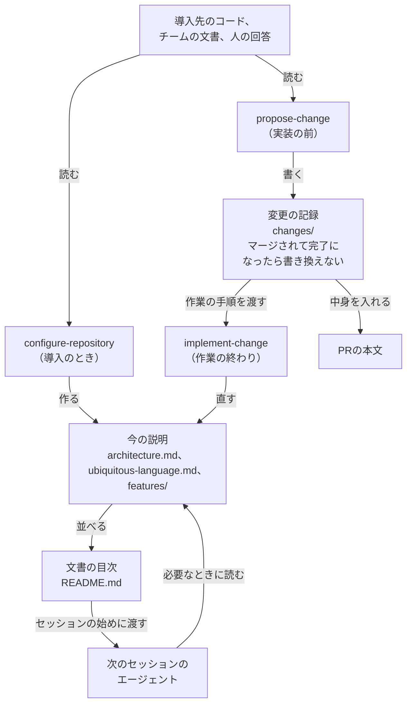

# 導入先の`.harness/`

| 項目 | 内容 |
|---|---|
| 確かめたコミット | `b7d78e4` |
| 関わる変更の記録 | なし |

`.harness/`は、導入先ごとのルール、設定、文書を置く、導入先の中のフォルダーである。導入先では`.git/info/exclude`（導入先のファイルを変えずに、gitから外す仕組み）でgitから外し、ハーネスのリポジトリではコミットする。この文書には、置くファイル、worktreeの中での読み方、保護、ルールが食い違ったときの扱い、`.harness/docs/`の書き分けと形を書く。

## 背景

- 多くのAIのツールでは、セッションをまたぐと会話の文脈がリセットされ、文書に残していない背景は次のセッションに伝わらない（[`architecture.md`の節「背景」](../architecture.md#背景)）。
- チームの合意が無い導入先には、ハーネスのためのファイルを導入先のgitに入れられない（[`architecture.md`の節「制約」](../architecture.md#制約)）。
- そのため、導入先について理解したことと導入先ごとのルールを、導入先のgitの外に、次のセッションでも読める形で置く必要がある。

## 要求

`.harness/`は、`architecture.md`の名前付きの要件のうち、「導入先を変えない」「導入の提案」（[節「導入の要件」](../architecture.md#導入の要件)）と、「worktreeでの動作」（[節「作業の要件」](../architecture.md#作業の要件)）を満たす。

## 業務のルール

### 置くファイル

```text
導入先のリポジトリ/
├── .git/
│   ├── config                        gitのフックの設定（hook.<名前>.commandとhook.<名前>.event）
│   └── info/exclude                  .harness/をgitから外す
├── .claude/settings.local.json       Claude Codeだけの設定（例：プラグインの有効化、本体の会話のモデルとeffort、サンドボックスの通信先と書き込みの禁止）
└── .harness/
    ├── rules/
    │   ├── always-read.md            導入先ごとのルール
    │   └── word-list.txt             導入先ごとの語の一覧（この文書の節「導入先ごとの語の一覧」）
    ├── config                        足す保護するブランチとCIの設定のファイルの場所
    ├── cache/                        ツールのキャッシュ（専用のキャッシュを選んだ導入先だけ）
    └── docs/                         導入先について理解したことの文書（この文書の節「`.harness/docs/`の形」）
```

| ファイル | 中身 | 誰が、いつ読むか | 書くときの人の確認 |
|---|---|---|---|
| `.harness/rules/always-read.md` | 導入先ごとのルール（例：テスト、lint、ビルドのコマンド、「テストの前にDockerを起動する」、コミットメッセージの形） | エージェントが、セッションの始めに | 求める |
| `.harness/rules/word-list.txt` | その導入先だけで止める語と、確かめる語をその導入先でも禁止にするかの答え | 語の確認（`scripts/find-banned-word.sh`）が語を探すたびに、`scripts/print-ambiguous-word-usage.sh`が導入のときに、`add-rule`のエージェントが同じ語を探すときに | 求める |
| `.harness/config` | git configの形式の設定（足す保護するブランチの`protection.branch`と、足すCIの設定のファイルの場所の`protection.ciSettingPath`） | 判定のスクリプトが判定のときに、gitの`pre-push`のスクリプトが保護するブランチだけをpushのときに | 求める |
| `.harness/docs/` | 機能の背景、要求、業務のルールのような、導入先について理解したことの文書 | エージェントが、必要なときに（セッションの始めには文書の目次だけ） | 求めない |
| `.harness/cache/` | 人が`configure-repository`の案から専用のキャッシュを選んだ導入先の、ツールのキャッシュ（[判断の記録](../../../docs/decisions/0051-tool-cache.md)） | ツール（例：Goのビルド）が、ビルドとテストのたびに | 求めない |

置き場所は、誰のものかと、いつ読むかで分ける。

| 誰のものか | 毎回読む（短く保つ） | 必要なときに読む（増えてよい） |
|---|---|---|
| ハーネスを使う開発者のもの | `.harness/`のルール | `.harness/`の文書 |
| チームのもの | 導入先の`CLAUDE.md`と`AGENTS.md` | 導入先の文書（例：`README.md`） |

| ルール | 理由 |
|---|---|
| テスト、lint、ビルドのコマンドと、レビュー役の組み合わせは、`.harness/config`ではなく導入先ごとのルールに書く。 | 読むのはエージェントだけで、スクリプトは読まない。 |
| `configure-repository`は、導入先を読み、人が承認したものだけを書く。導入先のチームのルールに書いてあることはコピーせず、書くものが無ければ空にする。 | 同じことを2か所に書くと、チームのルールを変えたときに片方が古くなる。 |
| ハーネスは、導入先の`CLAUDE.md`と`AGENTS.md`を書き換えない。作業の成果物（例：コード、チームに頼まれた文書）は、チームのやり方どおり、PRで導入先に入れる。 | 導入先のチームのやり方を変えない（[`architecture.md`の節「範囲の外」](../architecture.md#範囲の外)）。 |
| 開発者がチームに広げると決めたら、`.harness/`を`.git/info/exclude`から外してコミットする。`.harness/`の文書がチームの役に立つとわかったら、エージェントがチームの文書へ移すことを提案する。 | チームの合意ができたあとは、導入先のgitに入れてよい。 |
| ハーネスのリポジトリでは、`.harness/`もコミットし、`.harness/docs/`をほかの導入先と同じ形にする（ただし、書くことの無い節は置かない、[`CONTRIBUTING.md`の節「文書の形」](../../../CONTRIBUTING.md#文書の形)）。手引き（`docs/setup-guide.md`）と判断の記録（`docs/decisions/`）は、チームの文書として`docs/`に置き、`architecture.md`の冒頭の表から指す。 | 比べた案は、この文書の節「判断」からリンクした判断の記録に書く。 |

### メインの作業フォルダーの`.harness/`を読む

`.harness/`をgitから外した導入先では、新しいworktreeに`.harness/`が無い。そのため、エージェントとフックは、メインの作業フォルダー（worktreeではなく、もとのクローンの作業フォルダー）の`.harness/`を読む。

| ルール | 理由 |
|---|---|
| `SessionStart`のフックが、`scripts/print-main-worktree-path.sh`でメインの作業フォルダーを求めて渡す。サブエージェントには、呼ぶ側が依頼文で渡す。 | 1か所で求めるので、スキルごとに求め方を書かずに済む。 |
| フックは、ハーネスのリポジトリのworktreeでも、メインの作業フォルダーの`.harness/`を読む。 | `.harness/`がgitで追跡されるかで読む場所を変えず、どの導入先でも同じ処理にする。 |
| メインの作業フォルダーを求められないとき（gitの外、bareのリポジトリ、`.git`を外に置いたリポジトリのworktree）は、`SessionStart`のフックは今の作業フォルダーの`.harness/`を読み、そのことを出力に書く。 | 読んだ場所が違うことに、エージェントが気づける。同じ場面で、gitの`pre-push`のフックはpushを止める（[`protection.md`の節「秘密情報の探し方」](protection.md#秘密情報の探し方)）。 |

`scripts/print-main-worktree-path.sh`は、次の順にメインの作業フォルダーを求める。

1. `.git`の場所（`git rev-parse --git-dir`）と、worktreeで共有する場所（`--git-common-dir`）を比べる。
2. 同じならworktreeの外なので、作業フォルダーの一番上（`--show-toplevel`）を使う。
3. 違えば、`git worktree list --porcelain`の最初の行を、bareでなく、そこに`.git`があるときだけ使う。

変更の記録をどこで直すかは、誰がどこで動くかと、変更の記録がgitで追跡されるかで決まる。

| 場面 | 変更の記録を直す場所 | 理由 |
|---|---|---|
| 並行の実装役が、worktreeで動く | メインの作業フォルダーの変更の記録を、自分のworktreeの同じパスにコピーして直す。追跡されない導入先では、本体の会話が、worktreeを消す前に、worktreeの変更の記録をメインの作業フォルダーへ戻す。 | worktreeの実装役は、worktreeの外のファイルを直せない。 |
| 本体の会話がworktreeで動き、変更の記録が追跡される | 変更の記録を、そのworktreeの同じパスにコピーして直す。そのworktreeの同じパスに前のセッションでコミットした変更の記録があれば、コピーせずにそれを直す。 | メインの作業フォルダーの変更の記録を直しても、worktreeのコミットに入らず、PRに入らない。コミットしたほうが、メインの作業フォルダーに残った元より新しい。 |
| 本体の会話がworktreeで動き、変更の記録が追跡されない | コピーせずに、メインの作業フォルダーの変更の記録を直す。 | 追跡されない変更の記録は、コミットしない。 |

追跡される導入先で変更の記録をworktreeにコピーしたときは、本体の会話が、メインの作業フォルダーに残った元の変更の記録を、人の承認を得て消す。変更の記録はPRでコミットされるためである。

### 保護

| ルール | 理由 |
|---|---|
| `.harness/`のルールと設定のファイルは、サンドボックスの書き込み禁止に入れ、Claude CodeのEditとWriteでは権限で確認を求める（[`protection.md`](protection.md)）。PCの設定の`ask`のルールは環境を確かめるスクリプトが確かめ、導入先の`sandbox.filesystem.denyWrite`はスクリプトが見ないので、`configure-repository`がすべての項目を読む（`skills/configure-repository/SKILL.md`の節「保護の設定の読み方」）。 | 導入先ごとのルールと`.harness/config`は、保護するブランチとルールを決めるので、エージェントが人に聞かずに変えないようにする。 |
| 導入先ごとのルールと導入先ごとの語の一覧は、ハーネスと同じく`rules/`のフォルダーに置く。 | 書き込み禁止と確認をフォルダーで指定できるので、ファイルが増えても漏れない。 |
| Claude Codeだけの設定（例：プラグインの有効化、本体の会話のモデルとeffort、サンドボックスの通信先と書き込みの禁止）は、導入先の`.claude/settings.local.json`に置く。中身は、[`architecture.md`の節「導入」](../architecture.md#導入)に書く。 | Claude Codeは、権限とサンドボックスを、自分の設定のファイルからしか読まない。worktreeの中では、メインの作業フォルダーのファイルを使う（Settings files and precedence）。 |

### 導入先ごとの語の一覧

導入先ごとの語の一覧（`.harness/rules/word-list.txt`）は、その導入先だけで止める語と、確かめる語をその導入先でも禁止にするかの答えを書くファイルである。語の確認（`scripts/find-banned-word.sh`）が、`scripts/print-word-list.sh`を通して、語を探すたびに読む。場所ごとの語の扱いと聞く場面は[`rules/writing.md`の節「機械で止める規則」](../../../rules/writing.md#機械で止める規則)に、行の形は`add-rule`に書く。

| ルール | 理由 |
|---|---|
| 語の確認は、メインの作業フォルダーの`.harness/rules`がフォルダーのときだけ、導入したリポジトリとして一覧を読む。フォルダーでなければ、確かめる語を示すだけにする。 | 導入していないリポジトリには、答えを残す場所が無い。サンドボックスの中では、無い`.harness/rules`が中身の無いファイルに見えることがある（[`protection.md`の節「前提」](protection.md#前提)）。 |
| ハーネスのリポジトリには一覧を置かず、語の確認も読まない。 | 確かめる語をすべて止めるので答えが要らず、読むと語の確認の時間が延びる。 |
| 確かめる語への答えは、確かめる語のパターンの文字列どうしで比べ、正規表現では当てない。確かめる語と同じパターンの`banned`の行も、禁止にする答えに数える。 | 正規表現で当てると、複数の語をまとめたパターンへの答えが、その中の1語にも当たる。`banned`の行を数えるのは、導入先で足した語をあとでハーネスが確かめる語にしたときに、聞き直さないためである。 |
| ハーネスが確かめる語のパターンを変えると、導入先の答えが外れ、新しいパターンの語は決まっていない語になる。外れた答えの行（対応する確かめる語の無い答え）は、導入先で消すまで、語の確認のたびに知らせるだけにする（終了コード0）。 | 誤りにすると、ハーネスを変えた時点で、すべての導入先の語の確認が止まる。 |
| ハーネスの一覧と同じパターンの`banned`の行は、1つにまとめて示す。 | どの導入先でもの語をハーネスに足したあと、同じ語を2回示さない。 |
| 一覧の形の誤り（例：知らない種類、列の数、空の代わりの言い方、CR、同じパターンへの逆の答え、`grep`が読めないパターン、空の文字列に当たる除く形）は、語の確認を誤り（終了コード2）で止め、ファイルと行を示す。シンボリックリンク、ふつうのファイルでないもの、読めないファイルも2で止め、ファイルを示す。 | 壊れた一覧で、禁止にすると答えた語が黙って通らない。リンクをたどらないのは、リンク先の中身（例：秘密情報）を誤りの文に出さないためである。 |

### ルールが食い違ったとき

導入先ごとのルールは、共通のルールを上書きしない。フックは、両方をセッションの始めに渡す。導入先のルール（導入先ごとのルールと、導入先のチームのルール）が共通のルールと食い違ったときは、内容で扱いが分かれる。ここでのルールは文で書いたルールで、Claude Codeの設定のファイルは含まない。導入先のClaude Codeの設定は、PCの権限とサンドボックスを緩められる（[`protection.md`の節「前提」](protection.md#前提)）。

| 内容 | 食い違ったとき | 理由 |
|---|---|---|
| 書き方（例：コミットメッセージの形、PRのテンプレート） | 導入先のものに従う。 | 書き方は、導入先のルールと既存の形を先にする（[`rules/always-read.md`の節「導入先で書き方を決める順」](../../../rules/always-read.md#導入先で書き方を決める順)）。 |
| セキュリティ（保護するブランチ、CIの設定のファイル、秘密情報） | 足すことだけができ、緩められない。 | `.harness/config`は、厳しくする方向にだけ足せる（[`protection.md`の節「前提」](protection.md#前提)）。 |

例えば、導入先のルールに「`main`へ直接pushしてよい」と書いても、判定のスクリプトは文を読まないので、pushは止まったままである。

### `.harness/docs/`の形

ファイル名は、請求書（invoice）の機能を例にした。

```text
.harness/docs/
├── README.md                    文書の目次
├── architecture.md              全体の背景、要求、構成、コードの配置、前提、判断
├── ubiquitous-language.md       業務の言葉、意味、コードでの名前（開発者と業務の人が同じ言葉で話すため）
├── features/
│   └── invoice.md               機能の背景、要求、業務のルール、関わるコードの名前、前提、判断
└── changes/
    └── 2026-10-23-fix-invoice-total.md   1つのPRに1ファイル
```

次の図は、導入先について知ったことが、どの文書に書かれ、次のセッションにどう渡るかを示す。読む人は、スキルを作る人と、`.harness/docs/`を書くエージェントである。



### 書き分け

| ルール | 理由 |
|---|---|
| `changes/`の変更の記録だけが、マージされて「完了」になったあとは書き換えない文書である。ほかはすべて今の説明（導入先の今の状態のうち、コードから読み取れないことを書く文書）で、エージェントが作業の終わりに直す。 | 比べた案は、[判断の記録](../../../docs/decisions/0015-change-document-split.md)に書く。 |
| `implement-change`が変更の記録を「完了」にする時期は、gitで追跡されるかで分ける。追跡される変更の記録（例：ハーネスのリポジトリ）はPRの最後のコミットで、追跡されないものはマージを知ったときに「完了」にする。 | 比べた案は[判断の記録](../../../docs/decisions/0027-change-document-completion.md)に、手順は`implement-change`に書く。 |
| 今の説明には、コードから読み取れないこと（背景、要求、業務のルール、前提、理由）を書き、実装の細部は書かない。関わるコードは名前（識別子）で書き、ファイルのパスは書かない。 | ファイルのパスは、名前が変わると参照できなくなる。 |
| 前提の理由に書く確かめた所と、識別子の無いもの（例：シェルのスクリプト、スキル、ルールのファイル）は、ファイルのパスで書いてよい。 | 設定のファイル（例：`package.json`）のような識別子の無いものは、パスのほかに指す方法が無い。 |
| 推測は今の説明に書かず、変更の記録の「調べたこと」に書く。チームに確かめたら、結論と理由を今の説明へ移し、どこで確かめたかは変更の記録へのリンクにする。 | 今の説明を、確かめたことだけにする。 |
| 調査とセキュリティの確認の結果は、`.harness/docs/`に書かず、返事で報告する。変更につながれば、変更の記録の「調べたこと」に入れる。 | 今の説明は導入先の今の状態を書く文書で、調べた結果や確かめた結果の置き場所ではない。 |
| `architecture.md`と`ubiquitous-language.md`は、導入のときにコードから作る。機能の説明（`features/`のファイル）は、変更で調べたときに足し、全体を前もって書き起こさない。 | 書き起こしても、確かめていない推測が増える。ハーネスのリポジトリでは、構成要素ごとの設計を最初から`features/`に置く（この文書の節「判断」）。 |
| 文書の目次には今の説明のファイルを並べ、`changes/`は1行だけ書く。 | 変更の記録はPRごとに増え、セッションの始めに渡す目次が長くなる。 |

情報ごとに、何を正とし、`.harness/docs/`に書くかは、次のとおりである。仕様をコードから読み取らないのは、コードからわかるのは今どう動いているかで、どう動くべきかはわからないためである。

| 情報 | 正 | `.harness/docs/`に書くか |
|---|---|---|
| 今どう動いているか（実装） | コードが正である。 | 書かない。関わるコードの名前だけを書く。 |
| どう動くべきか（仕様、業務のルール） | チームの仕様書が正で、無ければ作業で確かめた業務のルールが正である。 | チームの仕様書は場所だけを書く。無ければ、確かめたルールだけを書く。 |
| なぜ（背景、要求、理由） | どこにも書かれていないことが多い。 | 書く（中心）。 |

### 自動の記憶との分け方

| ルール | 理由 |
|---|---|
| 導入先について理解したことと、作業の進み具合（変更の記録の作業の手順のチェックと、残っていること）は、`.harness/docs/`に書く。スキルは、Claude Codeの自動の記憶（Claude Codeが、PCごとに自分で書いて次のセッションで読むメモ）に書かない。 | 比べた案は、[判断の記録](../../../docs/decisions/0023-knowledge-location.md)に書く。 |
| 自動の記憶と`.harness/docs/`が食い違ったときは、`.harness/docs/`を正とする。 | スキルが書かなくても、Claude Codeが自分で進み具合を自動の記憶に書くことがある。どちらを信じるかを、その都度決めずに済む。 |

### 文書の形

| 形 | 列 | 使う所 |
|---|---|---|
| 冒頭の表 | 項目、内容 | 文書の目次を除くすべての文書の頭 |
| ルールの表 | ルール、理由 | 業務のルール |
| 前提の表 | 前提、理由 | 知らないと誤る前提 |
| 判断と理由の表 | 判断、誰が決めたか、理由 | 判断の節（誰が決めたかの列から、決めた文書へリンクし、比べた案はその文書に書く） |
| 案の表 | 案、結果（採った、採らなかった、未確認）、誰が決めたか、理由 | 比べた案を、その文書に書く判断の節（論点ごとに`###`を置く） |
| なし、未確認 | なし | 当てはまらない節（「なし」）と、確かめていない節（「未確認」） |

冒頭の表には確かめたコミットを書き、`git diff`でコードとの差を見る。今の説明の確かめたコミットは、`implement-change`が変更の記録を「完了」にするときに直す。

変更の記録の節と冒頭の表は、`propose-change`の`assets/change.md`に書く。

- 変更の記録には「範囲の外」の節を置く。範囲の外を書くと、議論が絞られる（KEP templateの節「Non-Goals」）。
- 要件の種類（機能、非機能、変えない動き、制約）に、「変えない動き」を置く。修正の前後で同じであるべき振る舞いが、はっきりする（Bugfix Specs（Kiro））。
- 今の説明の節は、機能の説明のテンプレート（`implement-change`の`assets/feature.md`）と、`configure-repository`の`assets/`のテンプレートに書く。
- 判断と案の表に、「誰が決めたか」の列を置く。値は、変更の記録では「人の回答（YYYY-MM-DD）」か「エージェントの案」、今の説明では人の回答と日付か、決めた文書（承認した変更の記録、チームの判断の記録）へのリンクにし、どちらでも確かめていなければ「未確認」にする。決めた文書を残さないときは、変更の記録と同じ値（「人の回答（YYYY-MM-DD）」か「エージェントの案」）を書く。エージェントの案が人の決定として残ると、あとのエージェントが、見直すべき場面でも人に聞かずに守り続けるためである。

「未確認」は、どこに書くかで扱いが違う。完了の報告とPRの本文での扱いは、[`rules/always-read.md`の節「完了の条件」](../../../rules/always-read.md#完了の条件)に書く。

| どこの未確認 | 扱い |
|---|---|
| 変更の記録の止める節（背景、要求、要件、範囲の外、判断） | 実装に進まず、人に聞く。 |
| 今の説明の、確かめていない節 | 「未確認」とだけ書き、推測の中身は書かない。作業は止めず、次に変えるときに確かめる。 |

## 関わるコードの名前

役割は、[`architecture.md`の節「コードの配置」](../architecture.md#コードの配置)に書く。

- `scripts/print-main-worktree-path.sh`
- `scripts/print-word-list.sh`、`scripts/print-project-word-list.sh`、`scripts/print-ambiguous-word-usage.sh`
- `hooks/print-session-context.sh`
- `skills/configure-repository/assets/`、`skills/implement-change/assets/feature.md`、`skills/propose-change/assets/change.md`

## 前提

| 前提 | 理由 |
|---|---|
| 導入先の`.harness/docs/`は、ほかのPCで読めない。別のPCでcloneした導入先には、`.harness/docs/`が無い。 | `.git/info/exclude`でgitから外すので、cloneに入らない。 |
| 導入先の`.harness/docs/`は、導入先のフォルダーと一緒に消える（例：`git clean -fdx`、`git clean -fdX`、導入先のフォルダーを消してのcloneのし直し）。`-x`も`-X`も無い`git clean -fd`では消えない。 | gitで追跡しないファイルで、gitの除外に入っている。 |
| 導入先ごとの語の一覧も、上の2つと同じく、ほかのPCとcloneのし直しと`git clean -fdx`で無くなる。そのときは`.harness/`ごと無くなるので、確かめる語は導入していないリポジトリと同じく示すだけになり、`configure-repository`をもう一度動かすと、表で聞き直す。 | 一覧も`.harness/`の中にあり、`.git/info/exclude`でgitから外す。 |
| 上の3つは、`.harness/`をコミットした導入先（ハーネスのリポジトリと、チームに広げた導入先）には当てはまらない。 | コミットしたファイルは、cloneに入り、`git clean`で消えない。 |
| `.git`を外に置いたリポジトリのworktreeでは、ふつうはメインの作業フォルダーを求められない（この文書の節「メインの作業フォルダーの`.harness/`を読む」）。例外として、外に置いた場所の名前が`.git`のとき（例：`git init --separate-git-dir=<フォルダー>/.git`）は、フックがそのworktreeで`.git`の親のフォルダーをメインの作業フォルダーとして渡し、導入先ごとのルールが「なし」と出る。 | gitがメインの作業フォルダーの場所を持たず、名前が`.git`だと、ふつうのリポジトリと見分けられない。 |
| `.git`の名前が`.git`のまま`core.worktree`で作業フォルダーを外に置いたときも、同じく導入先ごとのルールが「なし」と出る。 | `scripts/print-main-worktree-path.sh`は、`core.worktree`を読まない（この文書の節「判断」）。 |

## 判断

| 判断 | 誰が決めたか | 理由 |
|---|---|---|
| `.harness/`を導入先の中に置き、`.git/info/exclude`でgitから外す。ハーネスのリポジトリでは、`.harness/`もコミットする。 | [判断の記録](../../../docs/decisions/0003-harness-folder-location.md) | 導入先のgitを変えずに、エージェントが導入先の中で読める。 |
| ハーネスのリポジトリでは、要求、要件、全体の設計を`architecture.md`に、語の意味を`ubiquitous-language.md`に、構成要素ごとの設計を`features/`に書く。 | [判断の記録](../../../docs/decisions/0043-harness-document-form.md) | このリポジトリの作業でも`implement-change`が導入先と同じ今の説明を直すので、テンプレートの誤りが導入先より先に見つかる。 |
| 確かめる語は、導入先では、人が禁止にすると答えた語だけを止める。 | [判断の記録](../../../docs/decisions/0044-ambiguous-word-by-location.md) | 業務の言葉と重なる語だけを残し、ほかの語は導入先でも止められる。 |
| 導入先ごとの語の一覧は、`.harness/rules/word-list.txt`の1つのファイルにし、確かめる語への答えはパターンの文字列で指す。 | [判断の記録](../../../docs/decisions/0045-repository-word-list-form.md) | 保護の設定を足さずに済み、ハーネスが除く形を直すと導入先にも届く。 |
| `scripts/print-main-worktree-path.sh`は、`core.worktree`を読まない。 | エージェントの案 | 値の置き方（絶対パス、相対パス、`config.worktree`）ごとに分岐が増える。この置き方の導入先に入れると決めたら、見直す。 |

### メインの作業フォルダーの求め方

| 案 | 結果 | 誰が決めたか | 理由 |
|---|---|---|---|
| `.git`の場所と、worktreeで共有する場所を比べて分ける | 採った | エージェントの案 | `.git`を作業フォルダーの外に置いたリポジトリとサブモジュールでも、作業フォルダーを誤らない。 |
| `.git`の場所の親を使う | 採らなかった | エージェントの案 | `.git`を外に置いたリポジトリとサブモジュールで、`.git`の場所を作業フォルダーと誤る。 |
| `git worktree list --porcelain`の最初の行だけを使う | 採らなかった | エージェントの案 | 上と同じ形のリポジトリで、作業フォルダーを誤る。 |

## 出典

- [Settings files and precedence](https://code.claude.com/docs/en/settings)の節「Where Claude Code keeps the local file in a git repository」：「In a worktree, it uses the file at the main checkout's root.」（確かめた日：2026-10-23）
- [KEP template](https://raw.githubusercontent.com/kubernetes/enhancements/master/keps/NNNN-kep-template/README.md)の節「Non-Goals」：「Listing non-goals helps to focus discussion and make progress.」（確かめた日：2026-10-23）
- [Bugfix Specs（Kiro）](https://kiro.dev/docs/specs/bugfix-specs/)の節「1. Bugfix Analysis Phase」：「WHEN [condition] THEN the system SHALL CONTINUE TO [existing behavior]」（確かめた日：2026-10-23）
