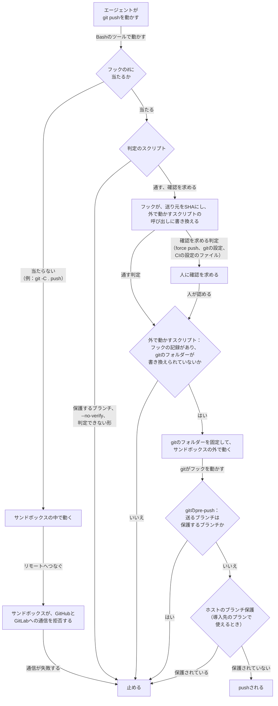

# 保護の仕組み

| 項目 | 内容 |
|---|---|
| 確かめたコミット | `b7d78e4` |
| 関わる変更の記録 | なし |

保護の仕組みは、秘密情報の漏れ、保護するブランチ（例：`main`）へのpush、人が知らないままのCIの設定のファイルの変更のpushを防ぐために、エージェントの操作を止めるか、人に確認を求める仕組みである。権限、サンドボックス、フックと判定のスクリプト、gitのフックの4つがある。強く止める所（境界）は、サンドボックスの読み書きと通信の制限と、サンドボックスの外で動くコマンドを見る判定のスクリプトと、判定のあとのgitのフォルダーの書き換えを止める、外で動かすスクリプトの確かめである。この文書には、操作ごとにどの仕組みが止めるか、仕組みごとの設定と規則、知らないと誤る前提を書く。語の意味（例：導入先、判定、作業用のブランチ）は、[`ubiquitous-language.md`](../ubiquitous-language.md)に書く。

## 背景

- 秘密情報の漏れは、一度起きると取り消せない（[`architecture.md`の節「背景」](../architecture.md#背景)）。
- Claude Codeの権限のルールと、フックの`if`の項目（フックを動かすコマンドを絞るパターン）は、ルールに書いたプログラムを別の形で動かすと当たらない（この文書の節「前提」）。
- そのため、1つの仕組みだけでは、止められない書き方が残る。
- 判定のあと、外のコマンドが動く前に、サンドボックスの中のコマンドが、送り元のブランチとgitの設定（例：`.git/commondir`）を書き換えられる。外のコマンドが書き換えたあとの状態のまま動くと、判定で確かめたものと違うcommitを送り、エージェントが書いた設定とフックを使う。

## 要求

保護の仕組みは、`architecture.md`の名前付きの要件のうち、「秘密情報と保護するブランチ」と「人に確認を求める場面」（[節「人の判断と保護の要件」](../architecture.md#人の判断と保護の要件)）と、「守れないことの提示」（[節「導入の要件」](../architecture.md#導入の要件)）を満たす。4つの仕組みを残すのは、ハーネスの要求で、精度（誤りなく終えることで、セキュリティの事故も誤りに含める）を人の手間より先にしているためである（[`architecture.md`の節「要求」](../architecture.md#要求)）。

## 業務のルール

この文書の「外に出す形」は、サンドボックスの外で動かすコマンドの形で、PCの設定の`excludedCommands`の2つ（外で動かすスクリプトの呼び出しと`gh`）で決める。外で動かすスクリプト（`hooks/exec-with-pinned-git-directory.sh`）は、フックが書き換えた`git push`、`git fetch`、`glab`と、確認を求める`gh`だけを、判定で求めたgitのフォルダーに固定して動かす（この文書の節「送り元とgitのフォルダーの固定」）。操作ごとに止めるか確認を求める仕組みは、次のとおりである。

| エージェントの操作 | 止めるか確認を求める仕組み |
|---|---|
| 秘密情報のファイル（例：`.env`、秘密鍵の`*.pem`と`id_ed25519`）を、Read、Editで読み書きする | 権限が止める |
| 秘密情報のファイルを、シェルで読む | サンドボックスが止める |
| 秘密情報を含むcommitを作る、送る | gitのフックが止める |
| 保護するブランチへpushする | フックと判定のスクリプト、gitのフックが止める |
| CIの設定のファイル（例：`.github/workflows/`、`.gitlab-ci.yml`）を変えたcommitをpushする | フックと判定のスクリプトが確認を求める |
| 外に出す形に当たらない書き方で、pushする（例：`git -C . push`、スクリプトの中のpush） | サンドボックスが通信を止める |
| PR、MR、Issue、コメントを`gh`か`glab`で作る | フックと判定のスクリプトが確認を求める |
| `glab`で、トークンと秘密の値（例：CI/CDの変数）を表示する | フックと判定のスクリプトが止める |
| 本文をファイルから読む形（例：`--body-file`）か、行の頭が`/`の本文（GitLabのクイックアクション）を、`gh`か`glab`で送る | フックと判定のスクリプトが止める |
| 判定のあとに、送り元のブランチかgitのフォルダー（例：`.git/commondir`）を書き換える | フックの書き換えと、外で動かすスクリプトの確かめが、書き換えたものを外のコマンドに使わせない |
| 外で動かすスクリプトを直接呼ぶ | フックと外で動かすスクリプトが止める |
| `--no-verify`で、gitのフックを飛ばす | `git commit`は権限が、`git push`はフックと判定のスクリプトが止める |
| `.harness/`のルールと設定を、Edit、Writeで書く | 権限が確認を求める |
| `.harness/`のルールと設定を、シェルで書く | サンドボックスが止める |
| サンドボックスの外で動くgitに、作業フォルダーの中のファイル（例：gitのフックのスクリプト）を動かさせる | フックと判定のスクリプトが確認を求める |

### 止める境界

保護の境界は、サンドボックスの読み書きと通信の制限と、判定のスクリプトと、外で動かすスクリプトの確かめである。外に出る`git push`、`git fetch`、`glab`は、フックが判定のスクリプトを通して書き換えた、外で動かすスクリプトの呼び出しだけになる。フックの`if`に当たらない書き方は、書き換えられずにサンドボックスの中に残る。権限のルールは、Claude Codeがふつう書く形に当てる補助にする。

次の図は、pushが、どの順に、どこで止まるか確認を求められるかを示す。読む人は、保護の仕組みを変える人である。図の下の箇条書きに、各段の条件と例を書く。

1. フックの`if`（フックを動かすコマンドを絞るパターン、例：`Bash(git push *)`）に当たらない書き方（例：`git -C . push`、`git -c core.hooksPath=/dev/null push`、スクリプトの中のpush）は、書き換えられずにサンドボックスの中で動き、ホストの名前でGitHubとGitLabに通信できずに失敗する。ほかのコマンドとつないだ形（例：`npm test && git push`、`cd sub && git push`）は、`if`が区切ったコマンドごとに当たるので、判定のスクリプトが止める。
2. 判定のスクリプトは、許す一覧（判定のスクリプトが通す、決まった書き方の一覧）にある簡単な形だけを通し、つないだ形を含む判定できない形（例：送り先を書かない形、一覧に無いオプション）を止める。pushは、`<送り元>:<送り先>`の形で送り先のブランチを書き、送り先が保護するブランチでないときだけ通す。force push、作業フォルダーの中を指すgitの設定（この文書の節「gitの設定の確認」）、CIの設定のファイルを変えるpush（この文書の節「CIの設定のファイルを変えるpush」）には、確認を求める。
3. フックは、通すか確認を求める判定の`git push`の語を、送り元を判定で確かめたcommitのSHAにしてフックの記録に書き、外で動かすスクリプトと記録の名前だけの呼び出しに書き換える（`updatedInput`）。確認を求めるときは、人が理由の文に出た動かすコマンドを見て認める。
4. 外で動かすスクリプトは、フックが書いた記録があり、判定のあとにgitのフォルダーが書き換えられていないときだけ、gitのフォルダーを環境変数で固定して、記録の語をサンドボックスの外で動かす（この文書の節「送り元とgitのフォルダーの固定」）。
5. 外で動いたpushでは、gitの`pre-push`のフックが、実際に送るブランチを確かめる。gitが2.54より古い導入先と、フックを足す前のリポジトリには`pre-push`のフックが無いので、判定のスクリプトの判定だけで`main`に届かない形にしている。
6. 導入先のプランで使えれば、ホスト（GitHubかGitLab）のブランチ保護が最後に止める。

この境界で、エージェントは次の7つのことができなくなる。直し方は、[導入の手引きの節「PCの設定を足す」](../../../docs/setup-guide.md#pcの設定を足す)の表に書く。

- `git push`、`git fetch`、`gh`、`glab`は、ほかのコマンドとつながず、`cd`とリダイレクト（末尾の`2>&1`を除く）を付けずに、1つで動かすことになる。pushは`<送り元>:<送り先>`の形で送り先のブランチを書き、書かないと止まる。
- ブランチでない送り先（例：タグ）へのpushは止まるので、タグは人が動かす。
- `git pull`は使えず、`git fetch`と、サンドボックスの中の`git merge --ff-only`に分ける（この文書の節「判定のスクリプト」）。
- サンドボックスの中の`git clone`と、GitHubとGitLabからの依存の取得（例：`npm install github:...`）は、通信できずに失敗する。
- サンドボックスに合わないツール（例：docker）は、そのプロジェクトの`.claude/settings.local.json`の`excludedCommands`に足すまで失敗する。
- 外で動かすスクリプトは、直接呼べない。書き換えの要る`git push`、`git fetch`、`glab`と、確認を求める`gh`は、Bashのツールでだけ動かせ、Bashのほかのツール（例：Monitor）では止まる。
- `gh`と`glab`に渡す本文は、ファイルから読まず、コマンドの値に書く（[`rules/git.md`の節「下書きの置き場所と確かめ方」](../../../rules/git.md#下書きの置き場所と確かめ方)）。

### 判定のスクリプト

`scripts/classify-remote-command.sh`（判定のスクリプト）は、作業フォルダーとコマンドの文字列を引数で受け取り、「通す」「確認を求める」「止める」のどれか（判定）を、理由の文と一緒に返す。許す簡単な形だけを通し（許す一覧）、判定できない形は止めて、理由の文で簡単な形を示す。止めると人に確認は出ず、エージェントが簡単な形に書き直す。

| コマンド | 通す | 確認を求める | 止める |
|---|---|---|---|
| `git push`、`git fetch`、`git pull`、`gh`、`glab`に共通 | 末尾の`2>&1` | なし | 先頭が`git push`、`git fetch`、`git pull`、`gh`、`glab`でない形（例：先頭の環境変数、`timeout`のような前置き、`git -C`のような`git`のオプション）、引用符の外の区切りの記号（例：`&&`、`;`、`\|`）とリダイレクトと`$`とバッククォートと`\`と展開の記号（例：`*`）、`"`の中の`$`とバッククォートと`\` |
| `git push` | gitの設定にあるリモートの名前と、`<送り元>:<送り先>`の形のブランチを書き（例：`git push origin feat/x:feat/x`）、送り先が保護するブランチでない形 | 作業用のブランチ（PRのために切ったブランチ）へのforce pushとブランチを消すpush（例：`--force`、`+<送り元>:<送り先>`、`--delete <ブランチ>`、`:<ブランチ>`）、CIの設定のファイルを変えるcommitのpush、リモートに送り先のブランチも`HEAD`も無いpush（例：空のリポジトリ） | 保護するブランチへの形（force pushと消すpushを含む）、`--no-verify`、送り先を書かない形（例：`git push`、`git push origin`、`git push origin HEAD`、`git push origin feat/x`）、送り元が手元のcommitにならない形（例：無いブランチ）、設定に無いリモート（例：URL）、ブランチでない送り先（例：`refs/tags/v1`）、パターンの記号（`*`、`?`、`[`）を含む送り先、知らないオプション（許す一覧に無いオプション） |
| `git fetch` | gitの設定にあるリモートの名前と、取るブランチだけを書いた形（例：`git fetch origin`、`git fetch origin main`） | なし | リモートを書かない形（例：`git fetch`、`git fetch --prune`）、知らないオプション（例：`--upload-pack`、`--all`）、設定に無いリモート |
| `git pull` | なし | なし | すべての形（理由の文で、`git fetch <リモート> <ブランチ>`のあとにサンドボックスの中で`git merge --ff-only <リモート>/<ブランチ>`を動かす形を示す） |
| `gh` | 読み取りのコマンド（例：`pr view`、`pr diff`、`pr checks`、`issue view`、一覧、引数の無い`auth status`）、書き込みのオプション（`--method`、`-X`、`-f`、`-F`、`--field`、`--raw-field`）の無い`gh api`、`mutation`の無い`gh api graphql` | GitHubのほかのホストを指す形（`--hostname`、URL、`-R`の`HOST/OWNER/REPO`）、`-w`と`--web`を付けた読み取り（束ねた短い形を含む）、通す列と止める列に無い形（例：本文を値に書いたPRの作成とコメント、`gh pr checkout`） | 引数の無い`auth status`のほかの`auth`（例：`auth status --show-token`、`auth token`、`auth login`）、`config`、外でほかのプログラムを動かす形と外の設定を書く形（例：`alias set`、`extension`、`skill install`、`codespace ssh`）、clone（例：`repo clone`、`--clone`の`repo create`）と`repo sync`、`gh api`の知らないオプション、本文か中身をほかの場所から読むオプション（例：`--body-file`、`--editor`、`--fill`）、書き込みのコマンドの短い形（`-F`、`-e`、`-T`、`-f`）と束ねた短い形、`gh api`の`--input`、`-F`の値のうち`@`で始まるものとghが置き換える語（例：`:owner`、`{repo}`）を含むもの |
| `glab` | 読み取りのコマンド（例：`mr view`、`mr diff`、`ci get`、`issue view`）、引数の無い`auth status`と`version`、決まったエンドポイントの形とGraphQLの決まった問い合わせだけの`glab api` | リモートへの書き込み（例：`mr create`、`mr note`、下書きのコメント）、ほかのホストを指す形、通すコマンドの許す一覧に無いオプション、`-w`と`--web`、`mr checkout`、中身のあるリポジトリの`glab`の設定（`.git/glab-cli/`） | トークンと秘密の値を出す形（例：`auth status -t`、`variable get`）、`glab`の中でpushを動かす形、外でほかのプログラムを動かす形と外の設定を書く形（例：`alias set`、`minder setup`）、一覧に無いコマンド、本文をファイルから読む形、行の頭が`/`の本文、`://`を含む`glab api`のエンドポイント |

`glab`のコマンドごとの扱いと理由は、この文書の節「`glab`の判定」に書く。

次の2文の並びは例で、判定の一覧のテスト（`tests/classify-remote-command-case-list.tsv`）に、ほかの形もある。コマンドの形で確認を求めるのは、force push、ブランチを消すpush、読み取りでない`gh`と`glab`（例：PRとMRの作成、コメント、`gh pr checkout`）、`-w`か`--web`を付けた読み取り、許す一覧に無いオプションを付けた`glab`の読み取り、ほかのホストへの`gh`と`glab`である。手元の状態で確認を求めるのは、作業フォルダーの中を指すgitの設定と中身のあるリポジトリの`glab`の設定を見つけたとき、導入先のリポジトリとみなせないとき、CIの設定のファイルを変えるpushである。force pushとブランチを消すpushで確認を求めるのは、リモートの履歴を上書きするか、ブランチを消し、取り消せないためである。

| ルール | 理由 |
|---|---|
| 引用符（`'`と`"`）の中は、1つの引数として読み、区切りの記号とみなさない。 | `gh`の`--jq`とGraphQLの問い合わせには記号が多く、毎回止まると書き直しが増える。 |
| `"`の中の`$`、バッククォート、`\`は止める。 | `$`とバッククォートは展開される。`\`は、シェルが次の文字によって外すか残し、改行の前では行をつなぐ。 |
| 引用符の外の区切りと展開を止める。 | 外に出す形だけをつないだ形は、サンドボックスの外で動く（この文書の節「前提」）。 |
| `git fetch`は、リモートの名前を書いた形だけを通し、知らないオプションを止める。 | 外で動くので、任意のコマンドを動かせるオプション（例：`--upload-pack`）を通さない。リモートを書かないと、gitは、サンドボックスの中から書ける`.git/remotes/`と`.git/branches/`から、設定に無いリモートを読むことがある（gitrepository-layout）。 |
| `git fetch`には、送り先の判定を当てない。 | fetchは、リモートへ書かない。 |
| `git pull`は止める。 | 外で動く`git pull`は、エージェントが用意したcommitで、サンドボックスが書かせないパス（Configure the sandboxed Bash toolの節「Protected paths」の、Claude Codeが決めた一覧で、例：`.claude/settings.json`、`.git`の`config`と`hooks`）のファイルを書ける。サンドボックスの中のマージは、そのファイルを書けずに止まる。 |
| `gh`の読み取りを通す。 | ほかの人のPRをレビューする`review-pr`と、自分のPRの指摘に対応する`resolve-review-comment`のスキルが、読み取りで毎回使う。 |
| GitHubのほかのホストを指す`gh`は、確認を求める。 | `gh`はサンドボックスの外で動き、通信先の制限を受けない。 |
| `gh`の読み取りでも、`-w`と`--web`（`-cw`のような束ねた短い形を含む）を付けた形には、確認を求める。 | `-w`を持つ読み取りのコマンドでは、`-w`はサンドボックスの外でブラウザーを開く`--web`の短い形で、`gh run list`の`-w`だけは`--workflow`の短い形である（gh pr view、gh run list）。`gh run list`の`-w`は確認を求める側に誤るが、コマンドごとに分けると規則が増えるので、分けずに`glab`の`-w`と`--web`と同じく確認を求める。 |
| `auth`は引数の無い`auth status`のほかを止め、`config`も止める。 | トークンをエージェントの文脈に出す形（引数を付けた`auth status`、`auth token`、ホストを付けた`config get oauth_token`）と、ghの認証、gitの認証のヘルパー、ghが動かすプログラム（例：`pager`）を書き換える形（例：`auth login`、`auth setup-git`、`config set`）がある（cli/cliのソース、gh config、gh auth setup-git）。 |
| `gh pr checkout`の確認の文には、サンドボックスの外でgitのfetchとcheckoutが動き、導入先のgitのフックとgitの設定のコマンド（例：`core.sshCommand`）も外で動くことがあると書く。この文は固定の文にし、gitの設定の確認（この文書の節「gitの設定の確認」の処理）が見つけたものを後ろに足す。 | 人が、フックのことを知ってから認められる。checkoutで動くフックを探す規則は足さず、ほかの確認を求める`gh`と同じ確認だけを当てる。 |
| 利用者の別名を書く`alias set`と`alias import`を止める。 | 利用者の別名は、判定が止めるコマンドを動かせ、`!`で始まるか`--shell`を付けた別名は、シェルの式として外の`sh`で動く（gh alias set）。 |
| `extension`を、ghの別名（`ext`、`extensions`）も含めて止める。 | 拡張はGitHubが確かめていないプログラムで、入れる形と外で動かす形（例：`install`、`exec`）がある（gh extension）。 |
| `copilot`を止める。 | `gh`は、Copilot CLIが入っていなければダウンロードし、サンドボックスの外で動かす（gh copilot）。 |
| `codespace`の`ssh`と`cp`を、ghの別名（`cs`）も含めて止める。 | sshとscpに渡すオプション（例：`ProxyCommand`）で、手元のコマンドを動かせる（gh codespace ssh、gh codespace cp、scp、ssh_config）。`cp`は、サンドボックスの外で手元のファイルを書ける（gh codespace cp）。 |
| `codespace`の`code`を、ghの別名（`cs`）も含めて止める。 | `--web`の無い形は手元のVS Codeで開く`vscode://`のURLを、`--web`の形はブラウザーで動くVS Codeのページを、ghのブラウザーの仕組みで開く（cli/cliのソース`pkg/cmd/codespace/code.go`、gh codespace code）。ハーネスのスキルの手順では使わず、`--web`の無い形は手元のVS Codeを外で起こすので、`--web`の形も分けずに止める。 |
| `codespace`の`jupyter`を、ghの別名（`cs`）も含めて止める。 | codespaceの中でJupyterLabを起こし、手元の空いたポートで待ち受けて転送してから、ブラウザーで開く（cli/cliのソース`pkg/cmd/codespace/jupyter.go`）。`ports forward`と同じく、サンドボックスの外で待ち受ける。 |
| `codespace`の`ports`を、ghの別名（`cs`）も含めて止める。 | `ports forward`は、codespaceのポートを手元のポートへ転送し、サンドボックスの外で待ち受ける（gh codespace ports forward）。 |
| `skill install`と`skill update`を、ghの別名（`skills`、`skill add`）も含めて止める。 | サンドボックスが書かせないClaude Codeのスキルの場所（例：作業フォルダーの`.claude/skills`）にも、外から指示のファイルを書ける（gh skill install、Configure the sandboxed Bash toolの節「Protected paths」）。 |
| `repo clone`、`repo fork`、`gist clone`と、`--clone`か`-c`を付けた`repo create`を止める。 | 確認を求める`gh`は、今のリポジトリのgitのフォルダーを固定して外で動き、固定した作業フォルダーがあると、`git clone`は`working tree '<作業フォルダー>' already exists.`で止まる（一時のリポジトリで確かめた）。`glab`の`repo clone`と`repo fork`と同じ扱いにする。 |
| `repo sync`を止める。 | 引数が無いと手元のリポジトリのブランチを外のgitで進めるか`--force`でhard resetし（gh repo sync）、`git pull`と同じく、サンドボックスが書かせないパスのファイルも書ける。 |
| 書き込みの`gh`は、本文を値に書く形（例：`--body '<本文>'`）だけを通し、本文か中身をファイル、エディター、標準入力から読むオプションを止める。 | 外で動く`gh`は、判定のあとに書き換えたファイルと、シンボリックリンクの先のサンドボックスが読めなくしたファイル（例：`~/.ssh/id_ed25519`）も読んで送り、人が確認で見るのはファイルのパスだけである。標準入力だけを読む形（例：`gh workflow run --json`）は、フックがつなぐ形とリダイレクトを止めるので、止めない。 |
| 書き込みの`gh`の短い形（`-F`、`-e`、`-T`、`-f`）と、束ねた短い形と値をつないだ短い形は止め、長い形で書くよう理由の文で示す。 | 短い形の意味はコマンドで違う（例：`gh label create -f`は`--force`）ので、誤って止めても安全な側にする。 |
| `gh api`と`gh workflow run`の`-F`（`--field`）の値のうち、`@`で始まるものと、ghが置き換える語（`:owner`、`:repo`、`:branch`、`{owner}`、`{repo}`、`{branch}`）を含むものを止める。`-f`（`--raw-field`）の値は止めない。 | `@`はファイルか標準入力を読み、置き換える語は黙って今のリポジトリの値に変わる。`-f`の値は、ghが変えない。 |
| 書き込みの`gh`の確認の文には、外の`gh`がサンドボックスの読めなくしたファイルも読め、書かせないパスにも書けることと、ファイルを渡すか書く先の引数のパスを確かめることと、知らないコマンドが利用者の別名か拡張のことがあることを書く。 | ファイルを送るコマンド（例：`gh gist create`、`gh release upload`）と、手元に書くコマンド（例：`gh release download --dir`、`gh run download`）と、別名か拡張の名前（例：`gh co`）で、人が気づけるようにする。 |
| コマンドを語に分ける処理は、`LC_ALL=C`でバイトを比べ、引用符の中は次の引用符まで、引用符の外は区切りと展開の記号の前までを、1回でまとめて取る。 | 1字ずつ足す形は、長い本文で長さの2乗の時間がかかり、日本語の2万字の本文の`glab mr create`で、フックの1回の判定が37秒（時間切れの30秒を超える）だった。まとめて取る形では0.8秒になり、区切りと展開の記号はどれもASCIIなので、同じ所で分かれる。 |
| pushの送り先は、`refs/heads/`を外して保護するブランチと比べ、ほかの書き方の送り先（例：`heads/main`、`refs/tags/v1`）は止める。 | gitは、`heads/main`を`refs/heads/main`と読む。 |
| 名前だけの送り先（例：`feat/x`）は、ブランチとみなして保護するブランチと比べる。 | 同じ名前のタグが手元にあれば、gitはタグを送る。名前が保護するブランチなら、タグでも止まる。 |
| 送り先を書かない送り元（例：`git push origin feat/x`）は止め、`<送り元>:<送り元>`の形を理由の文で示す。 | gitは、設定（例：`remote.<名前>.push`）と参照（例：`main`を指すタグ、`ORIG_HEAD`のようなシンボリックな参照）で、送り元と違うブランチへ送ることがある（git-push）。参照は判定のあとにもサンドボックスの中から書き換えられるので、判定のときに確かめても送る先は決まらない。 |
| 消すpush（`--delete <ブランチ>`）は、送り先を書かない形として止めない。 | `--delete`のあとの名前は、送り先である。 |
| リモートは、gitの設定にある名前だけを通す。 | 設定に無い名前を、gitはURLか手元のパスとして読む。そこにあるリポジトリ（例：作業フォルダーの中のbareのリポジトリ）のフックが、サンドボックスの外で動く。 |
| Claude Codeの作業フォルダー（`CLAUDE_PROJECT_DIR`）のリポジトリが表の下の2つの形に合わないか、コマンドのリポジトリがそれと違えば、導入先のリポジトリとみなさず、通すか確認を求める`git push`、`git fetch`、`glab`と、確認を求める`gh`を、リモートに問い合わせずに確認にする（止める形は止めたまま）。理由の文には、外のgitが設定とフックを読む共通のgitのフォルダーの場所を書く。 | worktreeの`.git`のファイルを偽のリポジトリに向けると、gitに聞いた場所はどれも偽のリポジトリになる。比べる元を、エージェントが書けない`CLAUDE_PROJECT_DIR`の字と、そこから求めた`<M>/.git`にする。 |
| 判定のスクリプトが決まった判定を返さないときと、`.harness/config`（導入先で保護するブランチを足すファイル）が読めないときのような、環境の問題で判定できないときは、確認を求める。 | 環境の問題は、エージェントがコマンドを書き直しても直らない（[`CONTRIBUTING.md`の節「コードの作り」](../../../CONTRIBUTING.md#コードの作り)の「わからないときは確認」）。 |
| 判定のスクリプトは、コマンドを語に分ける処理（`scripts/print-command-word.sh`）、コマンドごとの判定（`scripts/classify-git-push-command.sh`、`scripts/classify-git-fetch-command.sh`、`scripts/classify-gh-command.sh`、`scripts/classify-glab-command.sh`）、pushの送り先ごとの判定（`scripts/classify-git-push-refspec.sh`）、手元のgitの状態で強める判定（`scripts/classify-local-git-state.sh`）、導入先のリポジトリとみなす形かの判定（`scripts/print-project-common-directory.sh`）を、別のスクリプトに分ける。`gh`は、読み取りのコマンドの判定（`scripts/classify-gh-read-command.sh`）、`gh api`の判定（`scripts/classify-gh-api-command.sh`）、ほかの場所から読む形を探す処理（`scripts/find-gh-unreadable-form.sh`）も分ける。 | スクリプトの行数の上限（100行）に収める。 |

導入先のリポジトリとみなす2つの形は、次のとおりである。`<M>`は、`CLAUDE_PROJECT_DIR`のたどった先のパスで、最初の`/.claude/worktrees/`より前の部分（メインの作業フォルダー）である。

| `CLAUDE_PROJECT_DIR`のたどった先のパス | 導入先のリポジトリとみなす条件 |
|---|---|
| `/.claude/worktrees/`（Claude Codeがworktreeを作る既定の場所）を含む | 共通のgitのフォルダーが`<M>/.git`で、それがリンクでないフォルダーで、gitのフォルダーが`<M>/.git/worktrees/<名前>`であること |
| 含まない | gitのフォルダーと共通のgitのフォルダーがどちらも作業フォルダーの一番上の`.git`で、それがリンクでないフォルダーで、`CLAUDE_PROJECT_DIR`が一番上か、その下にあること |

- 形を確かめる処理は`scripts/print-project-common-directory.sh`で、判定のスクリプトが、判定で求めた場所を環境変数にする前に呼ぶ。処理の中のgitには、`GIT_DIR`、`GIT_COMMON_DIR`、`GIT_WORK_TREE`を渡さない。フックの環境の変数と、判定のスクリプトが環境変数にした場所に引かれないためである。
- `.claude/worktrees/`の外のworktree（例：`git worktree add ../x`で作ったもの、`WorktreeCreate`のフックで場所を変えたもの、bareのリポジトリの`.git`の隣に置いたもの）で始めたセッション（`CLAUDE_PROJECT_DIR`がそのworktreeのセッション）では、通すか確認を求めるpushとfetchと`glab`と、確認を求める`gh`が、いつも確認になる。Claude Code以外の、エージェントを並べて動かすアプリ（例：Orca）で並行して動かすときも、worktreeを`<メインの作業フォルダー>/.claude/worktrees/<名前>`に作り（例：`git worktree add .claude/worktrees/<名前>`）、そのフォルダーでセッションを始めれば、確認は増えない。
- `EnterWorktree`で移ったセッション、Claude Codeのデスクトップアプリ（Desktop application）で始めたworktreeのセッション（置き場所を設定で変えたものを含む）、`isolation: worktree`のサブエージェントでは、`CLAUDE_PROJECT_DIR`がメインの作業フォルダーでも`.claude/worktrees/`の下でも、確認は増えない。

保護するブランチの既定の一覧は、`main`、`master`、`develop`、`staging`、`production`と、`release`で始まるブランチである。一覧は`data/default-protected-branch-list.txt`に、シェルのパターン（例：`release*`）で置く。導入先の`.harness/config`の`protection.branch`で、保護するブランチを足せ（例：`hotfix/*`）、既定のものは外せない。

判定のスクリプトとgitの`pre-push`のスクリプトが同じ一覧を読むように、一覧を出す処理を`scripts/print-protection-list.sh`に分ける。このスクリプトは、受け取ったキー（`branch`か`ciSettingPath`）で、保護するブランチの一覧か、CIの設定のファイルの一覧（この文書の節「CIの設定のファイルを変えるpush」）を、既定の一覧と`.harness/config`の`protection.<キー>`の順に出す。

確認を求める回数は、判定の一覧のテスト（コマンドと判定の組を並べた一覧で、判定のスクリプトを確かめるテスト）で確かめる。このテストは、確認を求めない作業（[`rules/always-read.md`の節「人に確認を求める場面」](../../../rules/always-read.md#人に確認を求める場面)）で確認が出ないことと、リモートへの書き込みで確認が出ることを見る。確かめるのは、`git push`、`git fetch`、`git pull`、`gh`、`glab`の5つだけである。

### `glab`の判定

`scripts/classify-glab-command.sh`は、`glab`（GitLabのCLI）のコマンドを判定する。コマンドの名前の並び（例：`mr note create`）ごとの扱いは`data/glab-command-list.tsv`に、通すコマンドで許すオプションは`data/glab-read-command-option-list.tsv`に、`glab api`のエンドポイントの形は`data/glab-api-endpoint-list.tsv`に置く。`glab`も判定のスクリプトを通す理由と比べた案は、[GitHubとGitLabの導入先を同じスキルと判定で扱う判断の記録](../../../docs/decisions/0046-gitlab-support.md)に書く。

| ルール | 理由 |
|---|---|
| 通すのは、読み取りのコマンド（`mr view`、`mr diff`、`mr list`、`ci get`、`ci list`、`issue view`、`issue list`、`label list`、`release view`、`release list`）と、引数の無い`auth status`と`version`と、`glab api`の決まった読み取り（次の表）だけにする。 | `gh`と同じ許す一覧の形にし、今後の`glab`が足すコマンドを確認に回す。 |
| 通すコマンドでも、許すオプションの一覧に無いオプション、`-w`と`--web`、ほかのホストを指す形には確認を求める。 | 今後の`glab`が足すオプションを、確かめるまで通さない。`-w`と`--web`は、ブラウザーを開く。 |
| `ci status`、`ci view`、`ci trace`、`repo view`は、通さない。 | `ci status`と`ci view`は端末でジョブを動かし直せる画面を開き、`ci trace`はログを追い続けて終わらない。`repo view`は、`-F json`でOwnerに`runners_token`（ランナーを登録するトークン）を出す。 |
| トークンか秘密の値を出す形（例：`auth status -t`、`config get`、`token create`、`variable get`、`ci get --with-variables`）を止める。 | トークンと変数の値は、エージェントの文脈に入ると、許した通信先へ出せる。 |
| `glab`の中でgitのpushを動かす形（`mr create`の`--fill`と`--push`、`--push=false`を除く）を止める。 | pushが、判定のスクリプト（保護するブランチ、CIの設定のファイル）を通らない。 |
| ほかのプログラムをサンドボックスの外で動かす形（例：`alias set`、`duo cli`）、外の設定と指示のファイルを書く形（例：`minder setup`、`skills install`）、セッションの記録を送る形（`minder audit sync`）を止める。 | エージェントの作業に要らず、確認では人が引数から中身を読み取れないまま、サンドボックスとハーネスの外に出る。 |
| 判定のスクリプトと`glab`で読み方が食い違う形を止め、理由の文で書き直し方を示す。当たるのは、`glab`の直後のオプション（例：`glab -R g/p mr list`）、`--`、束ねた短い形と値をつないだ短い形（例：`-yf`、`-R=g/p`）、一覧に無いコマンド（別名を含む）、コマンドの名前の間のオプション（例：`glab mr note -R g/p create`）である。 | `glab`が使うcobraとpflagは、これらの形を、判定のスクリプトが読むのと違うコマンドとオプションとして読む。利用者の別名は、確認の文に`glab <名前>`しか出さずに、シェルのコマンドを外で動かせる。 |
| GitLabに送る本文は、値に書く形（`-d`、`--description`、`-m`、`--message`、`glab api`の`-f`と`-F`）だけを通し、ファイル、エディター、標準入力から読む形（例：`--description-file`、`--fill`、`-d -`、`-F body=@<ファイル>`）を止める。 | ファイルは判定のあとに書き換えられ、確認で人が見るのはパスだけなので、値に書く形だけを機械で確かめる。 |
| 本文の値に、行の頭が`/`の行（前の空白と、復帰の文字の区切りを含む）があれば止め、バッククォートで囲むか行の頭を変えるよう示す。 | GitLabは本文のクイックアクション（例：`/approve`、`/merge`）を動かす（Notes API）。ほかの人が書いた本文の誘導でその行が入ると、承認とマージを人が行う形が崩れる。 |
| 本文に`-m`が要るコマンド（`data/glab-command-list.tsv`の要る引数の列が`-m`の行、例：`mr note`、`mr note create`、`issue note`）で、`-m`が無ければ止める。 | `-m`が無いと、`glab`はエディターか標準入力から本文を読み、判定のスクリプトは本文を見られない。 |
| `mr approve`、`mr close`、`mr merge`、`mr update`は番号を、`mr create`は`--source-branch`を、コマンドの名前のすぐ後ろに書く形だけを通す。`repo clone`と`repo fork`は止める。 | 番号と送り元のブランチが無いと、`glab`は、判定のあとに変えられる今のブランチから決める。場所を決めるのは、ほかのオプションの値（例：`-d --source-branch`）と読み違えないためである。 |
| ほかのホストを指す形（`glab api`の`--hostname`と`-R`、`://`か`@`を含むか最初の部分に`.`か`:`を含む`-R`と`--repo`の値、`[A-Za-z0-9._/-]`のほかの文字を含むか`/`で始まるか`//`を含む位置の引数）に確認を求める。`glab api`のエンドポイントが`://`を含めば止める。 | `glab`は、`-R`の最初の部分が`.`か`:`を含む設定済みのホストのときホストとして読み、スキームの無いURLもそのホストへの要求にする。`glab api`のURLは、人が認めると今のホストのトークンがそのURLへ渡り、取り消せない。 |
| `glab mr checkout`は、`gh pr checkout`と同じく、固定の文で確認を求める。 | サンドボックスの外でgitのfetchとcheckoutが動き、`--force`は手元のブランチを書き換える。 |
| 確認の文には、外の`glab`がサンドボックスのdenyのファイルも読め、サンドボックスが書かせないパスにも書けることを書く。 | ファイルを送る形（例：`snippet create`、`release upload`）と、手元に書く形（例：`release download --dir`）で、人が気づけるようにする。 |
| `glab`にも、gitの設定の確認（この文書の節「gitの設定の確認」）を当てる。 | 外の`glab`は、送り先を決めるためにgitのコマンドを動かす。huskyの導入先では、`glab`の読み取りのたびに確認が出る。 |
| `glab`のバージョンは比べない。 | バージョンで動きの変わる形（`--fill`と`--push=false`、`--template`のファイル）はバージョンに依らず止め、MRの作り方の`--description`は古いバージョンにもある。 |

`glab api`は、スキルが使う読み取りだけを確認なしで通す。GitLabの読み取りのAPIにも、秘密の値を返すもの（プロジェクトとパイプラインのCI/CDの変数の`value`、自分が作ったトリガーのトークン、Ownerへの`runners_token`）があるためである。

| ルール | 理由 |
|---|---|
| 確認なしで通すのは、スキルが使うエンドポイントの形（MRと、そのdiscussions、notes、versions、pipelines、draft notes、パイプラインのjobs、保護したブランチ）と、ログインした人を読む`user`と、判定のスクリプトに書いたGraphQLの決まった問い合わせ（`visibility`と`ciConfigPathOrDefault`を読む1つ）だけにする。ほかのエンドポイントには、確認を求める。 | 秘密の値を返す読み取りを、確認なしにエージェントの文脈に入れない。スキルが新しいエンドポイントを使うときは、一覧とケースを直す。 |
| 秘密の値を返すエンドポイントの形（`variables`、`triggers`、`deploy_tokens`、`access_tokens`、`secure_files`の区切りを含むものと、`projects/
`と`groups/<G>`だけのもの）と、決まった問い合わせのほかのGraphQLを止める。 | GraphQLでも、CI/CDの変数を読める。`secure_files`は、`glab securefile download`と同じ中身を返す。 |
| `?`より前に、`%2F`のほかの`%`（小文字の`%2f`を含む）、空の区切り（`//`）、先頭か最後の`/`があるエンドポイントは止める。 | この形は、GitLabが`%XX`を字に戻すか余分な`/`を除いて読む場合に、秘密の値を返す形を判定から隠せる（例：`variabl%65s`、`projects/
/`）。エージェントは`%2F`のほかの`%`と余分な`/`の無い形に書き直せるので、GitLabの読み方に依らず止め、人が理由の文で秘密の値の形と気づけない確認にはしない。 |
| オプションは、許すもの（`-X`、`-H`、`-f`、`-F`、`--hostname`、`-R`、`--paginate`、`-i`、`--silent`、`--output`）のほかを止める。`-X`、`-H`、`--hostname`、`-R`があれば、決まった問い合わせでも確認を求める。 | 判定は許すオプションだけを読んでエンドポイントと送る値を決めるので、ほかのオプション（例：ファイルから読む`--input`と`--form`）は止める。`-X`、`-H`、`--hostname`、`-R`は、送る方法とヘッダーと送り先を変える。 |
| `-f`と`-F`の値が`@`で始まれば止める。JSONの値（`[`か`{`で始まる）は、`\`を含むか、`"`のあとに空白と`/`が続けば止める。 | `@`はファイルを読む。JSONのエスケープ（例：`\n`のあとの`/`）で、行の頭の`/`を隠せる。 |
| エンドポイントは、`?`より前を`/`の区切りごとに許す形と比べ、`..`、`%2e`、`%2E`と、`%2F`のほかの`%`を含む形は通さない。`?`の後ろは、決まった引数（例：`per_page`、`page`）と値の形だけを通し、`%XX`を戻してから行の頭の`/`を探す。 | シェルのパターンの`*`は`/`と`?`にも当たり、`projects/x/variables?a=/merge_requests/1/notes`のような形が、MRのnotesの形に当たる。 |
| GraphQLは、`query`、`fullPath`の順に値を書き、`query`の値が判定のスクリプトに書いた文と一字一句同じで、ほかの値が`/`でつないだ`fullPath`だけのときに通す。同じ名前の値が2つあれば止める。 | 問い合わせの文を読んで判定する規則を持たずに、決まった1つだけを通す。 |
| ジョブのtrace（ログ）は、確認を求める。 | 変数はジョブのログに誤って出ることがあり、Maskedにした値も、少し変えた形で出すと伏せられない（GitLab CI/CD variables）。 |
| 公開のリポジトリかは、`GET /projects/:id`ではなく、GraphQLの決まった問い合わせで読む。 | `GET /projects/:id`は、Ownerに`runners_token`を返す。 |

リポジトリの`glab`の設定（`.git/glab-cli/config.yml`）は、Readのdenyが無いとサンドボックスの中から書け、外で動く`glab`が設定として読む。送り先のホスト（`host`）も変えられるので、次のように扱う。

| ルール | 理由 |
|---|---|
| gitのフォルダー（`git rev-parse`の`--git-dir`と`--git-common-dir`の場所）と作業フォルダーの一番上の`.git/`に、中身のある`glab-cli`（シンボリックリンク、項目があるか中を読めないフォルダー、空でないファイル、ほかの種類）があれば、確認を求める。`git rev-parse`が失敗したときも、確認を求める。 | どのキーが送り先とトークンを変えるかを文書で確かめきれないので、中身を読まずに、あれば確認を求める。この文書の節「gitの設定の確認」と同じく、エージェントが書いた設定を、人が知らないまま外で使わせない。 |
| 空のフォルダー、空のファイル、文字デバイスの`glab-cli`は、設定とみなさない。中身の有無は`scripts/find-nonempty-glab-setting.sh`が見て、判定のスクリプトと外で動かすスクリプトが同じ条件を使う。 | 勧める設定（`data/recommended-claude-setting.json`の中身で、導入の手引きのとおりにPCの設定に足すもの）のReadのdeny（`**/.git/glab-cli/**`）のために、サンドボックスが作業フォルダーに空の`.git/glab-cli/`を置く。空のものは`glab`が設定として読めず、外さないと、すべての`glab`に確認が出て、人が認めても外で動かすスクリプトが動かさない。 |
| 導入先の`.claude/settings.local.json`の`filesystem.denyWrite`に`./.git/glab-cli`を足し（この文書の節「サンドボックス」）、判定の確かめも残す。 | サンドボックスの中から`.git/glab-cli/`を作れなくすれば、確認が出る場面が減る。worktreeでは`./.git`がファイルなので、書き込みの禁止が当たらない。 |

### CIの設定のファイルを変えるpush

CIの設定のファイル（例：`.github/workflows/`、`.gitlab-ci.yml`）は、作業用のブランチへのpushでCIを動かす。変えると、secrets（CIのジョブに渡す秘密の値）を外へ送るジョブを足せ、手元のテストでは動かず、PRのレビューで気づくのはpushのあとになる。そのため、判定のスクリプト（`scripts/classify-git-push-commit.sh`）は、通すか確認を求める`git push`で、送るcommitがCIの設定のファイルを変えるときに確認を求め、理由の文に変わるファイルを書く。確かめる場所と比べる元を選んだ理由は、[CIの設定のファイルを変えるpushの判断の記録](../../../docs/decisions/0047-ci-setting-push-confirmation.md)に書く。

| ルール | 理由 |
|---|---|
| 送るcommitのCIの設定のファイルを、リモートの送り先のブランチの今の先頭（`git ls-remote`で読む）と比べる。リモートに無い新しいブランチは、リモートの既定のブランチ（`HEAD`）の今の先頭と比べる。 | 手元の追跡のブランチ（`refs/remotes/`）と、親のcommitの情報（例：commit-graph、`info/grafts`）はサンドボックスの中から書き換えられ、変更が無いように見せられる。リモートの今の状態は、サンドボックスの中から書き換えられない。 |
| 比べるgitは、置き換えの参照とcommit-graphを使わない形（`git --no-replace-objects -c core.commitGraph=false`）で動かす。両方の側のcommitと、CIの設定のファイルの場所までのtreeを、中身から計算し直したSHA（`git hash-object`）と照らし、合わなければ確認を求める（`scripts/print-tree-entry.sh`）。 | 置き換えの参照（`refs/replace/`）、commit-graph、偽のオブジェクトのファイルで、手元のオブジェクトを偽れる（git-replace）。比べるのはファイルのblobのSHAだけで、blobの中身は読まない。 |
| リモートへの問い合わせ（`scripts/print-remote-head.sh`）は1回にし、送り先のブランチと`HEAD`を一緒に読む。リモートに`pushurl`があれば、pushと同じくその場所に問い合わせる。 | pushのたびに増える時間を、問い合わせの1回分にする。 |
| 問い合わせは、`url.*.insteadOf`を当てたあとのURL（`git ls-remote --get-url`）が`https://`、`ssh://`、scpの形、手元のパスのときだけ動かし、ほかの方式（例：`ext::`、`http://`）では、問い合わせずに確認を求める。問い合わせのgitには、`-c`で`protocol.allow=never`とその3つの方式の`always`を渡し、`GIT_PROTOCOL_FROM_USER=0`を付ける。 | `ext::`のURLでは、判定の中のgitが、人の確認の前にURLのコマンドをサンドボックスの外で動かす。`ls-remote`は渡したURLにも`insteadOf`を当て、`protocol.<名前>.allow`は`protocol.allow`より先に当たるので、`-c protocol.allow=never`だけではリポジトリの設定の`protocol.ext.allow`を消せない。 |
| 問い合わせは、認証の入力を待たない形（`GIT_TERMINAL_PROMPT=0`）で動かし、bashで作った10秒の上限を超えたら、止めずに確認を求める。 | macOSには、`timeout`のコマンドが無い。フックの時間切れ（30秒）になると、`onFailure: "block"`で、確認ではなく止まる。 |
| リモートに問い合わせられないとき（例：通信や認証の失敗）、比べる元のcommitが手元に無いとき、一覧と`.harness/config`を読めないときは、確認を求める。 | 環境の問題で判定できないときは確認を求める、という判定のスクリプトのルールに合わせる（この文書の節「判定のスクリプト」）。 |
| リモートに送り先のブランチも`HEAD`も無いとき（例：空のリポジトリ）は、確認を求める。送り元が手元のcommitにならないpush（例：無いブランチ）は止める。 | 空のリポジトリには、比べる元が無い。送り元の誤りはgitもpushを失敗させる形で、エージェントが書き直せる。 |
| gitの設定の確認（この文書の節「gitの設定の確認」）が、サンドボックスの中から書ける設定かファイルを見つけたときと、導入先のリポジトリとみなせないとき（この文書の節「判定のスクリプト」）のpushでは、問い合わせを動かさずに確認を求め、CIの設定のファイルを確かめていないことを理由の文に書く。 | 問い合わせのgitが、見つけた設定のコマンドと、導入先のリポジトリとみなせないリポジトリの設定（サンドボックスの中から書けることがある）のコマンドを、人の確認の前に動かさないようにする。 |
| force pushでは、見つけたCIの設定のファイルを確認の理由の文に足す。ブランチを消すpushには当てない。 | 消すpushには、送るcommitが無い。 |

CIの設定のファイルの既定の一覧は、`data/ci-setting-path-list.txt`（`.github/workflows/`、`.github/actions/`、`.gitlab-ci.yml`）に、リポジトリの一番上からのパスで置き、`/`で終わるものはフォルダーの中のすべてを指す。`.github/`と`.gitlab/`の下のすべてにしないのは、PRとIssueのテンプレートを直すたびに確認が出るためである。

導入先は、`.harness/config`の`protection.ciSettingPath`で場所を足せ（例：GitLabの`include`の`local`のファイル、プロジェクトの設定で変えたCIの設定のファイルのパス）、既定のものは外せない。足す場所は、`configure-repository`が導入先のCIの設定から案にする。

pushのたびに、リモートへの問い合わせが1回増える。SSHの鍵の承認（例：FIDOの鍵のタッチ、1Passwordの承認）が毎回出る環境では、pushのたびに承認が2回になる。既定のブランチがあとでCIの設定のファイルを変えると、古いブランチの最初のpushで、確認が1回増える。

### 送り元とgitのフォルダーの固定

判定のあと、外のコマンドが動く前に、サンドボックスの中のコマンド（例：裏で動くコマンド）は、送り元のブランチと、外のgitが読む場所（例：`.git/commondir`、worktreeの`.git`のファイル、下のフォルダーの`.git`、`.git/modules`）を書き換えられる。そのため、フックは判定で確かめたものだけを外で使う形にコマンドを書き換え、外で動かすスクリプトが動かす直前にもう一度確かめる。

| ルール | 理由 |
|---|---|
| フックは、通すか確認を求める`git push`、`git fetch`、`glab`と、確認を求める`gh`（例：書き込み、`gh pr checkout`、`-w`か`--web`かほかのホストを指す読み取り）を、外で動かすスクリプトの呼び出しに書き換える（`updatedInput`）。確認なしで通す`gh`の読み取りは、書き換えない。 | `gh`の読み取りが動かすgitは、`symbolic-ref`、`rev-parse`、`config`、`remote`、`show-ref`だけで、gitの設定のコマンドとフックを動かさない。 |
| pushの送り元は、判定で確かめたcommitのSHAにする（例：`git push origin feat/x:feat/x`を`git push origin <SHA>:refs/heads/feat/x`にする）。 | 判定のあとに、裏で動くコマンド（例：`git update-ref`）が送り元のブランチを書き換えても、確かめたcommitだけが送られる。 |
| gitの設定の確認が何かを見つけたときと、導入先のリポジトリとみなせないとき（この文書の節「判定のスクリプト」）は、送るcommitを確かめないが、送り元はSHAにし、gitのフォルダーも固定して書き換える。 | 送るcommitを確かめる問い合わせは、見つけた設定のまま動かさない（この文書の節「CIの設定のファイルを変えるpush」）。送り元のSHAは手元の`git rev-parse --verify`だけで求め、通信もフックも動かさないので、人が認めてから動くまでにブランチを書き換えられても、判定のときのcommitだけが送られる。 |
| 書き換えたコマンドは、`bash <外で動かすスクリプト> <フックの記録の名前>`だけにし、もとのコマンドの末尾の`2>&1`だけを残す。フックの記録は判定した語の並び（3つの場所、recurseかno-recurse、動かす語）で、名前は`mktemp`で作る英数字16字である。 | 本文にバッククォート、`$(`、1万字を超える長さがあると、Claude Codeは書き換えたコマンドを`excludedCommands`に当てず、サンドボックスの中で動かす（この文書の節「前提」）。語を記録に置けば、書き換えたコマンドは英数字と`/._ -`だけ（末尾に残す`2>&1`と、記号のあるハーネスの場所を囲む`'`を除く）になり、判定した語がbashにもう一度分けられずにそのまま動く。 |
| 末尾の`2>&1`は、コマンドの文字列の全体の最後にあるものだけを外す。判定、フックの記録、書き換えたコマンドは、同じスクリプト（`scripts/print-command-without-trailing-redirect.sh`）で外す。 | 行ごとに外すと、引用符の中の本文の途中の行末の`2>&1`（例：確かめ方のコードブロックの`tests/run-test-suite.sh 2>&1`）が外れ、記録の語がそのまま動くので、知らされずに本文が変わる。3か所の外し方が違うと、判定した語と動く語が分かれる。 |
| 送り元をSHAにしたpushの語には`-u`を残す。 | SHAを送り元にしたpushでは、`-u`を付けてもpushは成功し、追跡の設定が付かない。 |
| 英数字と`._/:+@=,-`のほかを含む語は`'`で囲んで組み立て（`scripts/print-quoted-word.sh`）、記録に書く前にもう一度語に分ける。語の中の`'`は、`'"'"'`の形で書く。 | 送り先の名前に、gitが許す記号（例：`'`）が入ることがある。`'\''`の形は、語に分けるスクリプトが引用符の外の`\`を分けない形として止め、記録を書けない。 |
| 判定のスクリプトは、gitのフォルダー、共通のgitのフォルダー、作業フォルダーの一番上を1回だけ求め（`scripts/print-git-directory.sh`）、`GIT_DIR`、`GIT_COMMON_DIR`、`GIT_WORK_TREE`と`GIT_NO_LAZY_FETCH=1`をexportしてから、判定の中のすべてのgitを動かす。外で動かすスクリプトも、同じ4つを付けてコマンドを動かす。 | 3つの変数を付けたgitは、偽の`commondir`、worktreeの`.git`のファイル、下のフォルダーの`.git`の設定とフックとオブジェクトを使わない。`GIT_NO_LAZY_FETCH`は、partial cloneで、判定の中のgitが足りないオブジェクトを取り寄せないようにする。 |
| 場所を求められないとき（gitの外、bareのリポジトリ、改行か復帰を含むパス）は止める。導入先のリポジトリとみなせないとき（`CLAUDE_PROJECT_DIR`が無いときを含む、この文書の節「判定のスクリプト」）は、確認を求める。 | 外に出せる形が、外で動かすスクリプトだけになる。導入先のリポジトリとみなせないリポジトリ（例：作業フォルダーの下の別のリポジトリ、`.git`を書き換えたworktree）の設定とフックは、サンドボックスの中から書けることがある。 |
| フックの記録は、サンドボックスの中から書けない`${CLAUDE_CONFIG_DIR:-~/.claude}/plugins/data/my-harness-pinned-command/`に、1回分だけ書く。外で動かすスクリプトは、渡された名前の記録を`mv`で取り出したときだけ記録の語を動かし、10分より古い記録は使わない。 | 記録が無いと、エージェントが外で動かすスクリプトを直接呼んで、判定を通らずに外で動かせる。10分は人が確認の画面を読む時間を見込んだ値で、根拠の資料は無い。 |
| 理由の文には、動かすコマンドを`scripts/print-quoted-word.sh`で囲んで出す。300字を超える語は初めの300字にして字数と全文のファイル（記録と同じフォルダーの`<名前>.txt`）のパスを書き、1,500字を超えたら初めの1,500字で切って全文のファイルのパスを足す。 | 書き換えたコマンドには語が残らないので、人は理由の文で動かす語を見て認める。全文のファイルのパスは理由の文の最後（1,500字を超えたときは初めの1,500字の後ろ）に付くので、理由の文をそれより手前で切る確認の画面では、残りの語もパスも見えない。 |
| 全文のファイルは、フックが毎回書き、外で動かすスクリプトが記録と一緒に消す。人が断ったときは、フックが次に記録を書くときに、10分より古いものを消す。 | そのフォルダーにはサンドボックスの中から書けないので、人が確認の画面を読むあいだに中身を変えられない。パスは語を短くしたときと全体を切ったときだけ出し、短いコマンドの確認の画面を長くしない。 |
| 記録の場所には、`CLAUDE_PLUGIN_DATA`を使わない。 | プラグインのデータのフォルダーの名前は入れ方で変わり（例：`my-harness-nnst0knnt`、`my-harness-inline`）、外で動かすスクリプトが同じ場所を求められない。 |
| 外で動かすスクリプトは、動かす直前に、`commondir`と中身のある`glab-cli`を確かめ（`scripts/find-unpinned-git-path.sh`）、当たれば動かさない。 | 参照は、3つの変数があっても`commondir`の指す場所から読み書きする。リポジトリの`glab`の設定は、環境変数で固定できない。 |
| 同じスクリプトは、gitのフォルダーと共通のgitのフォルダーの中の、`hooks/`のほかのシンボリックリンクと、`objects/`と`hooks/`のほかのハードリンクも確かめ、当たれば動かさない。 | リンクの先が作業フォルダーの外なら、外のgitがそこにファイル（例：`FETCH_HEAD`、参照、`objects/pack`のpack）を書き、`FETCH_HEAD`と`logs/`は置き換えずに開いて書くので、ハードリンクの先のファイルも書き換える。`objects/`は、`git clone --local`がハードリンクを作り、gitが置き換えで書くので外す。 |
| `hooks/`（サブモジュールの`modules/<名前>/hooks/`を含む）は、リンクを確かめる所から外す。 | gitが書かず、人がリンクのフックを置くことがある。判定のあとにリンクの先を書き換えてフックを動かす形は、判定が、pushとfetchで動くフックのリンクとハードリンクと、フックのフォルダーのリンクを探して確認を求める（この文書の節「gitの設定の確認」）。 |
| サブモジュールは、判定のときに`.git/modules`が無ければ、`GIT_CONFIG_COUNT`で`fetch.recurseSubmodules=false`、`push.recurseSubmodules=no`、`submodule.recurse=false`を渡して入らない。あれば、確認を求めて入る。 | 有効なサブモジュールでは、判定のあとに作った`.git/modules/<名前>/`のフックと設定を、3つの変数を付けた`git fetch`も使う。設定は、サンドボックスが`GIT_CONFIG_COUNT`で渡す`safe.directory`の後ろに足す。 |
| フックは、Bashのほかのツール（例：Monitor）で動かした書き換えの要るコマンドと、外で動かすスクリプトを直接呼ぶ形を止める。 | Bashのマッチャーのフックの`updatedInput`は、Monitorのコマンドに当たらない（Hooks referenceの節「Match Monitor commands」）。 |
| 直接の呼び出しは、コマンドを語に分け、空白の無い語がスクリプトの名前か`/<名前>`で終わるときに止める。`jq`が無いときは、入力の全体に名前があれば止める。 | 本文に名前があるだけのコマンド（例：`gh pr comment`の本文でスクリプトを説明する）を止めない。`jq`が無いときは語に分けられないが、直接の呼び出しを確認ではなく止める。 |

### フック

Claude Codeのフック（Claude Codeが、決まった時期に動かすスクリプト）は、次の2つを使う。置き場所は、ハーネスのプラグインの`hooks/`である。

| フック | いつ | すること |
|---|---|---|
| `SessionStart` | セッションの始め、再開、`/clear`、会話の圧縮のあと、既存のセッションから分けた新しいセッション（`fork`）の始め | ハーネスの場所、メインの作業フォルダー、共通のルール、導入先ごとのルール、導入先の文書の目次、環境の状態（サンドボックスが有効か、`jq`があるか、gitが古いか見つからないか、コマンドの動かし方、ファイルの読み書きとコマンドの書き方、終了コードの読み方）を渡す。情報を渡すだけで、セッションは止めない。 |
| `PreToolUse` | BashとMonitorのツールでコマンドを動かす前 | `git push`、`git fetch`、`git pull`、`gh`、`glab`のとき（`if`の項目で絞る）と、Claude Codeがコマンドを区切れないときに、判定のスクリプトを呼び、外に出すコマンドを外で動かすスクリプトの呼び出しに書き換える（この文書の節「送り元とgitのフォルダーの固定」）。外で動かすスクリプトを直接呼ぶ形（`if`の項目にある）は、判定のスクリプトを呼ぶ前に止める。 |

`PreToolUse`のフックでは、`hooks/read-bash-command.sh`が、Claude CodeがJSONで渡すコマンドと作業フォルダーを`jq`で取り出して判定のスクリプトに渡し、判定をフックの出力の形にする。書き換えたコマンドは、出力の`updatedInput`で渡す。

| ルール | 理由 |
|---|---|
| `if`は、`git push`、`git fetch`、`git pull`、`gh`、`glab`と、外で動かすスクリプトの呼び出し（`Bash(bash *exec-with-pinned-git-directory.sh *)`）に当てる。 | `if`は`&&`で区切ったコマンドのそれぞれに当たるので、`npm test && git push`でもフックが動き、判定のスクリプトが止める（Hooks reference）。先頭の環境変数（例：`GIT_TRACE=0 git push`）と`timeout`のような前置きを付けた形にも当たる。 |
| 外で動かすスクリプトの呼び出しは、フックが止める。 | フックが記録を書いたあと、人が認める前に、エージェントが同じ呼び出しを直接動かせないようにする。 |
| `git pull`は外に出す形ではないが、`if`に当てる。 | 判定のスクリプトが止め、代わりの形を理由の文で示す。 |
| matcherを`Monitor`にしたフックも足し、`git pull`のほかの同じ`if`（`Monitor(git push *)`の形）を当てる。 | Bashのマッチャーのフックは、Claude Code 2.1.314からMonitorのコマンドにも動くが、`allow`と`updatedInput`が当たらない（Hooks referenceの節「Match Monitor commands」）。Monitorのマッチャーのフックで、書き換えの要るコマンドを止め、Bashのツールで動かすよう理由の文で示す。 |
| Claude Codeがコマンドを区切れないときは、`git push`、`git fetch`、`git pull`、`gh`、`glab`のどれでもなくても、判定のスクリプトが止め、区切りと展開を使わない形に分けるよう理由の文で示す。 | 区切れないコマンドでは、`if`のパターンに関わらずフックが動く（Hooks reference）。区切れないコマンドに外に出す形が入っているかを、文字列から判定できない。 |
| `jq`が無いとき、JSONが壊れているとき、判定の結果が「通す」「確認を求める」「止める」のどれでもないときは、確認を求める。 | 判定できないまま、コマンドを通さない。 |
| 判定のJSONを出すときは、終了コードを0にする。 | 0と2のほかの終了コードは、許すJSONを出していても失敗に数えられる（Hooks reference）。 |
| `PreToolUse`のフックには、`onFailure: "block"`を付ける。 | 既定では、フックが失敗したときと時間切れのときに、コマンドが止まらずに進む（Hooks reference）。この項目はClaude Code 2.1.295からで、それより古いClaude Codeでは、フックが失敗するとコマンドが進む。 |

`SessionStart`のフックが渡す環境の状態は、`hooks/print-environment-state.sh`が作る。

| ルール | 理由 |
|---|---|
| サンドボックスが有効かは、OS、サンドボックスの依存（LinuxとWSL2ではbubblewrapとsocat）、設定のファイルの`sandbox.enabled`から、`scripts/print-sandbox-state.sh`が決める。 | フックの入力のJSONと環境変数には、サンドボックスが有効かを示す項目が無い（Hooks reference）。 |
| 設定のファイルは、Claude Codeが値を使う順（管理者の設定のファイル、導入先の`.claude/settings.local.json`、`.claude/settings.json`、`~/.claude/settings.json`）に読み、最初に`sandbox.enabled`を書いたファイルの値を使う。 | 同じキーは、順の先のファイルの値が使われる（Settings files and precedence）。 |
| 設定のファイルの場所にあるものがふつうのファイルでないとき（例：サンドボックスの中の文字デバイス、フォルダー）は無いファイルとして読み、読めないふつうのファイルと壊れたJSONは「わからない」にする。節「環境を確かめるスクリプト」のClaude Codeの設定の行と、同じ読み方である。 | サンドボックスの中では、無い`.claude/settings.json`と`.claude/settings.local.json`が、読めない文字デバイスに見える（この文書の節「前提」）。導入先の多くには`.claude/settings.json`が無く、`configure-repository`がサンドボックスの中で環境を確かめるスクリプトを動かすたびに「わからない」になる。 |
| `--settings`で渡した値と、ファイルでない管理者の設定で有効にしたときと、WSLで`wslInheritsWindowsSettings`を有効にしたPCのWindowsの側の管理者の設定で有効にしたときは、出力に「設定のファイルで有効になっていない」と書く。 | スクリプトは、`--settings`で渡した値と、ファイルでない管理者の設定を読めず、WSLでは`/etc/claude-code/`の管理者の設定だけを読む（Managed settings）。 |
| `git push`、`git fetch`、`gh`、`glab`をほかのコマンドとつながずに動かすこと、pushに送り先のブランチを書くこと、`git pull`の代わりに`git fetch`と`git merge --ff-only`を使うこと、外で動かすスクリプトを直接呼ばないことは、サンドボックスが無効なときにも渡す。 | `PreToolUse`のフックは、サンドボックスが無くても、つないだ形、送り先の無いpush、`git pull`、スクリプトの直接の呼び出しを止める。 |
| auto modeと、判定役がコマンドを見るplan modeでは、フックが書き換える呼び出しを1つの返事に1つだけ置き、その後ろにほかの呼び出しを続けないことも渡す。 | 判定役が見たあとにフックが入力を変えると、Claude Codeは判定せずに止めることがあり、同じ返事の中の前の呼び出しが変わったときにも起きる（Hooks referenceの節「`PreToolUse` `updatedInput` in auto mode」、Choose a permission modeの節「Server-side classifier review」）。フックは`glab`のすべても書き換えるので、GitLabの読み取りを並べるたびに止まり、plan modeでも既定で判定役がシェルのコマンドを見る（Choose a permission modeの節「Analyze before you edit with plan mode」）。 |
| ファイルの読み書きをシェルのコマンドではなくReadとEditとWriteで行うことと、コマンドに`cd`、シェルの変数、`$(...)`を使わないことと、終了コードを見るために`echo $?`をつながないことも渡す。共通のルールではなく、環境の状態に書く。 | シェルでの書き換えと、`cd`、変数、`$(...)`を含むコマンドは、確認を求めない作業でも確認が出ることがあり、サンドボックスの中のコマンドを確認なしで動かす設定（この文書の節「サンドボックス」）の対象からも外れる。Claude Codeのツールの名前を使う書き方で、共通のルールの字数の残りも少ない。 |
| Bashのツールの`Exit code`の行が無いことを0と読まず、`grep`と`git diff --quiet`のようなコマンドの結果を出力で読むことも渡す。 | Bashのツールは、0以外で終わったコマンドの結果の先頭に`Exit code`の行を出すが、`grep`と`git diff --quiet`のように1で終わっても出さないコマンドがある。行が無いことを0と読むと、差分があるのに同じと判断する。 |
| サンドボックスが働かないとき、`jq`が無いとき、gitが2.54より古いか見つからないときは、エージェントが、セッションの最初の返事で、働かない保護と、環境を確かめるスクリプト（`scripts/print-protection-status.sh`）で直し方がわかることを、人に1回伝える。gitが古いときは、直し方の文も渡す。 | 人が、守れていないことに気づける。gitで比べた案は、[判断の記録](../../../docs/decisions/0049-old-git-notice.md)に書く。 |
| gitのバージョンの比べ方は、`hooks/print-environment-state.sh`が`scripts/print-tool-status.sh`を引数`git`で呼んで使う。 | 同じ比べ方を2か所に置かない。引数なしで呼ぶと、セッションの始めのたびに`claude --version`も動く。 |
| 並行の実装役（worktreeで1つの作業を実装するサブエージェント）は、最初に`hooks/print-environment-state.sh`を動かして、環境の状態を読む（`skills/implement-change/SKILL.md`の節「並行のとき」）。 | `SessionStart`のフックの出力は、フォークでないサブエージェントの始めの文脈に入らない（`always-read-rule.md`の節「前提」）。実装役は、`git fetch origin <向き先のブランチ>`とpushを動かす。 |

### gitの設定の確認

外に出したgitは、サンドボックスの外で、すべての権限で動く。サンドボックスの中のコマンドから書ける状態を外のgitが動かすか読むと、エージェントが書いたものがサンドボックスの外で動く。この節の「書ける場所」は、サンドボックスの中のコマンドから書ける、作業フォルダーと、worktreeで共有する`.git`である。`..`を含むパスは、書ける場所を指すとみなす。

サンドボックスはほかの場所（例：一時のフォルダー、`--add-dir`で足した場所）にも書かせるが、gitの設定の確認は、この2つだけを書ける場所とみなす。ほかの場所に作った偽のリポジトリは、判定のスクリプトが導入先のリポジトリとみなさずに確認を求め（この文書の節「判定のスクリプト」）、人が書いた設定の値がほかの場所を指す形は、この文書の節「守れないこと」に書く。

書ける状態と、それを外のgitが使う場面は、次のとおりである。「探すものの表」は、この節の2つ目の表を指す。

| エージェントが書ける状態 | 外のgitが使う場面 | 止める所 |
|---|---|---|
| 作業フォルダーの中のファイル | 設定の値が指すファイル（例：フック、`core.sshCommand`のスクリプト）を動かすか読む。 | 探すものの表の設定を探し、確認を求める。 |
| `.git`の中の`hooks/`と`config`のほかのファイル（例：`refs/`、`ORIG_HEAD`、`remotes/`、`branches/`、`config.worktree`、`commondir`、`modules/`） | シンボリックな参照の指す先へ送り、設定に無いリモートを読む。設定とフックの場所を変える。 | 送り先を書かないpushとリモートを書かないfetchは判定のスクリプトが止め（この文書の節「判定のスクリプト」）、ほかは探すものの表で確認を求める。 |
| 作業フォルダーの中のほかのリポジトリ（例：bareのリポジトリ） | そこへpushすると、そのリポジトリのフックを動かす。 | 設定に無いリモートは判定のスクリプトが止め、設定にあるリモートのURLは探すものの表で探す。 |

判定のスクリプトは、通すか確認を求める`git push`、`git fetch`、`glab`と、確認を求める`gh`で、次の探すものの表のどれかを見つけたら、確認を求める。確認を求めるコマンド（例：force push）では、見つけたことを理由の文に足す。人が、導入先のフックかコマンドがサンドボックスの外で動くことを知ってから認められるようにするためである。

| 探すもの | gitがすること |
|---|---|
| 作業フォルダーの中を指す`core.hooksPath`（例：huskyの`.husky/_`） | そこにあるフック（例：`pre-push`）を動かす。 |
| 動かせる`pre-push`、`reference-transaction`、`pre-auto-gc`のフックのファイル（`.git/hooks/`か`core.hooksPath`の場所で、作業フォルダーの外も含む） | `pre-push`はpushのときに、`reference-transaction`はpushとfetchのときに、`pre-auto-gc`はfetchのあとの自動の保守で動かす。フックの中身が作業フォルダーの中のファイルを動かすか（例：lefthook、pre-commitのフレームワークの`pre-push`、`npm test`）を判定できないので、あれば探す。 |
| 同じ3つのフックのシンボリックリンク（動かせない先と、先の無いリンクも含む）とハードリンク（動かせないものも含む）と、フックのフォルダーのシンボリックリンク（先がどこでも） | 判定のあとにリンクの先かハードリンクのほかの名前のファイルを書き換えるか、先にフックを足すと、外のgitが動かす。外で動かすスクリプトは人の置いたリンクのフックで動けるよう`hooks/`を確かめないので（この文書の節「送り元とgitのフォルダーの固定」）、判定で探す。 |
| ハーネスの場所のスクリプトでない`hook.*.command` | gitの設定で足したフックとして動かす。コマンドが作業フォルダーの中のファイルを動かすかを文字列から判定できないので、ハーネスの場所のスクリプトのほかは、すべて探す。 |
| 書ける場所を指す、値をコマンドとして使う設定（シェルで動かす`core.sshCommand`、`core.fsmonitor`、`credential.helper`、`remote.*.uploadpack`、`remote.*.receivepack`と、値を1つのプログラムのパスとして動かす`core.askPass`、`gpg.program`、`gpg.*.program`、`core.gitProxy`） | pushとfetchのときに、そのコマンドを動かす。 |
| 書ける場所を指す、リモートの`url`、`pushurl`と、`url.*.insteadOf`の書き換え先 | そこにあるリポジトリへpushかfetchをし、そのリポジトリのフックを動かす。 |
| 作業フォルダーの中を指す`include.path`と`includeIf.*.path` | そのファイルを設定として読む。 |
| どの設定のファイルにあるかを問わない、`<名前>::`の形のリモートの`url`、`pushurl`と、`url.*.insteadOf`の書き換え先と、書き換えを当てたあとのリモートのURL（例：`ext::sh -c <コマンド>`） | `git-remote-<名前>`のプログラムを動かし、`ext::`では書いたコマンドを動かす。書き換え先とURLがつながって、初めてこの形になることがある。 |
| リポジトリの設定のファイル（作業フォルダーの一番上か共通のgitのフォルダーの中）にある`protocol.allow`、`protocol.*.allow`、`http.proxy`、`http.*.proxy`、`remote.*.proxy`と、gitが`false`と読む値（例：`false`、空の文字列、`0k`）か読めない値の`http.sslVerify`、`http.*.sslVerify` | 方式を許し、通信の相手を変え、証明書を確かめずに通信する。PCの設定（例：プロキシーの`http.proxy`）は、サンドボックスの中から書けず人が書いたものなので、探さない。 |
| 有効な`extensions.worktreeConfig` | サンドボックスの中から書ける`config.worktree`を、設定として読む。 |
| `.git/commondir` | そこに書いた場所の設定とフックを使う。判定のあとに作ったものは、外で動かすスクリプトが確かめる（この文書の節「送り元とgitのフォルダーの固定」）。 |
| `.git/modules/` | サブモジュールの設定（サンドボックスの中から書ける）を、fetchで読む。判定のときに無ければ、外で動かすスクリプトがサブモジュールに入らずに動かす（同じ節）。 |
| `.git`が、作業フォルダーの`.git`のフォルダーか、メインの`.git/worktrees/`の中を指さないこと（例：書き換えたworktreeの`.git`、サブモジュール、`.git`を外に置いたリポジトリ） | 指した場所の設定とフックを使う。 |
| worktreeの共通のgitのフォルダーが、作業フォルダーの中にあること（例：作業フォルダーの中に作った`x/.git/worktrees/y`に向けた`.git`のファイル） | エージェントが作ったリポジトリの設定とフックを、導入先のものとして使う。正しいworktreeの共通のgitのフォルダーは作業フォルダーの外にあり、作業フォルダーの外に作った偽のリポジトリは、判定のスクリプトが導入先のリポジトリとみなさない（この文書の節「判定のスクリプト」）。 |

探す処理は`scripts/find-git-setting-in-working-tree.sh`で、値が書ける場所を指すかは`scripts/find-writable-path-in-value.sh`が決め、通信の方式か相手を変える設定は`scripts/find-git-transport-setting.sh`が探す。

| ルール | 理由 |
|---|---|
| 探す処理は、フックではなく判定のスクリプトから呼ぶ。 | フックでコマンドの文字列の先頭から決めると、先頭の空白やタブで外れる。判定のスクリプトから呼べば、ほかのエージェントのフックからも同じ確認が当たる。 |
| 確認の理由の文には、探す処理の標準エラーのうち、見つけたものの文の頭（`find-git-setting-in-working-tree.sh: `か`find-git-transport-setting.sh: `）で始まる最初の行を入れる。探す処理は、ほかの行（例：bashのエラー、gitの警告）を標準エラーに出さず、見つけたものの文の中の改行は`⏎`にする。 | ほかの行が先にあると、見つけたもの（例：外で動く`core.hooksPath`）の代わりにその行が理由の文に出て、人が何を認めるのかを読めない。 |
| シェルで動かす設定の値は、引用符と`\`を読む`xargs`で語に分ける（例：`/mnt/c/Program\ Files/x`は1つの語）。 | 空白だけで分けると、空白を含むパスの後ろが相対パスに見え、Git Credential Managerの`credential.helper`でもpushのたびに確認が出る。 |
| 語に分けられないとき（例：閉じていない引用符）は、書ける場所を指すとみなす。 | 分けられない値は、どのファイルを動かすかを判定できない。 |
| 設定のファイルの場所を求められないとき（例：フォルダーの名前の最後が改行）は、そのファイルの相対パスの`include.path`を作業フォルダーの一番上から読み、通信の方式か相手を変える設定をリポジトリの設定とみなす。 | 場所を求められないファイルは、サンドボックスの中から書ける場所にあるかを判定できない。 |
| 値を1つのプログラムのパスとして動かす設定は、分けずに、値の全体を1つの語として読む。 | gitが、値の全体を1つのパスとして動かす。 |
| 語の分け方はbashで書かず、`xargs`を使う。 | bashで書くとスクリプトの行数の上限を超え、新しいスクリプトが要る。 |
| 分けた語に`$`、バッククォート、シェルの記号（例：`;`、`\|`、`*`、`{`、引用符）があるとき（例：`!$(cat x)`、`!/usr/bin/true;./x.sh`）と、2つ目からの語に空白か括弧があるとき（例：`!sh -c 'sh x.sh'`、sshの`-o "ProxyCommand …"`）は、書ける場所を指すとみなす。 | シェルか、引数を受け取ったプログラムがもう一度読んで動かすことがあり、どのファイルを動かすかを文字列から判定できない。中身を読んで分けると、展開とパターン（例：`*.sh`）の書き方ごとに規則が要る。 |
| 1つ目の語の空白と括弧は、空白を含むパス（例：`/mnt/c/Program\ Files\ \(x86\)/...`）の一部として読む。 | 1つ目の語は、動かすプログラムのパスである。 |
| 語は、`/`を含むか`.`か`~`で始まればパスとして読む。ほかの語は、作業フォルダーの一番上にそのファイルがあるときだけ、書ける場所を指すとみなす。 | ほかの語の多くはコマンドの名前（例：`ssh`）と引数で、すべてをパスとみなすと、ふつうの`credential.helper`でもpushのたびに確認が出る。 |
| オプション（例：`--file=./x`）は、`=`のあとの値を読む。`=`を含むほかの語（例：環境変数の代入の`BASH_ENV=./x`）は、`=`のあとの値と語の全体の両方を読む。 | シェルは、`=`の前が変数の名前にならない語（例：`./run=/usr/bin/x`）を、語の全体で1つのコマンドとして動かす。 |

`core.gitProxy`の値が`<コマンド> for <ドメイン>`の形なら、gitは` for `より前を動かす。判定のスクリプトは値の全体を1つの語として読むので、`./gp.sh for example.com`のように、作業フォルダーの中を指すパスで始まる形を見つける。`/`の無い名前だけの値は、gitが作業フォルダーではなく`PATH`から探す。

次の導入先では、pushとfetchと`glab`のたびに確認が出る。

- huskyを使う導入先
- 探すものの表のフックを`.git/hooks/`に置く導入先（例：lefthook）と、そのフックか`.git/hooks/`のフォルダーをリンクにした導入先
- `core.hooksPath`のフォルダーをリンクにした導入先とPC（例：dotfilesをリンクで置き、そのフォルダーを`core.hooksPath`にしたPC）
- 値の引数でシェルのコードを渡す導入先（例：`core.sshCommand`の`-o "ProxyCommand …"`）と、`=`のあとに`/`を含む引数を渡す導入先（例：`core.sshCommand`の`-o IdentityFile=~/.ssh/id_work`）

探す処理はpushとfetchと`glab`で同じなので、`pre-push`のフックだけを置く導入先でも、fetchと`glab`の読み取りのたびに確認が出る。確認の文には、導入先のフックかコマンドがサンドボックスの外で動くことを書く。

### 権限

Claude Codeの権限は、Claude Codeのツール（例：ファイルの読み書き、コマンドの実行）を、動かす前に許す、止める、確認を求めるに分ける。設定は、PCの設定（`~/.claude/settings.json`）に置き、そのPCのすべての導入先で読まれる。

| 種類 | 設定 |
|---|---|
| 止める（deny） | 秘密情報のファイル（例：`.env`）のReadとEdit、秘密鍵だけを入れるファイルの12の名前（`*.pem`、`*.key`、`id_rsa`、`id_dsa`、`id_ecdsa`、`id_ed25519`、`id_ecdsa_sk`、`id_ed25519_sk`、`*.ppk`、`*.p8`、`*.jks`、`*.keystore`）のReadとEdit、ホームのフォルダーの秘密情報（`~/.ssh`、`~/.aws`、`~/.config/gh`、`~/.git-credentials`、`~/.netrc`、`~/.docker/config.json`、`~/.kube/config`）のRead、`glab`の設定の3つの場所（`~/.config/glab-cli/`、`~/Library/Application Support/glab-cli/`、`**/.git/glab-cli/`）のRead、`git commit`のgitのフックを飛ばす`--no-verify`と短い形の`-n` |
| 確認を求める（ask） | `.harness/`のルールと`.harness/config`、`.git/config`と`.git/hooks/`、`.claude/`の設定と`~/.claude/settings.json`、`~/.gitconfig`と`~/.config/git/`、シェルの起動のファイル（例：`~/.bashrc`、`~/.zshrc`）への書き込み |
| 許す（allow） | `.harness/`の文書への書き込み、ハーネスの場所の読み取り、ハーネスの`scripts/`のスクリプト（読み取りと表示だけをする）の実行 |

権限とサンドボックスの実際の値は、`data/recommended-claude-setting.json`に置く。導入の手引き（`docs/setup-guide.md`）のとおりにエージェントがPCの設定に足し、環境を確かめるスクリプトが、PCの設定に無いものを示す。

| ルール | 理由 |
|---|---|
| 権限の設定は、プラグインではなくPCの設定に置く。 | プラグインのマニフェスト（`plugin.json`）には権限の項目が無く、知らない項目は外して読まれるので、権限を配れない（Plugin manifest reference）。 |
| 権限のルールは、Claude Codeのファイルのツールの制限と、ふつうの書き方のシェルのコマンドへの補助として使う。 | ファイルのツールはサンドボックスの外で動き、シェルのコマンドへのルールは別の形の書き方に当たらない（この文書の節「前提」）。 |
| `git commit`の`--no-verify`と、短い形の`-n`を止める。 | `pre-commit`と`pre-push`のフックは、`--no-verify`で飛ばせる（githooks、git-push）。`git commit`の`-n`は、`--no-verify`と同じ意味である（git-commit）。 |
| `git push`、`git fetch`、`glab`、確認を求める`gh`には、権限のdenyとaskを書かない。`git push`の`--no-verify`は、判定のスクリプトが止める。 | Claude Codeは、権限のルールを、フックが書き換えたあとの入力に当てる（Hooks referenceの節「`PreToolUse` decision control」）。書き換えたコマンドは外で動かすスクリプトとフックの記録の名前だけなので、もとのコマンドを指すルール（例：`Bash(git push *)`）も、スクリプトの後ろに語を書いたルールも当たらず、環境を確かめるスクリプトが`[働かない]`で示す。 |
| 秘密鍵だけを入れるファイルの12の名前の、ReadとEditを止める。 | Readのdenyはサンドボックスの読み取りの禁止にも合わさり、シェルからも読めなくなる。中身のパターン（`PRIVATE KEY`）はcommitとpushだけを止め、読んだ中身はエージェントの文脈と、許した通信先へ出せる。 |
| 秘密鍵のdenyで、公開の証明書の`.pem`とKeynoteの`.key`も読めなくなることを受け入れる。 | denyのルールには、除く形を書けない（`.env.example`と同じ）。 |
| 人が名前を変えた鍵（例：`id_rsa_work`）は、名前のdenyに当てず、守れないこととして残す（この文書の節「守れないこと」）。 | `**/id_*`にすると、公開鍵の`.pub`と関係の無いファイル（例：`id_card.png`）も読めなくなる。名前を変えた鍵の中身は、gitのフックがcommitとpushで止める。 |
| `glab`の設定の3つの場所のReadを止める。 | キーリングの無い環境（例：WSL2）では、`glab`がトークンを設定のファイルに平文で置く（Authenticate with GitLab）。`GLAB_CONFIG_DIR`か`XDG_CONFIG_HOME`で場所を変えたPCでは、当たらない。 |
| コミットメッセージは、`git commit -F`のファイルで渡す（[`rules/git.md`の節「下書きの置き場所と確かめ方」](../../../rules/git.md#下書きの置き場所と確かめ方)）。 | `--no-verify`と`-n`のdenyのルールはコマンドの文字列に当てるので、`git commit -m`のメッセージの中の同じ文字にも当たる。 |
| ホームのフォルダーの秘密情報のReadを止める。 | サンドボックスの中のコマンドは、既定でホームのフォルダーの秘密情報（例：`~/.ssh`の鍵）を読める（Configure the sandboxed Bash tool）。Readのdenyのルールは、サンドボックスの読み取りの禁止にも合わさる（この文書の節「サンドボックス」）。 |
| `~/.git-credentials`、`~/.netrc`、`~/.docker/config.json`、`~/.kube/config`のReadも止め、`~/.npmrc`のReadは止めない。 | 前の4つは、サンドボックスの中で読めなくても認証を使わない操作は動き、`git push`と`git fetch`はサンドボックスの外で読める。`~/.npmrc`を止めると、サンドボックスの中のnpmが、非公開のレジストリに認証できない（npmrc）。 |
| `~/.ssh/config`への書き込みも、`~/.ssh`のReadのdenyで止める。 | Readのdenyのルールは、同じパスのEditとWriteも止める（Configure permissions）。`~/.ssh/config`のProxyCommandは、サンドボックスの外で動くpushのときに動く。 |
| 秘密情報のファイルのdenyは`.env`と`.env.*`に当て、見本のファイル（例：`.env.example`）も読めないことを受け入れる。 | denyのルールには除く形を書けず、allowのルールでdenyを打ち消せない。 |
| シェルの起動のファイルへの書き込みで、確認を求める。 | Claude Codeは、セッションの始めにそのファイルの関数と別名を読み、すべてのシェルのコマンドに当てる（Tools reference）。 |
| 権限のモードが確認を出すパス（Choose a permission modeの節「Protected paths」の一覧で、例：`.git`、`.claude`）への書き込みも、askのルールで書く。この一覧は、Claude Codeの文書で同じ名前の、サンドボックスが書かせないパスとは別のものである。 | auto modeでは、このパスへの書き込みを判定役（判定のスクリプトとは別の、Claude Codeの分類器）が決め、確認が出るとは限らない（Choose a permission mode）。明示したaskのルールは、modが許した呼び出し（この文書の節「前提」）を除いて、どのモードでも確認を出す。 |
| 導入先の中のパスは、どの深さにも当たる`**/`の形で書く（例：`Edit(**/.harness/rules/**)`）。 | PCの設定で`/`から始めると、導入先ではなく、設定のファイルの場所から読まれる。`**/`の形は作業フォルダーの下にだけ当たり、作業フォルダーの外の秘密鍵（例：一時のフォルダーの`*.pem`）には当たらない。 |
| `.harness/`の文書への書き込みを許す。 | 頻繁に足すので、毎回聞くと確認が多くなりすぎる。 |

### サンドボックス

Claude Codeのサンドボックスは、エージェントが動かすシェルのコマンドについて、読み書きできるファイルと通信先を、OSの仕組みで制限する。主な設定はPCの設定（`~/.claude/settings.json`）に置き、導入先ごとの設定は導入先の`.claude/settings.local.json`に置く。主な設定をPCの設定に置くのは、場所が1つで済み、ハーネスを入れていないプロジェクトでも、シェルからの秘密情報の読み取りを止められるためである。

PCの設定には、次のものを置く。

| 設定 | 中身 | 理由 |
|---|---|---|
| `enabled: true` | サンドボックスを使う。 | シェルのコマンドの読み書きと通信を制限する。 |
| `autoAllowBashIfSandboxed: true` | サンドボックスの中で動くコマンドを、確認なしで動かす。 | `enabled`だけでは、中のコマンドもふつうの権限の確認を通り、作業フォルダーの外へのリダイレクト（例：scratchpadの下書きへの書き込み）に確認が出る。中のコマンドは読み書きと通信の制限の内で動き、denyのルールと、コマンドの中身で絞るaskのルール（例：`Bash(npm publish *)`）は当たり続ける。 |
| `failIfUnavailable: true` | サンドボックスが使えないときは、Claude Codeを起動させない。 | 既定では、依存（LinuxとWSL2ではbubblewrapとsocat）が無いと、サンドボックスなしで動く（Configure the sandboxed Bash tool）。知らせるだけだと、見落としたときに気づけない。 |
| `allowUnsandboxedCommands: false` | サンドボックスの中で失敗したコマンドを、外で再実行させない。 | 再実行されると、許可のルールに当たれば確認なしで外で動き、通信と読み書きの制限がかからない。 |
| `excludedCommands` | 外で動かすスクリプトの呼び出し（`bash <ハーネスの場所>/hooks/exec-with-pinned-git-directory.sh *`）と`gh *`を外で動かす（外に出す形）。 | `git push`、`git fetch`、`glab`は、判定のスクリプトを通ってフックが書き換えた呼び出しでだけ外に出し、フックが書き換えなかったとき（例：`jq`が無い）に、gitのフォルダーを固定せずに外で動かさない。`git pull`は、外で作業フォルダーを書き換えるので外に出さない（この文書の節「判定のスクリプト」）。 |
| `network.deniedDomains` | `github.com`、`*.github.com`、`gitlab.com`、`*.gitlab.com`への通信を拒否する。 | 通信先を許さないだけでは、auto modeで判定役が通信先を付けたコマンドを認めたときと、手動のモードで人が通信先の確認を許したときに、中のコマンドが通信できる。拒否する通信先は、どのモードでも止まる。 |
| 読み取り禁止 | 秘密情報のファイル（例：`.env`）とホームのフォルダーの秘密情報（例：`~/.ssh`）を、シェルのコマンド（例：`cat .env`）から読ませない。 | 権限の`Read`のdenyのルールが、サンドボックスの設定にも合わさる（Configure the sandboxed Bash tool）。 |

`autoAllowBashIfSandboxed`の対象から、`cd`、変数、`$(...)`を含むコマンドは外れる。そのため、外れない書き方を、`SessionStart`のフックが環境の状態で渡す（この文書の節「フック」）。

導入先の`.claude/settings.local.json`には、導入のスキル（`configure-repository`）が、人の承認を得て次のものを書く。

| 設定 | 中身 | 理由 |
|---|---|---|
| `network.allowedDomains` | その導入先だけで許す通信先（例：パッケージの取得先） | 初めての通信のたびに確認が出ないようにする。 |
| `network.deniedDomains` | リモートのホストが、PCの設定の拒否する4つの通信先に当たらないとき（例：自前のGitLab）の、そのホスト | 中のコマンドが、そのリモートに通信できないようにする。 |
| `filesystem.denyWrite` | `./.harness/rules`（導入先ごとのルールと導入先ごとの語の一覧）、`./.harness/config`、`./.git/glab-cli` | `.harness/`と`.git/glab-cli/`は作業フォルダーの中なので、そのままではサンドボックスの中のコマンドから書ける。worktreeでは`./.git`がファイルで`./.git/glab-cli`が当たらないので、判定の確かめも残す（この文書の節「`glab`の判定」）。 |
| `env`、`filesystem.allowWrite` | 人が専用のキャッシュを選んだ導入先の、ツールのキャッシュの場所（メインの作業フォルダーの`.harness/cache/<ツール>/`の絶対パス） | 外で動くビルドが使う共有のキャッシュを、サンドボックスの中から書き換えさせない。比べた案は、[判断の記録](../../../docs/decisions/0051-tool-cache.md)に書く。 |
| `excludedCommands`、`network.allowLocalBinding` | 人が緩める形を選んだ導入先の、手元のサーバーを使うテストのコマンドか、macOSの待ち受けの許可 | 勧めは人がClaude Codeの外で動かす形で、緩める形は環境を確かめるスクリプトが`[確かめる]`で示す。比べた案は、[判断の記録](../../../docs/decisions/0052-local-server-test.md)に書く。 |

| ルール | 理由 |
|---|---|
| `.harness/`の書き込みの禁止は、PCの設定ではなく導入先の設定に置く。 | PCの設定のサンドボックスのパスでは、`./`が`~/.claude`からの場所になる。LinuxとWSL2の`denyWrite`では末尾の`/**`のほかの`*`が使えず、導入先の中の場所を書けない（All settings）。 |
| 足す保護するブランチとCIの設定のファイルの場所が無い導入先には、`.harness/config`を作らない。 | 無くても、既定の一覧で止めるか確認を求める。`.harness/config`は2つの一覧に足すだけで、読めないか形が壊れていれば、判定のスクリプトは確認を求め、`pre-push`は止める。 |
| サンドボックスが使えないときは、`failIfUnavailable`で起動を止める。`SessionStart`のフックでは止めない。 | `failIfUnavailable`は、フックより前に動く。 |
| 起動しないときは、環境を確かめるスクリプト（`scripts/print-protection-status.sh`）と導入の手引き（`docs/setup-guide.md`）で、原因と直し方を示す。依存を入れられないPCでは、何が守られなくなるかを示したうえで、`failIfUnavailable`を`false`にするかを人が決める。 | 管理者の権限が無いPCでは、依存を入れられないことがある（[`architecture.md`の節「制約」](../architecture.md#制約)）。 |

### gitのフック

`configure-repository`が、人の承認を得て、導入先の`.git/config`に次の名前でgitのフックを足す。`commit-msg`のフックだけは、ハーネスのリポジトリにだけ足す。名前は`hook.<名前>.command`と`hook.<名前>.event`の`<名前>`で、コマンドはハーネスの場所からのパスである。

| フック | 名前 | 呼ぶコマンド | すること |
|---|---|---|---|
| `pre-push` | `harness-protected-branch` | `scripts/deny-protected-branch-push.sh` | 送るブランチが保護するブランチなら、止める。gitから実際に送るブランチを標準入力で受け取るので（githooks）、コマンドの文字列を解析せずに判定できる。 |
| `pre-push` | `harness-secret-pre-push` | `scripts/find-secret-in-commit.sh pre-push` | 送るcommitに秘密情報があれば、止める。 |
| `pre-commit` | `harness-secret-pre-commit` | `scripts/find-secret-in-commit.sh pre-commit` | 置いた変更（ステージした変更）に秘密情報があれば、止める。 |
| `commit-msg` | `harness-commit-message` | `scripts/find-banned-word.sh` | ハーネスのリポジトリだけで、コミットメッセージの止める語を止める。足し方は、[`CONTRIBUTING.md`の節「機械で確かめるもの」](../../../CONTRIBUTING.md#機械で確かめるもの)に書く。 |

名前、イベント、コマンド、足す導入先は`data/git-hook-setting-list.tsv`に置く（列は[`architecture.md`の節「コードの配置」](../architecture.md#コードの配置)）。環境を確かめるスクリプトは、その導入先に足すフックのうち、導入先で読むgitの設定（導入先の`.git/config`、PCとシステムの設定）に無いものを示す。gitは、どの設定に書いたフックも動かすためである（git-hook 2.54.0）。`hook.<名前>.enabled`を`false`にしたフックと、あとに読む設定で`hook.<名前>.event`を空の値にしてイベントを消したフック（例：gitのPCの設定のフックを、1つのリポジトリの設定で止めたもの）は、gitが動かさない。スクリプトはこの2つを見分けないので、無いものとして示さない。

| ルール | 理由 |
|---|---|
| `pre-push`のフックでは判定のスクリプトを呼ばず、`scripts/deny-protected-branch-push.sh`が、送るブランチを保護するブランチの一覧と比べて止める。 | 送るブランチを標準入力で受け取れるので、コマンドの文字列の判定が要らない。 |
| `pre-push`のフックは、worktreeでも、メインの作業フォルダーの`.harness/config`で足した保護するブランチを読む。 | gitは、フックを作業フォルダーの一番上で動かす（githooks）。`.harness/`をgitから外した導入先では、worktreeに`.harness/`が無い。 |
| gitのフックは、gitの設定でフックを足す方法（`hook.<名前>.command`と`hook.<名前>.event`）で、導入先の`.git/config`に書く。 | この方法はgit 2.54からで（git-hook 2.54.0）、`.git/config`は導入先のgitに入らず、worktreeでも同じ設定が読まれる（git-worktree）。 |
| huskyのような既存のフックと一緒に動かす。 | gitの設定で足したフックが先に動き、フックのフォルダー（既定の`.git/hooks/`か、`core.hooksPath`で指定したフォルダー）のものは最後に動く（git-hook 2.54.0、githooks）。 |
| `configure-repository`は、`.git/config`をEditで書き、権限のaskのルールで人の確認を経る。`git config`は、外に出す形に足さない。 | サンドボックスの中のコマンドは、`.git/config`に書けない（この文書の節「前提」）。足すと、確認なしでgitのフックの設定を変えられる。 |
| 導入のときとセッションの始めに、gitが2.54より古ければ、「gitを2.54以上にすれば動く」と人に示す。 | 古いgitでは、gitの設定で足したフックが動かない。git 2.43.0の文書には、この方法の説明が無い（git-hook 2.43.0）。 |

gitのフックは、どのエージェントでも、人が手で操作しても動く。人がGUIのgitのクライアント（例：IDEのgitの画面）で操作するときは、そのクライアントが2.54以上のgitを使うときだけ動く。古いgitでは、gitの設定で足したフックが動かないためである。

### 秘密情報の探し方

秘密情報のパターンとファイルの名前は、`data/secret-pattern-list.txt`に置く。中身のパターンは、秘密情報を探すツールgitleaksの既定の規則を、`grep -E`で読める形にしたものである。

| ルール | 理由 |
|---|---|
| 探すのは、足した行と、足すか変えたファイルの名前である。消した行は探さない。 | 秘密情報を消すcommitを止めない。 |
| ファイルの名前で止めるのは、`.env`と`.env.`で始まるファイル（見本の`.env.example`、`.env.sample`、`.env.template`を除く）と、PKCS #12のファイル（`.p12`、`.pfx`）である。 | `.env`は、Claude Codeの設定の例が読ませないファイルである（Settings files and precedence）。PKCS #12は中身が文字でなく、行から探せない。 |
| 送るcommitは、送るブランチのcommitから、リモートの追跡のブランチ（`refs/remotes/<リモート>/`）にあるcommitと、送り先のブランチがリモートで今指しているcommit（`pre-push`が標準入力で受け取る）にあるcommitを除いたものにする。 | リモートにあるcommitは、すでに送ってある。 |
| マージのcommitでは、どの親にも無い行だけを探す。 | 親から来た行は、親のcommitで探すか、すでに送ってある。git logの`--cc`の差分では、`+`がその親に無い行を表す（git-diff）。 |
| 差分は、`--text`と`--root`を付けて読む。 | 利用者のgitの設定と`.gitattributes`（例：`-diff`と`binary`の属性、`log.showRoot=false`）で、差分の形と範囲が変わらないようにする。 |
| 見つけたときは、場所（commit、ファイル、行）と種類を出し、値は出さない。 | gitのフックの出力は、エージェントの文脈に入る。 |
| 差分か一覧を読めないときは、止める。 | 探せないまま、commitとpushを通さない。 |

足した行とファイルの名前から探すので、次の場面では、探せないか、止まりすぎる。

| 場面 | 起きること |
|---|---|
| バイナリのファイル | 文字として読んで行を探すので、文字で書かれた秘密情報だけを探せる。圧縮か暗号化された中身は探せないので、名前で決まるもの（例：PKCS #12）だけを止める。 |
| リモートの追跡のブランチ（`refs/remotes/<リモート>/`）を、サンドボックスの中のコマンドで書き換えたとき | 書き換えた先のcommitは、送るcommitから除かれ、探さない。 |
| `data/secret-pattern-list.txt`に無い形の秘密情報（例：`PASSWORD=`のあとの値） | `.env`のような名前のファイルに無いと、止めない。 |
| 送り先がリモートの名前でなくURL | 追跡のブランチで除けないので、リモートにある古いcommitも探し、誤検知になることがある。 |
| `.env`をgitに入れる導入先 | `.env`を変えるたびに止まる。人が確かめてから、`--no-verify`で動かす。 |
| bareのリポジトリと、`.git`を外に置いたリポジトリのworktreeからのpush | メインの作業フォルダーを求められず、保護するブランチの一覧を読めないので、pushを止める。 |

### 環境を確かめるスクリプト

環境を確かめるスクリプト（`scripts/print-protection-status.sh`）は、PCと導入先で働かない保護と直し方を、人に表示する。項目は[導入の手引きの節「環境を確かめる」](../../../docs/setup-guide.md#環境を確かめる)に、直し方は[同じ手引きの節「働かない保護を直す」](../../../docs/setup-guide.md#働かない保護を直す)に書く。この節には、Claude Codeの設定の行（`scripts/print-claude-setting-status.sh`）の読み方を書く。

Claude Codeの設定の行は、`data/loosening-claude-setting-list.tsv`のキーを、PCの設定、導入先の`.claude/settings.json`と`.claude/settings.local.json`、`.mcp.json`から読む。見つけたものは、ファイルとキーごとに、次の2つの状態で示す。

| 状態 | 示すもの | 例 |
|---|---|---|
| `[働かない]` | ハーネスの保護を止める値 | `disableAllHooks: true`、ハーネスのプラグインを無効にする値、自前のプロキシのポート、`sandbox.filesystem.disabled: true`、書き換えたコマンドに当たらないdeny（例：`Bash(git push *)`） |
| `[確かめる]` | 保護を緩めるか、サンドボックスの外で動く項目 | `excludedCommands`、`allowedDomains`、`permissions.allow`、フック、プラグイン、`.mcp.json`のMCPのサーバー |

| ルール | 理由 |
|---|---|
| `[働かない]`は、Claude Codeが値を使う順（`.claude/settings.local.json`、`.claude/settings.json`、PCの設定）で、最初に書いたファイルの値で決める。 | 同じキーは、順の先のファイルの値が使われる（Settings files and precedence）。導入先は、プラグインのフックも止める`disableAllHooks`と、拒否する通信先を当てなくする自前のプロキシのポートを書ける（All settings）。 |
| 勧める設定にあるキー（`sandbox.enabled`、`sandbox.failIfUnavailable`）の`[働かない]`は、導入先のファイルの値だけを示す。 | PCの設定の値は、PCの設定の行が示す。 |
| `sandbox.filesystem.disabled`、`sandbox.allowNestedUserNamespaces`、`sandbox.allowAppleEvents`の`true`と、`processWrapper`、`sandbox.ripgrep`、`sshHostCommands`は、PCの設定の値だけで示す。 | 導入先の設定では当たらないか、`true`が数えられない（Configure the sandboxed Bash tool、All settings）。PCの設定の値は、ほかの導入先でも当たる。 |
| `sandbox.network.allowLocalBinding`の`true`は、PCの設定の値を`[働かない]`で、導入先の設定の値を`[確かめる]`で示す。 | 導入先では、手元のサーバーを使うテストのために、人が`configure-repository`の案から選んで足すことがある。PCの設定の値は、ほかの導入先でも当たる。 |
| `[確かめる]`は、ファイルごとに、`false`でない値をすべて示す。 | 一覧は合わさるので、どのファイルの項目も当たる（Settings files and precedence）。 |
| PCの設定からは、サンドボックスの外で動く項目（フック、プラグイン、コマンドを動かす設定）と、`[働かない]`の値だけを読む。 | PCの設定の権限の一覧には人が自分で足した項目が多く、すべて並べると表示が読まれなくなる。ハーネスの外の処理（例：npmのパッケージのスクリプト）は、PCの設定にもフックを書ける。 |
| PCの設定のサンドボックスの一覧（例：`excludedCommands`、`allowedDomains`）は、`[確かめる]`に出さない。 | PCの設定は、勧める設定のaskのルールで、エージェントが人の確認なしに書けない。エージェントの外でPCの設定を書き換える処理は、人と同じ権限で動き、一覧に足さなくても同じ操作ができるので、示しても防げる操作は増えない。 |
| `[確かめる]`は、働かない数と終了コードに入れず、最後の行に数を出す。 | 人が認めて足した項目（例：`configure-repository`が足す許す通信先）もあり、毎回1で終わると表示が読まれなくなる。 |
| ハーネスのプラグインを有効にする値（名前が`my-harness@nnst0knnt`のもの）は示さない。名前は完全に比べる。 | 保護を緩めない。似た名前（例：`my-harness@other`）は、ほかのマーケットプレイスのプラグインである。 |
| マーケットプレイス（`extraKnownMarketplaces`と別名の`additionalMarketplaces`）は、認証のヘッダーを作るコマンド（`headersHelper`）を持つものだけを`[確かめる]`にする。 | PCの設定の`headersHelper`は確認なしで動く（Host and maintain a marketplace）。ほかのマーケットプレイスは設定に書いたコマンドを動かさず、プラグインは`enabledPlugins`の行が示す。 |
| `allowUnsandboxedCommands`、`autoAllowBashIfSandboxed`、`network.deniedDomains`、`filesystem.denyWrite`は読まない。denyとaskの一覧は、次の行のルールを探すときだけ読む。 | PCの設定の`allowUnsandboxedCommands: false`は導入先の`true`より先に当たり、`autoAllowBashIfSandboxed`の`false`は厳しくする向きである。ほかの一覧は合わさり、導入先の許可では消せない（All settings、Configure permissions）。 |
| PCと導入先のdenyのうち、もとの`git push`、`git fetch`、`glab`、`gh`を指すもの（例：`Bash(git push *)`）と、askのうち、もとの`git push`、`git fetch`、`glab`を指すものは、`[働かない]`で示し、書いたファイルから消すことと、判定のスクリプトが止めるか確認を求めることを示す。 | フックはこれらを外で動かすスクリプトの呼び出しに書き換え、Claude Codeは書き換えたあとの入力に権限のルールを当てるので、このルールは止めず、確認も出さない（この文書の節「権限」）。人が、止めるつもりのルールが当たっていないことに気づける。 |
| PCと導入先の`excludedCommands`に残った`git push *`、`git fetch *`、`glab *`と、同じコマンドに当たるほかの書き方（例：`git push*`、`git fetch:*`）と、gitのすべてに当たる広い値（例：`git *`）は、`[働かない]`で示す。 | フックが書き換えなかったとき（例：`jq`が無い、フックが動かない）に、そのコマンドがgitのフォルダーを固定せずに外で動く。広い値では、フックの当たらない書き方（例：`git -C . push`）も外で動く。 |
| `enabledPlugins`の`[確かめる]`の文には、プラグインのmodが、組み込みの保護のmodが読み込まれない環境で、denyとaskのルールと`PreToolUse`のフックを越えることを書く。プラグインのファイルを読んでmodを見分けることはしない。 | modはプラグインとして入るので、入れたプラグインを示せば、人が確かめられる。プラグインのファイルを読むと、Claude Codeの保存の形が変わったときに黙って誤り、`--plugin-dir`で読み込んだmodは設定のファイルにも保存の場所にも無い。 |
| ふつうのファイルでないもの（例：サンドボックスの中の文字デバイス、フォルダー）は、無いファイルとして読む。読めないファイルと壊れたJSONは、`[わからない]`にする。 | サンドボックスの中では、無い`.mcp.json`と`.claude/settings.json`が文字デバイスに見える（この文書の節「前提」）。 |
| Claude Codeの設定の行は、`SessionStart`のフックでは渡さない。 | フックとプラグインを止める値ではフックが動かない。`[確かめる]`を毎回渡すと、人が認めた項目を毎回伝えることになる。 |

## 関わるコードの名前

役割は、[`architecture.md`の節「コードの配置」](../architecture.md#コードの配置)に書く。

- 判定のスクリプト：`scripts/classify-remote-command.sh`、`scripts/print-project-common-directory.sh`、`scripts/print-command-word.sh`、`scripts/classify-git-push-command.sh`、`scripts/classify-git-push-refspec.sh`、`scripts/classify-git-fetch-command.sh`、`scripts/classify-gh-command.sh`、`scripts/classify-gh-read-command.sh`、`scripts/classify-gh-api-command.sh`、`scripts/find-gh-unreadable-form.sh`、`scripts/classify-local-git-state.sh`、`scripts/find-git-setting-in-working-tree.sh`、`scripts/find-writable-path-in-value.sh`、`scripts/print-protection-list.sh`
- `glab`の判定：`scripts/classify-glab-command.sh`、`scripts/classify-glab-read-command.sh`、`scripts/classify-glab-api-command.sh`、`scripts/print-glab-command-row.sh`、`scripts/print-glab-api-endpoint-kind.sh`、`scripts/find-glab-unreadable-form.sh`、`scripts/find-glab-missing-argument.sh`、`scripts/find-glab-api-unsafe-value.sh`、`scripts/find-other-host-word.sh`、`scripts/find-quick-action-line.sh`、`scripts/find-glab-setting-in-git-directory.sh`、`scripts/find-nonempty-glab-setting.sh`
- CIの設定のファイルを変えるpush：`scripts/classify-git-push-commit.sh`、`scripts/print-remote-head.sh`、`scripts/print-tree-entry.sh`
- 送り元とgitのフォルダーの固定：`hooks/exec-with-pinned-git-directory.sh`、`hooks/write-pinned-command-record.sh`、`hooks/print-pinned-command-record-path.sh`、`hooks/print-pinned-command-reason.sh`、`scripts/print-git-directory.sh`、`scripts/find-unpinned-git-path.sh`、`scripts/print-quoted-word.sh`
- gitのフックが呼ぶスクリプト：`scripts/deny-protected-branch-push.sh`、`scripts/find-secret-in-commit.sh`、`scripts/find-banned-word.sh`
- フック：`hooks/hooks.json`、`hooks/read-bash-command.sh`、`hooks/print-environment-state.sh`、`scripts/print-sandbox-state.sh`
- 環境を確かめるスクリプト：`scripts/print-protection-status.sh`、`scripts/print-claude-setting-status.sh`、`scripts/print-tool-status.sh`
- 一覧と設定：`data/default-protected-branch-list.txt`、`data/ci-setting-path-list.txt`、`data/glab-command-list.tsv`、`data/glab-read-command-option-list.tsv`、`data/glab-api-endpoint-list.tsv`、`data/secret-pattern-list.txt`、`data/git-hook-setting-list.tsv`、`data/recommended-claude-setting.json`、`data/loosening-claude-setting-list.tsv`、`.harness/config`の`protection.branch`と`protection.ciSettingPath`

## 前提

| 前提 | 理由 |
|---|---|
| 強く止める所は、サンドボックス（読み書きと通信）と、外に出す形を見る判定のスクリプトと、外で動かすスクリプトの確かめである。権限のルールは、ファイルのツールの制限と、ふつうの書き方への補助である。 | サンドボックスは、コマンドの文字列に依らず、OSが動いているプロセスに当てる（Configure the sandboxed Bash tool）。権限のルールとフックの`if`は、次の行のとおり、別の形の書き方に当たらない。 |
| Bashの権限のルール（denyとask）とフックの`if`は、同じプログラムを別の形で動かすと当たらない（例：`git -C . push`、長い形を縮めた`git push --no-verif`、短い形をまとめた`git commit -an`）。 | 権限のルールが当たるのは、Claude Codeがふつう書く形だけである（Configure permissions）。`git commit`と`git push`は、長い形を縮めた書き方と、短い形をまとめた書き方も受け付ける（gitcli）。 |
| 外に出す形に当たるのは、区切ったすべてのコマンドが外に出す形のどれかで、`cd`、リダイレクト（`2>&1`を除く）、`$(...)`を含まない呼び出しである。ほかの形はサンドボックスの中に残り、ホストの名前でGitHubとGitLabに通信できない。 | `excludedCommands`は、区切ったコマンドのすべてが当たれば外に出し、`cd`、リダイレクト、`$(...)`を含む呼び出しは中に残す（Configure the sandboxed Bash tool）。そのため、外に出す形だけをつないだ形（例：`gh pr view 1 && gh pr view 2`）は外で動き、判定のスクリプトが止める。 |
| Claude Codeは、区切れない形を含むコマンドを、`excludedCommands`に当てない。区切れない形は、引用符の中でも、バッククォート、`$(`、`<(`、`>(`、`$[`、後ろが空白かパイプの記号の`${`、1万字を超える長さ、制御文字（復帰を含む）、`\`と改行のような形である。 | Claude Code 2.1.311の本体のコードの動きである。そのため、フックは書き換えたコマンドに本文を残さない（この文書の節「送り元とgitのフォルダーの固定」）。 |
| 外に出したコマンドは、サンドボックスの外で、すべての権限で動く。外の`gh`と`glab`は、サンドボックスのdenyのファイルも読め、サンドボックスが書かせないパス（例：`.claude/settings.json`）にも書ける。 | 外のgitが作業フォルダーの中のファイルを動かすと、エージェントが書いたものが外で動く。そのため、判定のスクリプトがgitの設定を確かめ（この文書の節「gitの設定の確認」）、`gh`と`glab`の本文をファイルから読む形を止める。 |
| Claude Codeは、フックが書き換えた入力（`updatedInput`）に、権限のルールを当てる。 | Hooks referenceの節「`PreToolUse` decision control」に書かれている。もとのコマンドを指すdenyとask（例：`Bash(git push *)`）は、書き換えたコマンドに当たらない（この文書の節「権限」）。 |
| 参照（`refs/`）は、`GIT_DIR`、`GIT_COMMON_DIR`、`GIT_WORK_TREE`の3つの変数があっても、`commondir`の指す場所から読み書きする。 | gitrepository-layoutの`commondir`の文は`GIT_COMMON_DIR`の値のことで、同じページの`refs`の項は、変数があれば`$GIT_COMMON_DIR/refs`を使うと書くが、参照を読み書きするgitは、変数があっても`commondir`の先を読む（git 2.56.1の動き）。3つの変数で固定できないので、外で動かすスクリプトが、動かす直前に`commondir`とgitのフォルダーの中のリンクを確かめる（この文書の節「送り元とgitのフォルダーの固定」）。 |
| ハーネスの場所に英数字と`._/:+@=,-`のほかの文字（例：空白）があると、書き換えた呼び出しは場所を`'`で囲み、Claude Codeがその呼び出しをPCの設定の`excludedCommands`に当てないことがある。 | 当てなければ、書き換えた呼び出しはサンドボックスの中で動いて通信で失敗するので、外で設定が動くことは無い。pushとfetchが失敗したら、ハーネスを記号の無い場所に置き直す。 |
| Claude Codeのフックでは、導入先のコマンド（例：lint、テスト）を動かさない。 | Claude Codeのフックはサンドボックスの外で動く。導入先のコマンドは、エージェントが書き換えられるコード（例：`package.json`の`scripts`）を動かすので、エージェントが書いたコードがサンドボックスの外で動く。 |
| 導入先ごとのハーネスの設定（`.harness/config`）は、厳しくする方向にだけ足せる（例：保護するブランチは足せるが、既定のものは外せない）。 | 設定を書き換えるだけで制限を緩められると、エージェントが人に聞かずに緩められる。 |
| 導入先のClaude Codeの設定（`.claude/settings.json`と`.claude/settings.local.json`）は、PCの権限とサンドボックスを緩められる（例：`sandbox.enabled`を`false`にする、`sandbox.excludedCommands`と`permissions.allow`に足す）。環境を確かめるスクリプトは、緩める値と項目を示す（この文書の節「環境を確かめるスクリプト」）。 | 同じキーは導入先の設定の値が先に当たり、一覧は合わさる（Settings files and precedence）。これらのファイルはサンドボックスの中から書けないので、緩めるのはチームか人である。 |
| 環境を確かめるスクリプトは、管理者の設定（サンドボックスの行が読む、設定のファイルの`sandbox.enabled`を除く）、`--settings`で渡した値、`~/.claude.json`のMCPのサーバー、スキルとサブエージェントの前付けのフックを読まない。そこで保護を緩めるか、サンドボックスの外で動くものを足しても示さない。 | 管理者の設定と`--settings`は、組織か人が決める。`~/.claude.json`はClaude Codeが自分で書くファイルで（Settings files and precedence）、前付けのフックはスキルとサブエージェントのファイルごとに書かれる。 |
| 環境を確かめるスクリプトは、PCの設定と導入先の設定の`env`を読まない。PCの設定の`env`に足した変数（例：`GIT_SSH_COMMAND`）が、サンドボックスの外で動くコマンドの動きを変えても示さない。 | 導入先の設定のうち、リポジトリに任せない変数は、Claude Codeが外す（All settings）。設定のフックはどの種類もサンドボックスの外で動くので示すが、変数は外のコマンドに何をするかが変数ごとに違い（例：`GIT_SSH_COMMAND`は、書いたコマンドをsshの代わりに動かす）、名前だけを並べても人が見るべきものを絞れない。 |
| サンドボックスが制限するのは、シェルのコマンドだけである。Claude Codeのファイルのツールは権限のルールに従い、フックはサンドボックスの外で動く。 | Configure the sandboxed Bash toolの節「What runs outside the sandbox」に書かれている。 |
| ローカルのMCPのサーバーは、サンドボックスの外で、すべての権限で動く。MCPのツールの呼び出しは、`PreToolUse`のフック（BashとMonitorだけに当てる）と判定のスクリプトを通らない。 | Configure the sandboxed Bash toolの節「What runs outside the sandbox」に書かれている。ハーネスはMCPのサーバーを足さず、足すかは導入先の人が決める。 |
| 組み込みの保護のmod（built-in guard）が読み込まれない環境では、mod（Claude Codeの中で動くプラグインのコード）が、denyとaskのルールと`PreToolUse`のフックの判定を越えて、ツールの呼び出しを許せる。組み込みの保護のmodが読み込まれるのは、管理の設定、`managed-mcp.json`、TeamかEnterpriseの`/login`のどれかがあるときである。 | Configure permissionsの節「Precedence among rules, hooks, and mods」に書かれている。modはプラグインとして入り、サンドボックスに入らない（Mods overview）。 |
| 勧める設定が読ませないのは、書いたファイルだけである。ほかの認証のファイル（例：`~/.npmrc`）と環境変数の秘密情報（例：`NPM_TOKEN`）は、サンドボックスの中のコマンドから読め、許した通信先へ送れる。 | Claude Codeには、組み込みの読み取り禁止の一覧が無く、環境変数はClaude Codeから引き継がれる（Configure the sandboxed Bash tool）。止めたいPCでは、人がPCの設定の`sandbox.credentials`に足す。 |
| サンドボックスの中のコマンドは、作業フォルダーの`.git/config`と`.git/hooks/`に書けず、`.git`の中のほかの場所（例：`.git/commondir`、`.git/modules/`）には書ける。 | Configure the sandboxed Bash toolの節「Protected paths」に書かれている。書けなかったときは`could not lock config file .git/config: File exists`のようなエラーになり、サンドボックスが原因だとは示されない。 |
| Claude Codeは、worktreeを既定で`<リポジトリ>/.claude/worktrees/<名前>/`に作り、ほかの場所には、`WorktreeCreate`のフックか、Claude Codeのデスクトップアプリ（Desktop application）の設定のWorktree locationで置く。`CLAUDE_PROJECT_DIR`は、`EnterWorktree`で移ってもセッションを始めたプロジェクトの一番上を指し、そのデスクトップアプリで始めたworktreeのセッションではメインの作業フォルダーの一番上を指す。 | Run parallel sessions with worktreesとDesktop applicationに書かれている。判定のスクリプトは、`CLAUDE_PROJECT_DIR`の字とこの既定の場所から、導入先のリポジトリとみなす形を決める（この文書の節「判定のスクリプト」）。 |
| Claude Code 2.1.330の`EnterWorktree`で移ったworktreeでは、サンドボックスの中のコマンドは、worktreeの`.git`のファイルと、メインの`.git/worktrees/<名前>/`の`commondir`、`gitdir`、`config.worktree`に書けず、`.git`の名前も変えられない（`Device or resource busy`）。メインの`.git`のフォルダーと、`.git/worktrees/<名前>/`のほかのファイル（例：`HEAD`、`index`）には書ける。 | 公式の文書には書かれていない保護で、バージョンとセッションの形で変わりうる。判定のスクリプトは、この保護に頼らずに導入先のリポジトリの形を確かめる（この文書の節「判定のスクリプト」）。 |
| `.claude/settings.local.json`は、サンドボックスの中から書けず、worktreeでもメインの作業フォルダーのものが使われる。 | Configure the sandboxed Bash toolの節「Protected paths」と、Settings files and precedenceに書かれている。 |
| LinuxとWSL2では、作業フォルダーに無い、書き込みを止めるパス（例：サンドボックスが書かせないパスの`.mcp.json`と`.claude/settings.json`、`filesystem.denyWrite`の`.harness/config`）が、サンドボックスの中のコマンドからは中身の無いファイル（例：文字デバイス）に見える。中の`git status`には追跡されていないファイルとして出て、`git add -A`と`git add .`は`can only add regular files`で失敗する。 | サンドボックスは、無いファイルへの書き込みを止めるために、コマンドが動く間だけ中身の無いファイルを置き、終わると消す（Configure the sandboxed Bash tool）。ファイルの名前を指定した`git add`は通り、サンドボックスの外の`git status`には出ない。 |
| サンドボックスが置く文字デバイスは、`[ -e ]`と`[ -r ]`が真でも、読むと`Permission denied`になる。 | サンドボックスは、`/dev/null`を`nodev`のマウントで重ねる（LinuxとWSL2の`/proc/self/mountinfo`）。 |
| 無い`.harness/config`が文字デバイスに見えると、サンドボックスの中で動かした`scripts/print-protection-list.sh`は読めずに止まる。判定のスクリプトと`pre-push`のフックはサンドボックスの外で動くので、判定は変わらない。 | 前の行の、無いファイルへの書き込みを止める仕組みで起きる。止まったときは、理由の文で、Claude Codeの外のシェルで動かすよう示す（エージェントは人に頼む）。 |
| macOSのサンドボックスは標準のSeatbeltで動き、足す依存は無い。macOSでは、SSHのリモートへのpushとfetchは、サンドボックスの中では失敗することがある。 | Configure the sandboxed Bash toolに書かれている。外に出す形は外で動くので、この制限に当たらない。 |
| LinuxとWSL2では、任意の依存のseccompのフィルターが無いと、サンドボックスはUnixのソケットへの接続を止めない。環境を確かめるスクリプトとセッションの始めのフックは、フィルターを見ない。 | フィルターが無くてもClaude Codeは起動する（Configure the sandboxed Bash tool、All settings）。`configure-repository`がサンドボックスの中で`socat`を1回動かして見て、比べた案は[判断の記録](../../../docs/decisions/0053-unix-socket-block-detection.md)に書く。 |
| 管理者の設定がハーネスの保護を外すか（例：`allowManagedHooksOnly`、`allowManagedPermissionRulesOnly`）は、人が`/status`の`Setting sources`の行で見て、管理者に確かめる。 | 管理者の設定はファイルでない形（例：MDMのポリシー）でも配られ、`allowManagedHooksOnly`はセッションの始めのフックも止める（Settings files and precedence、All settings）。比べた案は、[判断の記録](../../../docs/decisions/0054-managed-setting-view.md)に書く。 |
| 拒否する通信先は、ホストの名前に当てる。IPアドレスへの通信は、拒否する通信先に当たらず、許す通信先と権限のモードで決まる。 | Configure the sandboxed Bash toolの節「Hostnames that resolve to local addresses」に書かれている。 |
| askのルールは、ルールのパスの形に当たる場所にだけ当たる。サブモジュールと`.git`を外に置いたリポジトリでは、`.git/config`の場所が`**/.git/config`に当たらない。 | 権限のルールは、パスの形で当てる。 |
| ハーネスのリポジトリでは、gitのフックのスクリプトが作業フォルダーの中にある。サンドボックスの中のコマンドでスクリプトを書き換えると、pushのときにサンドボックスの外で動く。 | gitの設定の確認は、ハーネスの場所のスクリプトを探すものから除くので、スクリプトの書き換えは確認を求めずに、守れないこととして残す。 |
| Claude Codeの最低のバージョン（2.1.314）は、フックがMonitorのツールのコマンドにも動くバージョン（フックの`onFailure`は2.1.295から）で決める。Claude Codeの勧告で直ったバージョンがこれより新しくなったら、`scripts/print-tool-status.sh`の`MINIMUM_CLAUDE_VERSION`と導入の手引きの表を、そのバージョンに上げる。 | ハーネスは、勧告を見張らない。ネイティブのインストールは自動で新しいバージョンになり、Homebrew、WinGet、Linuxのパッケージの管理ツールで入れたものは、人が上げる（Set up Claude Code）。 |

modが許した呼び出しでも、次のことは変わらない。プラグインを入れる前の確かめ方は、[導入の手引きの節「プラグインを入れる前にmodを確かめる」](../../../docs/setup-guide.md#プラグインを入れる前にmodを確かめる)に書く。

- サンドボックスの読み書きと通信の制限は、modが許したシェルのコマンドにも当たる（Mods overview）。外に出す形（外で動かすスクリプトの呼び出しと`gh`）だけが、サンドボックスの外で動く。
- 外で動かすスクリプトは、フックが書いたフックの記録の語だけを動かす。そのため、勧める設定のPCでは、判定のスクリプトが止めた`git push`、`git fetch`、`glab`（例：`--no-verify`、保護するブランチへのpush）は、modが許してもサンドボックスの中で動き、通信で失敗する。
- modが自分で始めるプロセスとファイルの読み書き（mods APIの呼び出し）は、権限のルールとフックを通らない。

### 守れないこと

次のことは、ハーネスの保護では止められない。保護の仕組みを変えるときは、この表の項目が増えないかを確かめる。

| 守れないこと | 理由 |
|---|---|
| 組み込みの保護のmodが読み込まれない環境で、modが、判定のスクリプトが確認を求めた呼び出し（例：force push、CIの設定のファイルを変えるpush、`gh`と`glab`の書き込み）を、人の確認なしに許す。`gh`は`gh *`で外に出るので、判定のスクリプトが止めた形も外で動く。 | modが許した呼び出しは、askのルールとフックの確認を飛ばせる（Configure permissions）。ハーネスはmodを見分けず、導入する人が入れる前に確かめる。 |
| CIの既存のジョブが動かすコード（例：`npm test`のテスト）を変えたpushで、そのジョブのsecretsを外へ送る。 | CIの設定のファイルを変えなくても、そのコードはCIで動く。確かめるのは、CIの設定のファイルの変更だけである。 |
| 人が名前を変えた秘密鍵（例：`id_rsa_work`）と、作業フォルダーの外の秘密鍵（例：一時のフォルダーの`*.pem`）を、Readとシェルで読む。 | 名前のdenyと`**/`の形に当たらない（この文書の節「権限」）。鍵の中身は、gitのフックがcommitとpushで止める。 |
| ジョブのログ（GitLabのtrace）に出た、Maskedにしていない変数と、Maskedにした値を少し変えた形を、人が認めたあとに読む。 | 判定のスクリプトは、traceの読み取りに確認を求めるだけで、ログの中身を伏せない。 |
| 外で動かすスクリプトが確かめてから動かすまでの短い間に、サンドボックスの中のコマンドが、gitのフォルダーの中のリンク（例：`FETCH_HEAD`、`refs/`、`objects/pack`）か、中身のある`glab-cli`を作る。 | 確かめとコマンドの実行は、同時にはできない。 |
| フックが作業フォルダーの中にある導入先（例：huskyの`core.hooksPath`、作業フォルダーの中のファイルへのリンクかハードリンクのフック）で、人が認めたあとにサンドボックスの中のコマンドがそのフックを書き換えると、外のgitが書き換えたフックを動かす。 | 判定は、確認を求めてフックがサンドボックスの外で動くことを理由の文に書くが、認めたあとのフックの中身は確かめない。 |
| `.git/modules`のある導入先で、人が認めたあとに、外のgitがサンドボックスの中から書いたサブモジュールの設定とフックを使う。 | 判定のときに`.git/modules`があれば、確認を求めてサブモジュールに入る。サブモジュールの設定は、環境変数で固定できない。 |
| 人が書いた設定の値が、作業フォルダーと共有する`.git`のほかの、サンドボックスの中から書ける場所（例：一時のフォルダー、`--add-dir`で足した場所）を指すと（例：`core.hooksPath`を`--add-dir`の場所にしたPC）、そこにエージェントが置いたフックかファイルを、外のgitが動かす。 | 判定のスクリプトは、サンドボックスが書ける場所の一覧を知らない。`/add-dir`と`--add-dir`の場所は設定のファイルに無く、一時のフォルダーの場所もClaude Codeが決める。 |
| `.claude/worktrees/`の外に人が作ったworktree（例：`git worktree add ../x`で作ったもの）で始めたセッションで、サンドボックスがworktreeの`.git`のファイルを守らない場合に、`.git`のファイルを偽の設定を書いた`.git`のフォルダーに置き換えると、判定はその設定を導入先のものとして読み、外のgitがその設定のコマンドを動かす。メインの作業フォルダーの中のworktreeで、前のセッションが間のフォルダーに偽の`.git`を作り、そのworktreeのセッションで`.git`のファイルを消す形も同じである。 | 判定が頼れるのは`CLAUDE_PROJECT_DIR`の字だけで、`.git`を書き換えたworktreeと、ふつうのリポジトリか`.git`の無い下のフォルダーで始めたセッションを見分けられない。サンドボックスがworktreeの`.git`のファイルを守る場合（この文書の節「前提」）は、置き換えも消すこともできない。 |
| `.git`の無い下のフォルダー（例：monorepoの`packages/foo`）で始めたセッションで、エージェントがそこで`git init`して偽の設定（例：`core.sshCommand`）を書くと、判定はそのリポジトリを導入先のものとみなし、判定の中の問い合わせと外のgitがその設定のコマンドを動かす。サンドボックスが、まだ無い作業フォルダーの`.git/config`にも書かせない環境では、偽の設定を書けない。 | 判定は、`CLAUDE_PROJECT_DIR`が一番上の`.git`のフォルダーの下にあれば導入先のリポジトリとみなし、セッションの中で作った`.git`と前からある`.git`を見分けられない。 |
| `core.hooksPath`の途中のフォルダーが作業フォルダーの中へのリンク（例：`~/dot`が作業フォルダーの`dot/`へのリンクで、値が`~/dot/hooks`）だと、判定のあとに足したフックを外のgitが動かす。 | 値の確かめはパスを字で比べてリンクをたどらず、フックのフォルダーのリンクの確かめは最後の名前だけを見る。 |
| 作業フォルダーの下の別のリポジトリ（`CLAUDE_PROJECT_DIR`と違うリポジトリ）で、人が認めたあとに、外のgitがそのリポジトリの`.git/config`と`.git/hooks/`を使う。 | そのリポジトリの`.git/config`と`.git/hooks/`は、サンドボックスの中から書ける。判定のスクリプトは、確認の理由の文にこのことを書く。 |
| ハーネスのリポジトリでは、サンドボックスの中のコマンドが、外で動かすスクリプトとgitのフックのスクリプトを書き換える。 | ハーネスの`hooks/`と`scripts/`は、作業フォルダーの中にある。導入先では、ハーネスの場所は作業フォルダーの外である。 |
| macOSのサンドボックスの中から`.git`の名前を変えられる場合に、判定のあとに別のgitのフォルダーと入れ替える。 | LinuxとWSL2では、サンドボックスの中から`.git`の名前を変えられない（`Device or resource busy`）。macOSで変えられても、参照のリンクと同じく、閉じる方法が無い。 |
| macOSのサンドボックスの中から`.harness`の名前を変えられる場合に、書き込みを禁止した`.harness/rules`と`.harness/config`を、エージェントが書いたフォルダー（例：足した保護するブランチを消した`.harness/config`）と入れ替える。 | LinuxとWSL2のサンドボックスは、`.git`と同じく`.harness`にもマウントを置く（`/proc/self/mountinfo`）。macOSで名前を変えられる場合も、`.git`と同じく閉じる方法が無い。 |

## 判断

| 判断 | 誰が決めたか | 理由 |
|---|---|---|
| GitHubとGitLabへの通信を、サンドボックスの中では拒否する。通信が要る外に出す形だけをサンドボックスの外に出し、外に出る形はすべて判定のスクリプトに通す。 | [判断の記録](../../../docs/decisions/0034-sandbox-network-boundary.md) | 権限のルールとフックの`if`に当たらない書き方でも、通信で止まる。 |
| 判定できる簡単な形だけを通し、判定できない形は止めて、理由の文で簡単な形を示す（許す一覧）。判定のスクリプトは、コマンドの文字列を引数で受け取る。 | [判断の記録](../../../docs/decisions/0009-command-allow-list.md) | 判定できない形は、確認を出さずにエージェントが書き直す。JSONを読む処理を呼ぶ側の`hooks/`に置くので、エージェントごとの知識が共通の部分に入らない。 |
| pushは、`<送り元>:<送り先>`の形だけを通す。 | [判断の記録](../../../docs/decisions/0041-push-destination-required.md) | 送り先が判定した文字列のまま変わらず、送り先を変える設定と参照を探す処理が要らない。 |
| `git pull`を外に出す形から外し、判定のスクリプトで止める。 | [判断の記録](../../../docs/decisions/0040-git-pull-inside-sandbox.md) | サンドボックスの中のマージは、サンドボックスの中から書けないファイルを書けずに止まる。取得は、外に出す`git fetch`で動く。 |
| 通すか確認を求める外に出すgitのコマンドと`glab`で、外のgitが使う、サンドボックスの中から書ける設定とファイルを探し、あれば確認を求める。ハーネスの場所のスクリプトは除く。 | [判断の記録](../../../docs/decisions/0038-git-setting-in-working-tree.md) | 人が知らないまま、エージェントが書いたものがサンドボックスの外で動くことが無い。設定の無い導入先では、確認は増えない。 |
| `CLAUDE_PROJECT_DIR`のリポジトリを導入先のリポジトリとみなすのは、Claude Codeの既定の場所のworktreeの形と、一番上の`.git`のフォルダーのリポジトリの形だけにする。 | [判断の記録](../../../docs/decisions/0055-worktree-repository-condition.md) | 比べる元をエージェントが書けない`CLAUDE_PROJECT_DIR`の字から求め、記録のファイルも設定の読み取りも要らない。`.claude/worktrees/`の外のworktreeで始めたセッションでは、通すか確認を求めるpushとfetchと`glab`が、いつも確認になる。 |
| `allowUnsandboxedCommands: false`にし、外での再実行を止める。 | [判断の記録](../../../docs/decisions/0035-unsandboxed-retry.md) | 権限のルールとフックの`if`に当たらない書き方のpushと、`cat .env`のような読み取りが、サンドボックスの外で動き直さない。 |
| `autoAllowBashIfSandboxed: true`にし、サンドボックスの中のコマンドを確認なしで動かす。 | [判断の記録](../../../docs/decisions/0039-sandbox-auto-allow.md) | サンドボックスの中のコマンドは、読み書きと通信の制限の内で動く。denyのルールと、中身を指すaskのルール（例：`Bash(npm publish *)`）は当たり続ける。 |
| ツールのキャッシュがサンドボックスの書ける場所の外にある導入先では、`configure-repository`が案を示し、人が選ぶ。勧めは、メインの作業フォルダーの`.harness/cache/<ツール>/`に置く専用のキャッシュである。 | [判断の記録](../../../docs/decisions/0051-tool-cache.md)（人の回答、2026-11-23） | 外で動くビルドが使う共有のキャッシュを、サンドボックスの中から書き換えられない。 |
| 手元のサーバーを使うテストは、`configure-repository`が案を示し、人が選ぶ。勧めは、導入先ごとのルールに1行書き、人がClaude Codeの外で動かす形である。 | [判断の記録](../../../docs/decisions/0052-local-server-test.md)（人の回答、2026-11-23） | 保護を緩めず、エージェントが書いたテストのコードがサンドボックスの外で動かない。 |
| LinuxとWSL2でUnixのソケットへの接続が止まるかは、`configure-repository`がサンドボックスの中で`socat`を1回動かして見る。 | [判断の記録](../../../docs/decisions/0053-unix-socket-block-detection.md) | フィルターの有無でなく止める動きそのものを見るので、フィルターの置き場所に依らない。 |
| pushの送り元を、判定で確かめたcommitのSHAに書き換えて動かす。 | [判断の記録](../../../docs/decisions/0056-push-source-rewrite.md) | 判定のあとに送り元のブランチを書き換えても、確かめたcommitだけが送られる。 |
| 外に出すコマンドを、判定で求めたgitのフォルダーを環境変数で固定する、外で動かすスクリプトの呼び出しに書き換える。PCの設定の`excludedCommands`には、そのスクリプトの1行を足す。 | [判断の記録](../../../docs/decisions/0057-pinned-git-directory.md)（人の決定、2026-11-20） | `git push`、`git fetch`、`glab`の外に出る形がスクリプトの1行だけになり、判定を通らない形はサンドボックスの中で動いて通信で失敗する。PCの設定に1行で、導入先ごとの作業は無い。 |
| `gh`と`glab`の本文は、値に書く形だけを通し、ファイルから読む形を止める。 | [判断の記録](../../../docs/decisions/0058-command-body-in-value.md)（人の回答、2026-11-19） | 外の`gh`と`glab`はリンクの先のファイルも読んで送り、確認で人が見るのはパスだけである。 |
| 秘密鍵だけを入れるファイルの12の名前と、`glab`の設定の3つの場所のReadを止める。 | [判断の記録](../../../docs/decisions/0059-private-key-file-deny.md)（人の回答、2026-11-19） | シェルからも読めなくなる。公開の証明書の`.pem`も読めなくなるが、denyのルールに除く形を書けない。 |
| リポジトリの中身のある`glab`の設定に確認を求め、導入先の書き込みの禁止に`./.git/glab-cli`を足す。 | [判断の記録](../../../docs/decisions/0060-repository-glab-setting.md)（人の回答、2026-11-19） | 外の`glab`が、エージェントの書いた設定を、人が知らないまま使わない。 |
| modの前提は、この文書の前提に条件を付けて書き、導入の手引きに確かめ方を書く。環境を確かめるスクリプトは、modを見分けない。 | [判断の記録](../../../docs/decisions/0061-mod-premise.md) | modはプラグインとして入るので、`enabledPlugins`の`[確かめる]`で示せる。プラグインのファイルを読んで見分けると、保存の形が変わったときに黙って誤る。 |
| 管理者の設定がハーネスの保護を外すかは、環境を確かめるスクリプトで示さず、人が`/status`で見る。 | [判断の記録](../../../docs/decisions/0054-managed-setting-view.md)（人の回答、2026-11-23） | Claude Codeが読み込んだ管理者の設定を、配り方に依らずに見られる。 |
| `glab`も、`git push`と同じく判定のスクリプトを通し、許す形だけを確認なしで通す。 | [判断の記録](../../../docs/decisions/0046-gitlab-support.md) | 外に出る形をすべて判定のスクリプトに通す判断のままで、GitLabの導入先でも同じスキルを使える。 |
| `glab api`は、スキルが使うエンドポイントの形と、GraphQLの決まった問い合わせだけを確認なしで通し、秘密の値を返す形を止める。 | [判断の記録](../../../docs/decisions/0062-glab-api-read-scope.md)（人の回答、2026-11-19） | 秘密の値を返す読み取りを、確認なしにエージェントの文脈に入れない。 |
| CIの設定のファイルを変えるpushで、判定のスクリプトが、リモートの今の先頭と比べて確認を求める。 | [判断の記録](../../../docs/decisions/0047-ci-setting-push-confirmation.md) | 外に出るすべてのpushが通り、比べる元をサンドボックスの中から書き換えられない。 |
| CIの設定のファイルの既定の一覧に、導入先の`.harness/config`の`protection.ciSettingPath`で場所を足せる。 | [判断の記録](../../../docs/decisions/0063-ci-setting-path-list.md) | 保護するブランチと同じ形で、導入先ごとの場所（例：`include`で読むファイル）も確かめられる。 |
| PCの設定の権限で、ハーネスの場所の読み取りと、`scripts/`のスクリプトの実行だけを許す。ハーネスのファイルの編集は、確認を求めるまま残す。 | [判断の記録](../../../docs/decisions/0028-harness-file-permission.md) | 1回の設定で、そのPCのすべての導入先に当てはまる。 |
| gitのフックは、gitの設定で足す（`hook.<名前>.command`）。 | [判断の記録](../../../docs/decisions/0012-git-hook-installation.md) | 既存のフックと衝突せず、方法が1つで済む。gitの公式の文書が示す方法である。 |
| 秘密情報を、`pre-commit`では置いた変更から、`pre-push`では送るcommitから探す。 | [判断の記録](../../../docs/decisions/0036-secret-search-hook.md) | `pre-commit`を飛ばしたcommitも、送る前に`pre-push`で止まる。`pre-commit`で早く知らせると、直すcommitが少なくて済む。 |
| gitが2.54より古いか見つからないときは、毎回の確認でなく、セッションの始めに1回知らせる。 | [判断の記録](../../../docs/decisions/0049-old-git-notice.md)（人の回答、2026-11-23） | 確認の画面を増やさずに、人がClaude Codeの外でするcommitとpushが守られないことも伝えられる。 |
| `Stop`のフックと、編集のあとに整形のコマンドを動かすフックを使わない。 | [判断の記録](../../../docs/decisions/0010-stop-hook.md) | どちらのフックも、サンドボックスの外で導入先のコードを動かす。 |

### タグへのpush

| 案 | 結果 | 誰が決めたか | 理由 |
|---|---|---|---|
| 止めて、人が動かす | 採った | エージェントの案 | 判定の規則を増やさない。 |
| 確認に回す | 採らなかった | エージェントの案 | 判定の規則が1つ増える。 |

### 秘密情報のファイルのdeny

| 案 | 結果 | 誰が決めたか | 理由 |
|---|---|---|---|
| `.env`と`.env.*`に当てる | 採った | エージェントの案 | 名前の一覧に無い秘密情報のファイルも止める。 |
| 決まった名前（例：`.env.local`、`.env.production`）だけに当てる | 採らなかった | エージェントの案 | 一覧に無い名前（例：`.env.prod`）の秘密情報を読める。 |

### `.harness/`の書き込みの禁止の置き場所

| 案 | 結果 | 誰が決めたか | 理由 |
|---|---|---|---|
| 導入先の`.claude/settings.local.json`に置く | 採った | エージェントの案 | 導入先の中の場所を、`./`で書ける。 |
| PCの設定に、導入先ごとの絶対パスを足す | 採らなかった | エージェントの案 | 導入先の数だけ、PCの設定を書き換える。 |

## 出典

### Claude Code

- [Hooks reference](https://code.claude.com/docs/en/hooks)の節「SessionStart」：表の`fork`の行の「A new session forked from an existing one」（確かめた日：2026-11-14）
- 同じページの節「Common input fields」：「Hook events receive these fields as JSON, in addition to event-specific fields」（確かめた日：2026-11-16）
- 同じページの節「How `if` patterns match Bash commands」：表の「each subcommand is checked; `git push` matches」、「When Claude Code can't split the Bash input into subcommands, it runs your hook regardless of the pattern.」（確かめた日：2026-11-16）
- 同じページの節「Block the action when a hook fails」：「On most events, when a hook fails or times out, Claude Code still carries out the action.」、「Requires Claude Code v2.1.295 or later.」、「counts for a command hook even if it printed JSON that allows the action」（確かめた日：2026-11-16）
- 同じページの節「PreToolUse decision control」：「Deny and ask rules are still evaluated regardless of what the hook returns」、「precedence is `deny` > `defer` > `ask` > `allow`.」（確かめた日：2026-11-16）、`updatedInput`の行の「Claude Code evaluates permission rules and a Bash command's auto-background eligibility against the input your hook returns, not the input Claude sent.」（確かめた日：2026-11-20）
- 同じページの節「Match Monitor commands」：「its `allow` and `updatedInput` have no effect on them.」、「Requires Claude Code v2.1.314 or later.」（確かめた日：2026-11-20）
- 同じページの節「PreToolUse `updatedInput` in auto mode」：「In the sessions that show this text, a `command` hook in settings or a plugin's hooks file can change Bash, PowerShell, Monitor, Edit, Write, and NotebookEdit calls without this denial.」、「The denial can still appear, such as when any hook changed an earlier call in the same Claude response or a Bash command asks to run outside the sandbox.」（確かめた日：2026-11-21）
- [Plugin manifest reference](https://code.claude.com/docs/en/plugins-reference)の節「Unrecognized fields」：「An unrecognized top-level key is stripped」（確かめた日：2026-11-17）
- [Configure permissions](https://code.claude.com/docs/en/permissions)の節「What a Bash rule doesn’t match」：「It doesn’t match the same program invoked in a different form, so a deny or ask rule covers the invocation Claude usually produces and isn’t a security boundary around the program.」（確かめた日：2026-10-24）
- 同じページの節「What `Read` and `Edit` rules cover」：「A `Read` deny rule also blocks the Edit and Write tools on the same path, including creating a new file there.」（確かめた日：2026-11-16）
- 同じページの節「Settings precedence」：「deny rules from any scope are evaluated before allow rules」（確かめた日：2026-11-17）
- 同じページの節「Precedence among rules, hooks, and mods」：「With managed settings or a `managed-mcp.json` file, or a Team or Enterprise `/login` as the session's credential, the built-in guard loads by default.」、「In that setup, the mod can approve a call that a `PreToolUse` hook blocked, and some calls that a deny rule refuses.」、「a call the mod approves can skip the prompt from an ask rule, a `PreToolUse` hook, or `permissions.blockReadsOutsideWorkingDirectories`.」（確かめた日：2026-11-20）
- [Choose a permission mode](https://code.claude.com/docs/en/permission-modes)の節「Protected paths」：表の「Routed to the classifier, which decides」（確かめた日：2026-11-16）
- 同じページの節「Actions no mode auto-approves」：「Tools matched by an explicit ask rule」（確かめた日：2026-11-16）
- 同じページの節「Server-side classifier review」：「If a hook or mod changes an action's input after the server's review, Claude Code can deny the action with no verdict.」（確かめた日：2026-11-21）
- 同じページの節「Analyze before you edit with plan mode」：「the classifier reviews shell commands other than critical-path removals instead of prompting you.」（確かめた日：2026-11-21）
- [Tools reference](https://code.claude.com/docs/en/tools-reference)の節「What persists between commands」：「At session start, Claude Code sources `~/.zshrc`, `~/.bashrc`, or `~/.profile` depending on your shell, captures the resulting aliases, functions, and shell options, and applies them to every Bash command.」（確かめた日：2026-11-16）
- [Run parallel sessions with worktrees](https://code.claude.com/docs/en/worktrees)の節「Start Claude in a worktree」：「By default, the worktree is created under `.claude/worktrees/<name>/` at your repository root」、節「Ask Claude to create a worktree」：「it still points at the project root where the session started」、節「Replace worktree creation with a hook」：「including placing worktrees somewhere other than `.claude/worktrees/`.」、節「What worktrees share with the main checkout」：「In a worktree session you start from the desktop app」、「Hook commands run in that root, and `${CLAUDE_PROJECT_DIR}` points at it.」（確かめた日：2026-11-23）
- [Desktop application](https://code.claude.com/docs/en/desktop)の節「Run a session in its own worktree」：「To store them in a custom directory instead」（確かめた日：2026-11-23）
- [Configure the sandboxed Bash tool](https://code.claude.com/docs/en/sandboxing)の節「What runs outside the sandbox」：「The sandbox wraps shell commands.」、「Built-in file and web tools: tools such as Read, Edit, Write, WebFetch, and WebSearch follow permission rules instead.」、「Other processes Claude Code starts: command hooks, local MCP servers, plugin monitors, LSP servers」、「run with your full access」、「Mods: a mod runs its own code inside Claude Code」、「aren't sandboxed」（確かめた日：2026-11-18）
- 同じページの節「Get started」：「By default, when the platform doesn't support the sandbox or the dependency check at startup fails, Claude Code runs commands without sandboxing.」、「the sandbox relies on bubblewrap and socat」（確かめた日：2026-11-06）、「sandboxing uses the built-in Seatbelt framework」（確かめた日：2026-11-16）、「By default, commands inside the sandbox can write to the working directory, a per-user temp directory, and any directories you've added with `--add-dir`, `/add-dir`, or `permissions.additionalDirectories`.」（確かめた日：2026-11-23）
- 同じページの節「Set up Linux and WSL2」：「The seccomp filter is optional and adds Unix domain socket blocking.」（確かめた日：2026-11-23）
- 同じページの節「The unsandboxed retry escape hatch」：「The retried command runs unsandboxed.」、「it also approves the retry」（確かめた日：2026-11-06）
- 同じページの節「Turn off the retry with strict sandbox mode」：「With the retry disabled, Claude Code ignores the `dangerouslyDisableSandbox` parameter.」（確かめた日：2026-11-16）
- 同じページの節「Run commands outside the sandbox with `excludedCommands`」：「Every command in the call has to match」、「a redirect to a file, a `cd`, or a command substitution such as `$(...)` keeps the whole call sandboxed」、「An excluded command runs with your full access.」（確かめた日：2026-11-16）
- 同じページの節「Protected paths」：「In your working directory and the directories above it: the `.claude` settings files」（確かめた日：2026-11-16）、「the `.claude/skills`, `.claude/agents`, `.claude/commands`, and `.claude/hooks` directories」（確かめた日：2026-11-24）、「In your working directory only: shell startup files such as .bashrc and .zshrc, .gitconfig, the .vscode and .idea directories, and hooks and config inside .git」（確かめた日：2026-10-23）
- 同じページの節「Filesystem isolation」：「This default still allows reading credential files」（確かめた日：2026-11-16）
- 同じページの節「What the sandbox restricts」：表の「Inherited from Claude Code, including any secrets in its environment」（確かめた日：2026-11-17）
- 同じページの節「Protect credentials」：「There is no built-in credential deny list, so only the files and variables you list are restricted.」（確かめた日：2026-11-17）
- 同じページの節「Which settings can disable it」：「Project settings in `.claude/settings.json` and `.claude/settings.local.json` can't set it.」（確かめた日：2026-11-18）
- 同じページの節「`open`, `osascript`, or browser-based auth flows fail with error `-600` on macOS」：「Claude Code ignores this key in project settings.」（確かめた日：2026-11-18）
- 同じページの節「0-byte read-only files appear at `.claude` settings paths, and "Yes, and don't ask again" doesn't save」：「On Linux and WSL2, the sandbox holds a write denial on a file that doesn't exist yet by creating a 0-byte read-only placeholder there while a sandboxed command runs.」（確かめた日：2026-11-17）
- 同じページの節「Auto-allow mode」：「Claude Code approves a command automatically, with no prompt, when the command runs inside the sandbox.」、「Content-scoped ask rules like `Bash(git push *)` still force a prompt even for sandboxed commands」（確かめた日：2026-11-17）
- 同じページの節「Network isolation」：「The proxy checks the hostname of each connection against your allowed and denied domains.」（確かめた日：2026-11-16）
- 同じページの節「Hosts outside your allowed domains」：「A connection to a host in `deniedDomains` is refused in every permission mode too.」（確かめた日：2026-11-16）
- 同じページの節「Hostnames that resolve to local addresses」：「Your allowed domains and permission mode decide a connection to an IP address.」（確かめた日：2026-11-16）
- 同じページの節「Permission rules」：「Paths and domains from both sandbox settings and permission rules are merged into the final sandbox configuration.」（確かめた日：2026-10-23）、「The operating system enforces the sandbox boundary on the running process, so it holds regardless of what the model chose to run」（確かめた日：2026-11-16）
- 同じページの節「`git` over SSH fails with the sandbox on」：「On macOS, `git fetch`, `git pull`, and `git push` against an SSH remote can fail inside the sandbox even when the host is allowed.」（確かめた日：2026-11-23）
- [Mods overview](https://code.claude.com/docs/en/plugins/mods/overview)の節「Get a mod」：「A mod installs as a plugin, from a marketplace.」、節「What a mod can reach」：「A mod runs with your permissions」、「Mods aren't sandboxed.」（確かめた日：2026-11-18）、「the sandbox isolates the Bash commands Claude runs, and a process that a mod starts runs outside it.」（確かめた日：2026-11-20）
- [All settings](https://code.claude.com/docs/en/settings-reference)の節「Sandbox path prefixes」：「Relative to the project root for project settings, or to `~/.claude` for user settings」、「Only a trailing `/**` works」（確かめた日：2026-11-16）
- 同じページの節「`sandbox.allowUnsandboxedCommands`」：「A `false` in your user settings holds against a project's `true`」（確かめた日：2026-11-17）
- 同じページの節「`sandbox.network.httpProxyPort`」：「Claude Code stops applying its domain lists and network prompts to traffic sent there.」（確かめた日：2026-11-17）
- 同じページの節「`disableAllHooks`」：「Claude Code disables user, project, local, and plugin hooks」（確かめた日：2026-11-17）
- 同じページの節「`enabledPlugins`」：「Project settings take precedence over user settings」（確かめた日：2026-11-17）
- 同じページの節「`env`」：「Project and local settings can't set variables that a checked-out repository shouldn't control」（確かめた日：2026-11-17）
- 同じページの節「`sandbox.allowNestedUserNamespaces`」：「Claude Code ignores a `true` in a project's `.claude/settings.json` or `.claude/settings.local.json`.」（確かめた日：2026-11-18）
- 同じページの節「`processWrapper`」：Scopeの「User or managed」（確かめた日：2026-11-18）
- 同じページの節「Marketplace key aliases」：「In any settings file that accepts the canonical key, Claude Code reads the alias exactly as it reads the canonical key.」（確かめた日：2026-11-18）
- 同じページの節「`sandbox.network.allowAllUnixSockets`」：「When the filter is missing, which `/sandbox` reports on its Dependencies tab, the sandbox doesn't block Unix-socket calls.」（確かめた日：2026-11-23）
- 同じページの節「`allowManagedHooksOnly`」：「Restrict hook execution to hooks your organization deploys.」、節「`allowManagedPermissionRulesOnly`」：「Make managed settings the only settings source of permission rules.」（確かめた日：2026-11-23）
- [Host and maintain a marketplace](https://code.claude.com/docs/en/plugins/host-marketplace)の節「When a marketplace `url` source's command runs」：「Without asking, including during a background marketplace refresh」（確かめた日：2026-11-18）
- [Managed settings](https://code.claude.com/docs/en/managed-settings)の節「Deploy a managed settings file」：「Linux and WSL: `/etc/claude-code/managed-settings.json`」、節「How Claude Code combines managed sources」：「on WSL once the HKLM registry or the Windows managed settings file turns `wslInheritsWindowsSettings` on」（確かめた日：2026-11-25）
- [Settings files and precedence](https://code.claude.com/docs/en/settings)の節「Settings precedence」：「When the same key appears in more than one place, Claude Code uses the value from the highest level that sets it.」（確かめた日：2026-11-16）、「settings your organization deploys, by a `managed-settings.json` file, an MDM policy」（確かめた日：2026-11-23）
- 同じページの節「Check what your organization enforces」：「To see which, run `/status`: the `Setting sources` line names the managed source that applies to you.」（確かめた日：2026-11-23）
- 同じページの節「Lists merge instead of overriding」：「When you set the same list key, such as `permissions.allow`, in more than one file, Claude Code combines the lists instead of picking one」（確かめた日：2026-11-16）
- 同じページの節「Find or create your settings files」：「Claude Code also keeps a fifth file」、「that it writes for itself」（確かめた日：2026-11-17）
- 同じページの節「Where Claude Code keeps the local file in a git repository」：「In a worktree, it uses the file at the main checkout's root.」（確かめた日：2026-11-16）
- 同じページの節「Edit a settings file」：「to let Claude Code run your lint and test commands without asking and stop it reading `.env` files」（確かめた日：2026-11-16）
- [Set up Claude Code](https://code.claude.com/docs/en/setup)の節「Update Claude Code」：「Native installations automatically update in the background.」、「Homebrew, WinGet, and Linux package manager installations require manual updates by default.」（確かめた日：2026-11-17）

### GitHub

- [cli/cli](https://github.com/cli/cli)のソース`pkg/cmd/config/get/get.go`の`getRun`：「if opts.Hostname != "" && opts.Key == "oauth_token" {」、「fmt.Fprintf(opts.IO.Out, "%s\n", token)」（確かめた日：2026-11-23）
- [gh config](https://cli.github.com/manual/gh_config)の節「Current respected settings」：「`pager`: the terminal pager program to send standard output to」（確かめた日：2026-11-23）
- [gh auth setup-git](https://cli.github.com/manual/gh_auth_setup-git)：「This command configures `git` to use GitHub CLI as a credential helper.」（確かめた日：2026-11-24）
- [gh pr view](https://cli.github.com/manual/gh_pr_view)：「With `--web` flag, open the pull request in a web browser instead.」、オプションの「-w, --web」「Open a pull request in the browser」（確かめた日：2026-11-24）
- [gh run list](https://cli.github.com/manual/gh_run_list)のオプション：「-w, --workflow <string>」「Filter runs by workflow」（確かめた日：2026-11-24）
- [gh alias set](https://cli.github.com/manual/gh_alias_set)：「If the expansion starts with `!` or if `--shell` was given, the expansion is a shell expression that will be evaluated through the `sh` interpreter when the alias is invoked.」（確かめた日：2026-11-24）
- [gh extension](https://cli.github.com/manual/gh_extension)：「Extensions are not verified, signed, or endorsed by GitHub.」、コマンドの一覧の「gh extension exec」、「gh extension install」（確かめた日：2026-11-24）
- [gh copilot](https://cli.github.com/manual/gh_copilot)：「Runs the GitHub Copilot CLI.」、「If already installed, `gh` will execute the Copilot CLI found in your `PATH`.」、「If the Copilot CLI is not installed, it will be downloaded to /home/runner/.local/share/gh/copilot.」（確かめた日：2026-11-24）
- [gh skill install](https://cli.github.com/manual/gh_skill_install)：「Install agent skills from a GitHub repository or local directory into your local environment.」、例の「Install for Claude Code at user scope」（確かめた日：2026-11-24）
- [gh codespace ssh](https://cli.github.com/manual/gh_codespace_ssh)の使い方：「gh codespace ssh [<flags>...] [-- <ssh-flags>...] [<command>]」（確かめた日：2026-11-24）
- [gh codespace cp](https://cli.github.com/manual/gh_codespace_cp)：「The `cp` command copies files between the local and remote file systems.」、使い方の「gh codespace cp [-e] [-r] [-- [<scp flags>...]] <sources>... <dest>」（確かめた日：2026-11-24）
- [gh codespace code](https://cli.github.com/manual/gh_codespace_code)のオプション：「-w, --web」「Use the web version of Visual Studio Code」（確かめた日：2026-11-24）
- [cli/cli](https://github.com/cli/cli)のソース`pkg/cmd/codespace/code.go`の`VSCode`：「// VSCode opens a codespace in the local VS VSCode application.」、「browseURL = codespace.WebURL」、「if err := a.browser.Browse(browseURL); err != nil {」（確かめた日：2026-11-24）
- 同じソースの`vscodeProtocolURL`：「return fmt.Sprintf("%s://github.codespaces/connect?name=%s&windowId=_blank", application, url.QueryEscape(codespaceName))」（確かめた日：2026-11-24）
- 同じリポジトリのソース`pkg/cmd/codespace/jupyter.go`の`Jupyter`：「serverPort, serverUrl, err = invoker.StartJupyterServer(ctx)」、「listen, _, err := codespaces.ListenTCP(0, false)」、「tunnelClosed <- fwd.ForwardPortToListener(ctx, opts, listen)」、「err = a.browser.Browse(targetUrl)」（確かめた日：2026-11-24）
- [gh codespace ports forward](https://cli.github.com/manual/gh_codespace_ports_forward)：「Forward ports from a codespace to your local machine.」（確かめた日：2026-11-24）
- [gh repo sync](https://cli.github.com/manual/gh_repo_sync)：「Without an argument, the local repository is selected as the destination repository.」、「A fast forward update will be used except when the `--force` flag is specified, then the two branches will be synced using a hard reset.」（確かめた日：2026-11-24）

### GitLab

- [Notes API](https://docs.gitlab.com/api/notes/)：「Runs and then removes any quick actions」（確かめた日：2026-11-19）
- [Projects API](https://docs.gitlab.com/api/projects/)の`runners_token`：「Only visible if you have administrator access or the Owner role for the project.」（確かめた日：2026-11-19）
- [GitLab CI/CD variables](https://docs.gitlab.com/ci/variables/)：「Code pushed to the `.gitlab-ci.yml` file could compromise your variables.」（確かめた日：2026-11-19）、節「CI/CD variable security」：「Variables could be accidentally exposed in a job log, or maliciously sent to a third party server.」、節「Mask a CI/CD variable」：「If a process outputs the value in a slightly modified way, the value can’t be masked.」（確かめた日：2026-11-24）
- [glab mr create](https://docs.gitlab.com/cli/mr/create/)：「Pushes the branch unless --push=false is set.」（確かめた日：2026-11-19）
- [Authenticate with GitLab](https://docs.gitlab.com/cli/authentication/)の節「Credential storage」：「If no keyring is available, if you pass `--insecure-storage`, or if you use `glab` in CI/CD environments where `GITLAB_CI` or `CI` is set to `true`, `glab` stores credentials as plaintext in the configuration file and prints a warning.」（確かめた日：2026-11-24）
- [Configure the CLI](https://docs.gitlab.com/cli/configuration/)の節「Configuration levels」：「The local configuration file is available at `.git/glab-cli/config.yml` in the current working Git directory.」（確かめた日：2026-11-23）

### npm

- [npmrc](https://docs.npmjs.com/cli/v11/configuring-npm/npmrc/)の節「Files」：「per-user config file (~/.npmrc)」、節「Auth related configuration」：「The settings _auth, _authToken, username, _password, certfile, and keyfile must all be scoped to a specific registry.」（確かめた日：2026-11-17）

### 秘密情報のパターン

- [gitleaks v8.30.1の既定の規則](https://github.com/gitleaks/gitleaks/blob/v8.30.1/config/gitleaks.toml)：「id = "aws-access-token"」と、`data/secret-pattern-list.txt`の名前の括弧の中のidの規則（確かめた日：2026-11-16）

### git

- [git-config](https://git-scm.com/docs/git-config)の`protocol.allow`：「If set, provide a user defined default policy for all protocols which don’t explicitly have a policy (protocol.<name>.allow).」（確かめた日：2026-11-22）
- [git-ls-remote](https://git-scm.com/docs/git-ls-remote)の`--get-url`：「Expand the URL of the given remote repository taking into account any "url.<base>.insteadOf" config setting (See git-config(1)) and exit without talking to the remote.」（確かめた日：2026-11-22）
- [githooks](https://git-scm.com/docs/githooks)の節「pre-commit」：「This hook is invoked by git-commit[1], and can be bypassed with the --no-verify option.」（確かめた日：2026-10-23）
- 同じページの節「DESCRIPTION」：「Before Git invokes a hook, it changes its working directory to either $GIT_DIR in a bare repository or the root of the working tree in a non-bare repository.」（確かめた日：2026-11-16）、「By default the hooks directory is $GIT_DIR/hooks, but that can be changed via the core.hooksPath configuration variable」（確かめた日：2026-10-23）
- 同じページの節「pre-push」：「The hook is called with two parameters which provide the name and location of the destination remote, if a named remote is not being used both values will be the same.」（確かめた日：2026-11-16）、「Information about what is to be pushed is provided on the hook's standard input with lines of the form」（確かめた日：2026-10-23）
- [git-diff](https://git-scm.com/docs/git-diff)の節「Combined diff format」：「A `+` character in the column N means that the line appears in the result, and fileN does not have that line」（確かめた日：2026-11-16）
- [git-commit](https://git-scm.com/docs/git-commit)の節「OPTIONS」の`-n`と`--no-verify`：「Bypass the pre-commit and commit-msg hooks.」（確かめた日：2026-10-24）
- [git-push](https://git-scm.com/docs/git-push)の`--no-verify`：「With --no-verify, the hook is bypassed completely.」（確かめた日：2026-10-23）
- 同じページの`<refspec>`：「<src> without a :<dst> means to update the same ref as the <src>, unless the remote.<repository>.push configuration specifies a different <dst>.」（確かめた日：2026-11-16）
- [git-hook 2.54.0](https://git-scm.com/docs/git-hook/2.54.0)の節「DESCRIPTION」：「git config set hook.<some-name>.command <path-to-script>」（確かめた日：2026-10-23）
- 同じページの節「SUBCOMMANDS」：「The default <hook-name> from the hookdir is run last.」（確かめた日：2026-10-23）
- 同じページの節「DESCRIPTION」：「This command parses the default configuration files for sets of configs like so:」（確かめた日：2026-11-26）
- 同じページの節「CONFIGURATION」の`hook.<friendly-name>.enabled`：「Set to false to disable the hook without removing its configuration.」、`hook.<friendly-name>.event`：「An empty value resets the list of events, clearing any previously defined events for hook.<friendly-name>.」（確かめた日：2026-11-26）
- [git-hook 2.43.0](https://git-scm.com/docs/git-hook/2.43.0)のバージョンの一覧：「2.43.1 → 2.53.1 no changes」（確かめた日：2026-11-17）
- [gitcli](https://git-scm.com/docs/gitcli)の節「Aggregating short options」：「Commands that support the enhanced option parser allow you to aggregate short options.」（確かめた日：2026-10-24）
- 同じページの節「Abbreviating long options」：「Commands that support the enhanced option parser accepts unique prefix of a long option as if it is fully spelled out, but use this with a caution.」（確かめた日：2026-10-24）
- [git-worktree](https://git-scm.com/docs/git-worktree)の節「CONFIGURATION FILE」：「By default, the repository config file is shared across all worktrees.」（確かめた日：2026-10-24）
- [gitrepository-layout](https://git-scm.com/docs/gitrepository-layout)の節「remotes」：「Stores shorthands for URL and default refnames for use when interacting with remote repositories via git fetch, git pull and git push commands.」（確かめた日：2026-11-16）
- 同じページの`commondir`：「If this file exists, $GIT_COMMON_DIR (see git[1]) will be set to the path specified in this file if it is not explicitly set.」（確かめた日：2026-11-24）
- 同じページの`refs`：「This directory is ignored (except refs/bisect, refs/rewritten and refs/worktree) if $GIT_COMMON_DIR is set and "$GIT_COMMON_DIR/refs" will be used instead.」（確かめた日：2026-11-24）
- [git-replace](https://git-scm.com/docs/git-replace)：「Replacement references will be used by default by all Git commands except those doing reachability traversal (prune, pack transfer and fsck).」（確かめた日：2026-11-19）
- [git](https://git-scm.com/docs/git)の`GIT_SSH_COMMAND`：「$GIT_SSH_COMMAND takes precedence over $GIT_SSH, and is interpreted by the shell, which allows additional arguments to be included.」、「If either of these environment variables is set then git fetch and git push will use the specified command instead of ssh when they need to connect to a remote system.」（確かめた日：2026-11-18）

### OpenSSH

- [ssh_config](https://man.openbsd.org/ssh_config)の`ProxyCommand`：「Specifies the command to use to connect to the server.」（確かめた日：2026-11-24）
- [scp](https://man.openbsd.org/scp)の`-o`：「Can be used to pass options to ssh in the format used in ssh_config(5).」（確かめた日：2026-11-24）
