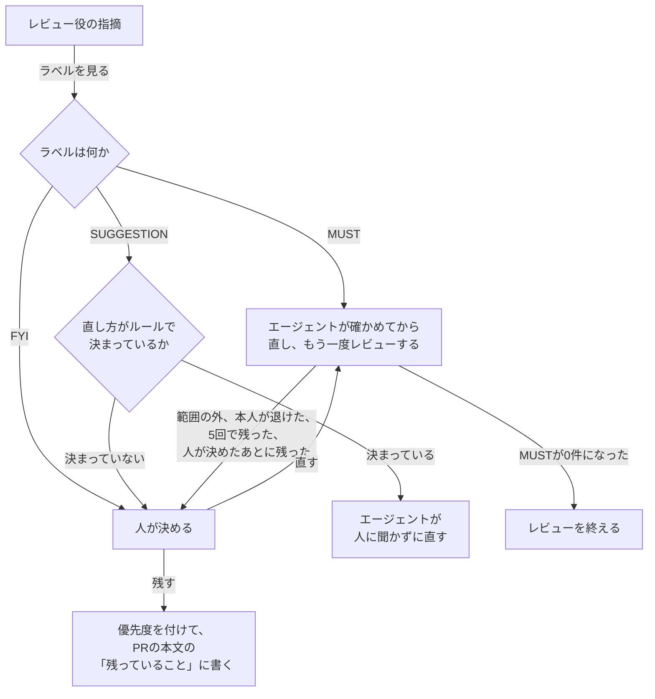

# レビュー役

| 項目 | 内容 |
|---|---|
| 確かめたコミット | `b7d78e4` |
| 関わる変更の記録 | なし |

レビュー役は、別の文脈のレビューをするサブエージェント（`reviewer`、定義は`agents/reviewer.md`）である。スキルが、完了と言う前や指摘の案を人に示す前に呼び、依頼と変更の記録を差分と比べさせる。この文書には、どのスキルがいつ呼ぶか、レビュー役が読むものと持つツール、指摘の流れを書く。指摘の条件の全文は、[`rules/review.md`](../../../rules/review.md)に書く。

## 背景

書いた本人の会話で見直すと、書いたときの判断を引き継いだまま読む。別の文脈は、その判断を引き継がずに、依頼と差分を比べられる。

## 要求

レビュー役は、`architecture.md`の名前付きの要件「別の文脈のレビュー」「質の問い」「完了の証拠」（[節「確かめの要件」](../architecture.md#確かめの要件)）を満たす。

## 業務のルール

### 呼ぶスキルと時期

| スキル | レビュー役を呼ぶ時期 |
|---|---|
| `implement-change`、`audit-security` | 完了と言う前 |
| `review-pr` | 指摘の案を人に示す前 |
| `resolve-review-comment` | 直しの差分を作ったあと |
| `investigate-code`、`add-rule`、`configure-repository` | 呼ばない |

最後の行の3つのスキルには、レビュー役が見る差分か範囲が無い。調査は主張ごとの根拠で、ルールの直しと導入は人の確認で確かめる。

### 読むものと見ること

| ルール | 理由 |
|---|---|
| レビュー役は、最初に常に読むルールの2つを自分で読み、次に`rules/review.md`と`rules/quality.md`を読む。差分に文章があれば、`rules/writing.md`も読む。 | `SessionStart`のフックの出力は、レビュー役の始めの文脈に入らない（[`always-read-rule.md`の節「前提」](always-read-rule.md#前提)）。 |
| レビュー役の定義の本文は、ハーネスの`rules/`を`${CLAUDE_PLUGIN_ROOT}`で指す。 | Claude Codeが、プラグインの場所の絶対パスに置き換える。 |
| 見ることは、`rules/quality.md`の質の問いにする。 | 作る側と同じ問いで見て、基準をそろえる（要件「質の問い」）。 |
| レビューの深さ（軽い、標準、深い）は、変更を誤ったときの害で選ぶ。 | 深さごとに見ることと理由は、[`rules/review.md`の節「レビューの深さ」](../../../rules/review.md#レビューの深さ)に書く。 |
| セキュリティの観点は`audit-security`の`references/security-viewpoint.md`に置き、`audit-security`から頼まれたレビュー役が読む。 | 観点の一覧は、セキュリティの確認でだけ使う。 |

### ツールと動かしてよいこと

レビュー役が持つツールは、読み取りのツール（Read、Grep、Glob）とBashだけである。GrepとGlobは、macOS、Linux、WSLのClaude Codeには既定で無く、そこではReadとBashだけになる（Tools reference）。ファイルを書き換えるツール（Edit、Write）と、サブエージェントを起動するツールは持たない。

| ルール | 理由 |
|---|---|
| Bashは、差分と履歴を読むコマンドと、一時のフォルダーの中でスクリプトとテストを動かすことだけに使う。この制限は、定義の本文の指示で守らせる。 | Bashはファイルを書き換えられるので、持たせるツールでは書き換えを止められない。 |
| スクリプトとテストを一時のフォルダーで動かしてよい。 | 差分を読むだけでは見つからない誤り（例：`.git`を外に置いたリポジトリでの動き、テストの見逃し）を見つけられる。 |
| `implement-change`と`resolve-review-comment`のレビューは、作業用のブランチへのpushのあとに動かす。 | レビュー役が作業フォルダーを書き換えても、レビューする変更はリモートに残る。 |
| pushしない`audit-security`と`review-pr`では、本体の会話が、作業の前と後の`git status --porcelain`と今のブランチを比べ、変わっていれば人に示す。 | リモートに変更が残っていないので、書き換えに気づく方法がほかに無い。 |
| ほかの人のPRでは、レビュー役はPRのコードを動かさず、ファイルをgitの中から読む（例：`git show`）。 | コードは一時のフォルダーでもこのPCの権限で動き、ファイルとして開くと、PRが入れたシンボリックリンクの先を読むおそれがある。 |

### 指摘の流れ

次の図は、レビューの指摘が、ラベル（指摘の重さを示す`MUST`、`SUGGESTION`、`FYI`）ごとにどこへ進み、どこで終わるかを示す。読む人は、指摘の扱いを変える人である。各条件の全文と、理由を書いた判断の記録へのリンクは、[`rules/review.md`の節「指摘の流れ」](../../../rules/review.md#指摘の流れ)に書く。

人が決める時期は、レビューが止まったときはその場で、ほかはPRを作る前の確認である。ハーネスのリポジトリでは、残す候補をPRの差分へのコメントにし、人がPRの上で決める（[`CONTRIBUTING.md`の節「残した指摘の形」](../../../CONTRIBUTING.md#残した指摘の形)）。

## 関わるコードの名前

役割は、[`architecture.md`の節「コードの配置」](../architecture.md#コードの配置)に書く。

- `agents/reviewer.md`（サブエージェントの名前は`reviewer`）
- `rules/review.md`、`rules/quality.md`
- `skills/audit-security/references/security-viewpoint.md`

## 判断

| 判断 | 誰が決めたか | 理由 |
|---|---|---|
| テストを弱める変更は、フックで止めず、常に読むルールで変える前に人に聞かせ、レビュー役が`MUST`で挙げる。 | [判断の記録](../../../docs/decisions/0011-test-weakening-change.md) | エージェントとレビュー役が、文字列で判定せず、意味で判断できる。 |
| レビュー役のモデルとeffortは、過去のレビューで測って決める。標準はOpusの`xhigh`である。 | [判断の記録](../../../docs/decisions/0024-review-model.md) | 過去のレビューで測ると、Opusの`xhigh`が`MUST`として9件中5件を見つけ、最も多かった。 |
| ハーネスの`rules/`は、スキルと違い、定義の本文で`${CLAUDE_PLUGIN_ROOT}`から指す。 | [判断の記録](../../../docs/decisions/0026-skill-rule-path.md) | レビュー役はClaude Codeのサブエージェントで、ほかのエージェントでは使わない。 |
| セキュリティの観点を、サブエージェントの`skills`の項目で`audit-security`を読み込ませる形にしない。 | エージェントの案 | その形では`SKILL.md`の全文が入り（Create custom subagents）、本体の会話向けの手順（例：深さを決める、チケットを作る）までレビュー役に入る。 |

## 出典

- [Tools reference](https://code.claude.com/docs/en/tools-reference)の表の`Grep`の行：「Searches for patterns in file contents. Absent by default on macOS, Linux, and WSL.」、`Glob`の行：「Finds files based on pattern matching. Absent by default on macOS, Linux, and WSL.」（確かめた日：2026-11-26）
- [Create custom subagents](https://code.claude.com/docs/en/sub-agents)の節「Preload skills into subagents」：「The full content of each listed skill is injected into the subagent's context at startup」（確かめた日：2026-11-14）
