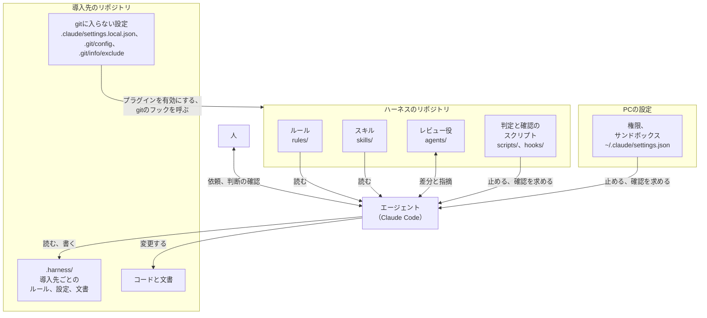

# my.harness

my.harnessは、AIのエージェントにプロダクトの改修を任せるときに、成果物の誤りと人の手間を減らすためのハーネスです。ハーネスとは、エージェントが読むルールと作業の手順、操作を止める設定、結果を確かめるスクリプトをまとめたものです。主に既存のプロダクトの改修を想定していますが、新しいプロダクトでも使えます（雛形は作りません）。

## 概要

エージェントに改修を任せると、誤りや抜けを人が見つけて直す手間がかかり、同じことをセッションごとに指摘することになります。秘密情報の漏れのように、一度起きると取り消せない事故も起こります。

my.harnessを入れると、人は依頼を書くだけで済みます。エージェントが手順を選び、自分で確かめ、別の文脈のレビュー（書いた本人とは別の会話が、変更を見直すこと）まで進めます。エージェントが止まって人に聞くのは、人が判断すべき場面（例：方針の変更、取り消せない操作、ほかの人に見える書き込み）だけです。

導入先（ハーネスを入れて作業するリポジトリ）のgitには、ハーネスのためのファイルを何も入れないので、チームの合意が無くても、自分だけで使い始められます。エージェントはClaude Codeで使い、ルール、スキル、スクリプトは、ほかのエージェントでも使える形で作ります。PRとチケットを送るホストは、GitHubかGitLabです。

## 機能

| 機能 | すること |
|---|---|
| 毎回のルール | `SessionStart`のフックが、セッションの始めに、毎回守るルールをエージェントに渡します。 |
| 作業ごとの手順 | 調査、計画、実装、セキュリティの確認のような作業の手順（スキル）を8つ持ち、エージェントが依頼に合うものを選びます。 |
| 完了の確かめ | エージェントが完了と言う前に、テストとlintの出力を示し、レビュー役のサブエージェントが変更をレビューします。 |
| 操作の保護 | 権限、サンドボックス、フック、gitのフックが、秘密情報の読み書きと、保護するブランチ（例：`main`）へのpushを止めます。 |
| 人への確認 | PR、Issue、コメントのような、ほかの人に見える書き込みの前に、判定のスクリプトが人に確認を求めます。 |
| 指摘の記録 | エージェントが、人の指摘と作業中の気づきをルールとして残し、次のセッションから守られるようにします。 |
| 文章の確かめ | スクリプトが、`rules/writing.md`の語と表記の規則から外れた所を見つけます。 |

## 全体像

ハーネスは、ハーネスのリポジトリ、PCの設定、導入先のリポジトリの3か所に分かれます。次の図は、エージェントが3か所から何を受け取り、何を変えるかを示します。

Claude Codeは、ハーネスのリポジトリを導入先にコピーせず、手元の場所から読み込みます。そのため、ハーネスのリポジトリで今チェックアウトしているブランチの中身を直すと、プラグインを有効にしたすべての導入先で、次のセッションから新しい中身が使われます。

導入先に置くものは、次の4つです。

| 置くもの | すること |
|---|---|
| `.harness/` | 導入先ごとのルール、設定、文書を置きます。 |
| `.claude/settings.local.json` | その導入先だけで、プラグインを有効にします。 |
| `.git/config` | gitのフックから、ハーネスのスクリプトを呼びます。 |
| `.git/info/exclude` | `.harness/`を、導入先のgitから外します。 |

この4つは導入先のgitに入れず、コードと文書の変更だけを、PRでチームに渡します。ハーネスのリポジトリだけは、作者のリポジトリでチームの合意が要らないので、`.harness/`もコミットします（[`.harness/docs/architecture.md`の節「判断」](.harness/docs/architecture.md#判断)）。

## 導入

導入は、PCごとに1回と、導入先ごとに1回行います。

| いつ | すること |
|---|---|
| PCごとに1回 | 人が、[`docs/setup-guide.md`](docs/setup-guide.md)のとおりに、マーケットプレイスへの登録、PCの設定、環境の確認を行います。 |
| 導入先ごとに1回 | 人が導入先で`claude plugin install my-harness@nnst0knnt --scope local`を動かしてから、Claude Codeに「このリポジトリにハーネスを導入して」と頼みます。エージェントが`configure-repository`のスキルで設定の案を示し、人が承認したものだけを書きます。 |

## 文書

初めて読むときは、このファイルのあとに[`.harness/docs/architecture.md`](.harness/docs/architecture.md)の節「構成」まで読むと、全体をつかめます。ほかの文書は、要るときに読みます。

文書は、要求、要件、設計、ルールとスキルの4つに分け、前のものが後のものの理由になるように書いています。1つの事実は、1か所にだけ書いています（[文書の分け方の判断の記録](docs/decisions/0001-document-stage.md)）。要求、要件、設計は、導入先と同じ`.harness/docs/`の形で書いています（[置き場所の判断の記録](docs/decisions/0043-harness-document-form.md)）。

| 文書 | 中身 | 読むとき |
|---|---|---|
| [`.harness/docs/architecture.md`](.harness/docs/architecture.md) | 背景、要求、要件、全体の構成、導入、ファイルの配置 | 全体を理解するとき、要件を変えるとき |
| [`.harness/docs/ubiquitous-language.md`](.harness/docs/ubiquitous-language.md) | 語の意味 | 語の意味がわからないとき |
| [`.harness/docs/features/`](.harness/docs/features/) | 構成要素ごとの設計（常に読むルール、スキル、複数の作業の並行、レビュー役、CI） | 構成要素を作るとき、変えるとき |
| [`.harness/docs/features/protection.md`](.harness/docs/features/protection.md) | 操作を止める仕組み | 保護の仕組みを作るとき、変えるとき |
| [`.harness/docs/features/harness-folder.md`](.harness/docs/features/harness-folder.md) | 導入先の`.harness/`と、その中の文書の形 | スキルを作るとき、`.harness/docs/`を書くとき |
| [`docs/decisions/`](docs/decisions/) | 論点ごとの、比べた案と選んだ理由 | 判断の理由を見直すとき |
| [`rules/`](rules/) | エージェントが守るルール | エージェントが書く前とレビューの前 |
| [`skills/`](skills/) | 作業ごとの手順（例：調査、計画、実装、PRのレビュー、導入） | エージェントが依頼に合う手順を選んだとき |
| [`CONTRIBUTING.md`](CONTRIBUTING.md) | このリポジトリのファイル、コード、GitHubの設定のルール | このリポジトリを変えるとき |
